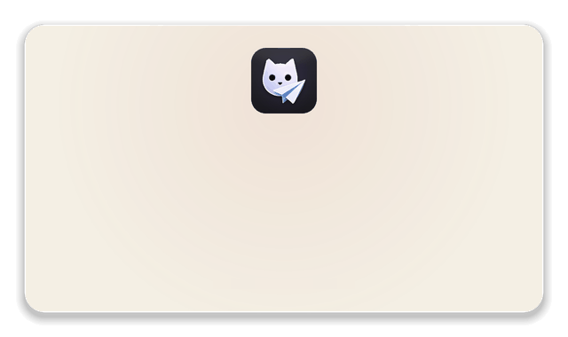
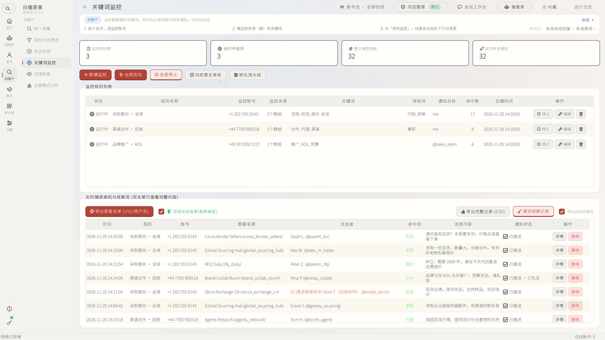
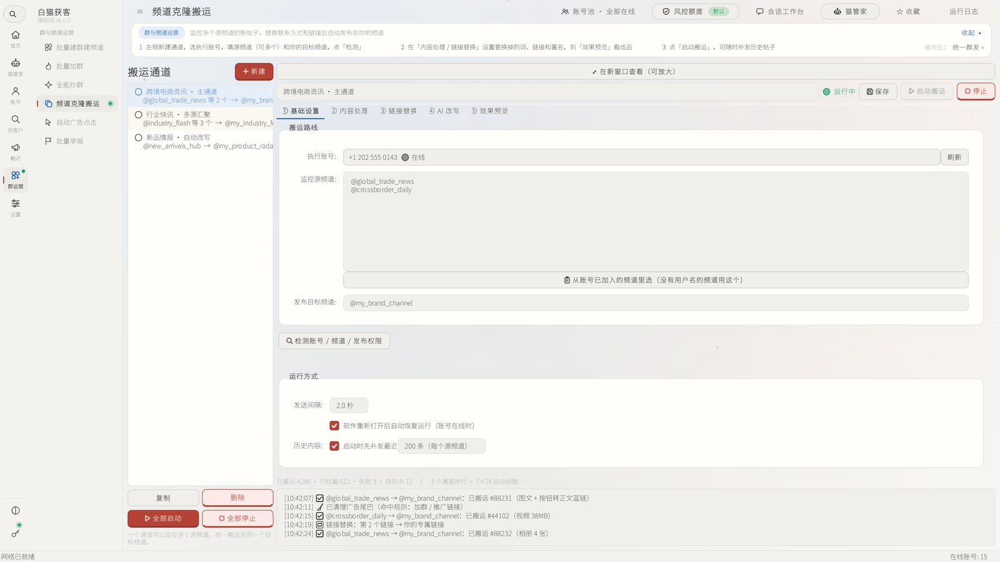

  <picture>
    <source media="(prefers-color-scheme: dark)" srcset="./docs/promo/v6/whitecat_hand_dark.gif">
    
  </picture>
  <h3>白猫 TG 自动获客助手 · 旗舰商业版 v6.0.0</h3>
  

    
    
    
  

  

    <a href="https://tg.web3baimao.com"><strong>官方网站</strong></a> ·
    <a href="https://bai-mao.gitbook.io/bai-mao-docs/"><strong>使用文档</strong></a> ·
    <a href="https://t.me/oxbaimao"><strong>客服 @oxbaimao</strong></a> ·
    <a href="https://t.me/wchjbot"><strong>手机端 Bot @wchjbot</strong></a>
  

---

## 它能做什么

WhiteCat 是一个跑在你自己电脑上的 Telegram 获客工具：**找客户、联系客户、运营社群**，全部用自己的账号完成，数据不上传。

6.0 新增 **猫管家**：对它说一句话，它就调用软件里的工具去做；还能用你自己的 **Telegram 机器人在手机上遥控**。需要真实发送或加群的动作，一律先弹确认，你点头才执行。

新机器首次使用，自带 3 小时全功能免费试用。

---

## 下载

请只从官网或本页的 Release 下载，并核对 SHA-256。两处是同一批文件，校验码相同。

| 系统 | 类型 | 官网直链（推荐） | GitHub 镜像 | SHA-256 |
| :--- | :--- | :--- | :--- | :--- |
| Windows x64 | 安装版（自带自动更新） | [Setup.exe](https://license.web3baimao.com/api/v1/update/files/WhiteCat-TG-Assistant-6.0.0-Setup.exe) | [Release](https://github.com/oxbaimao/whitecat-tg-assistant-commercial-build/releases/download/v6.0.0/WhiteCat-TG-Assistant-6.0.0-Setup.exe) | `dc1e86120c6cc3d135ebab728213fdd4faddb8d075ca24418090bf4c026ef1da` |
| Windows x64 | 便携版（解压即用） | [Portable.zip](https://license.web3baimao.com/api/v1/update/files/WhiteCat-TG-Assistant-6.0.0-Windows-x64-Portable.zip) | [Release](https://github.com/oxbaimao/whitecat-tg-assistant-commercial-build/releases/download/v6.0.0/WhiteCat-TG-Assistant-6.0.0-Windows-x64-Portable.zip) | `ecf7d5141b4d60bd8d3013910ff3f32dcaab899bc58371ec40128cd63ac201be` |
| macOS Apple 芯片（M1–M4） | dmg 安装版 | [arm64.dmg](https://license.web3baimao.com/api/v1/update/files/WhiteCat-TG-Assistant-6.0.0-macOS-arm64.dmg) | [Release](https://github.com/oxbaimao/whitecat-tg-assistant-commercial-build/releases/download/v6.0.0/WhiteCat-TG-Assistant-6.0.0-macOS-arm64.dmg) | `80875f715cfc3fd6973a2e82053aaa18ba13927c63c207850b88614889ac894d` |
| macOS Apple 芯片（M1–M4） | 便携版 | [arm64 Portable.zip](https://license.web3baimao.com/api/v1/update/files/WhiteCat-TG-Assistant-6.0.0-macOS-arm64-Portable.zip) | [Release](https://github.com/oxbaimao/whitecat-tg-assistant-commercial-build/releases/download/v6.0.0/WhiteCat-TG-Assistant-6.0.0-macOS-arm64-Portable.zip) | `0a39afb85a32a6887c0557dd8ce3eaa60d73733066dfcc04a4d3b9d3e9932387` |
| macOS Intel | dmg 安装版 | [x64.dmg](https://license.web3baimao.com/api/v1/update/files/WhiteCat-TG-Assistant-6.0.0-macOS-x64.dmg) | [Release](https://github.com/oxbaimao/whitecat-tg-assistant-commercial-build/releases/download/v6.0.0/WhiteCat-TG-Assistant-6.0.0-macOS-x64.dmg) | `2f8b9afda3e9b9d79ce85e5d6be99068a9b513e16b7ae127fbbbb719187330e6` |
| macOS Intel | 便携版 | [x64 Portable.zip](https://license.web3baimao.com/api/v1/update/files/WhiteCat-TG-Assistant-6.0.0-macOS-x64-Portable.zip) | [Release](https://github.com/oxbaimao/whitecat-tg-assistant-commercial-build/releases/download/v6.0.0/WhiteCat-TG-Assistant-6.0.0-macOS-x64-Portable.zip) | `73956ee7e8cff9389fd1f06a9edd686aca0e1c6a7c8eac0bd6fbd6b11f826264` |
| Linux x86_64 | 便携版（tar.gz） | [Portable.tar.gz](https://license.web3baimao.com/api/v1/update/files/WhiteCat-TG-Assistant-6.0.0-Linux-x64-Portable.tar.gz) | [Release](https://github.com/oxbaimao/whitecat-tg-assistant-commercial-build/releases/download/v6.0.0/WhiteCat-TG-Assistant-6.0.0-Linux-x64-Portable.tar.gz) | `2bbc66754d5e64da9694df1955d871f2f657a351498f0f71a163dd959c131ae4` |

> 安装提示：Windows 首次运行若提示「已保护你的电脑」，点「更多信息 → 仍要运行」；macOS 若被拦截，到「系统设置 → 隐私与安全性」点「仍要打开」。安装包目前未做代码签名。
> 需要正式卡密或商务咨询，请联系 [@oxbaimao](https://t.me/oxbaimao)。

---

## 功能一览

| 方向 | 能力 |
| :--- | :--- |
| **AI 猫管家（6.0 新）** | 用自然语言下达需求，由 62 项软件工具真实执行；动作先出确认卡，可选「询问 / 计划 / 自动 / 完全放开」；接你自己的模型服务；支持拖入文件与截图；多会话、可随时停止并给出真实报告 |
| **Telegram 机器人（6.0 新）** | 用你自己的机器人在手机上对话、批准动作；一次性配对码，只认你本人；关键动作点两次才执行；手机号打码，验证码和密码不进对话 |
| **AI 与智能体接入** | 62 项标准 MCP 工具，可接 Claude、Cursor、Antigravity 等；有副作用的动作默认先预览；AI 打开网页并核实结果、文字转语音 |
| **账号** | 登录 / 导入（session、tdata、压缩包）、状态检测、SpamBot 申诉、代理绑定、批量改资料、养号 |
| **找客户** | 多群成员采集、关键词监控与线索转发、目标分类筛选、安全检测、间谍获客、运营模式分析 |
| **触达** | 统一群发与私信（文字 / 图片 / 语音 / 圆形视频）、回复动态触达、强拉加群（默认先预览）、自动回复、会话工作台 |
| **群运营** | 批量建群 / 加群、AI 炒群、频道克隆搬运、退群管理、定时消息清理 |

> 所有真实结果都经过回读核实：发送后确认消息在对话里，拉人后确认对方在群里；读不到的数据如实报错，不返回示例数据。

---

## 软件截图

<table>
  <tr>
    <td width="50%"> 账号矩阵与风控额度</td>
    <td width="50%"> 关键词监控与线索流</td>
  </tr>
  <tr>
    <td width="50%"> 语音条与私信触达</td>
    <td width="50%"> 频道克隆搬运</td>
  </tr>
</table>

截图为真实软件界面，账号与数据均为演示用模拟数据。

---

## 联系与支持

- 购买卡密 / 商务合作：[@oxbaimao](https://t.me/oxbaimao)
- 手机端获客 Bot：[@wchjbot](https://t.me/wchjbot)
- 官方网站：[tg.web3baimao.com](https://tg.web3baimao.com)　文档：[GitBook](https://bai-mao.gitbook.io/bai-mao-docs/)
- 更新说明：[v6.0.0](./docs/getting_started/whats_new_6_0_0.md)

---

## 热门搜索关联词

> **核心业务词**：
> `Telegram 获客助手` · `Telegram 营销系统` · `Telegram 关键词监控` · `TG 采集群成员` · `Telegram 群发软件` · `TG 私信群发` · `Telegram AI 炒群` · `Telegram 自动拉群` · `TG 批量加群` · `Telegram 养号防封` · `Telegram 搬运频道` · `Telegram 克隆频道` · `TG 查定时消息` · `Telegram 验证码自动破解` · `Telegram 机器人探查` · `TG 申诉解封` · `Telegram 导出聊天记录` · `Telegram 媒体文件下载` · `Telegram 营销机器人` · `TG 全域获客神器` · `电报引流软件` · `电报获客工具` · `电报群发协议` · `电报僵尸号过滤` · `电报多账号管理`
>
> **Global & Overseas Traffic Keywords**：
> `Telegram Marketing Tool` · `Telegram Scraper` · `Telegram Mass DM` · `Telegram Auto Sender` · `Telegram Lead Generation` · `Telegram Member Scraper` · `Telegram Channel Clone` · `Telegram Captcha Solver` · `Telegram Group Scraper` · `Telegram Marketing Software` · `Telegram Multi Account Manager` · `Telegram Growth Tool` · `Telegram Anti Ban` · `Telegram Bot Automation` · `Telegram MTProto Client` · `TG Marketing Bot` · `TG User Scraper` · `Telegram Bulk Messenger` · `Telegram Outreach Tool`
>
> **AI Agent & MCP Keywords**：
> `Telegram MCP Server` · `Model Context Protocol Telegram` · `Claude Telegram Agent` · `Cursor Telegram MCP` · `Antigravity Telegram` · `GrokBot Telegram` · `Muse Telegram` · `Telegram AI Agent` · `Telegram 自然语言获客` · `LLM Telegram Automation` · `AI 自动化引流`
>
> **行业垂类场景词**：
> `Web3 Telegram 营销` · `加密货币社群裂变` · `外贸精准获客` · `跨境电商私域引流` · `海外独立站推广` · `海外公域截流转化` · `Telegram 智能客服系统` · `Telegram 协议号批量登录` · `Session转Tdata` · `Telegram 批量踢设备`

---

WhiteCat Studio · 白猫工作室

