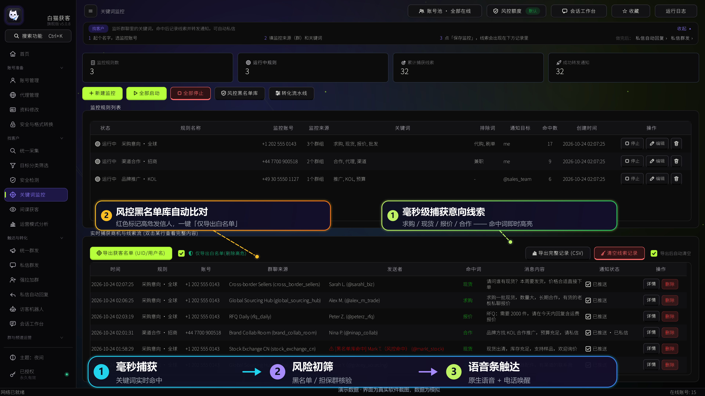
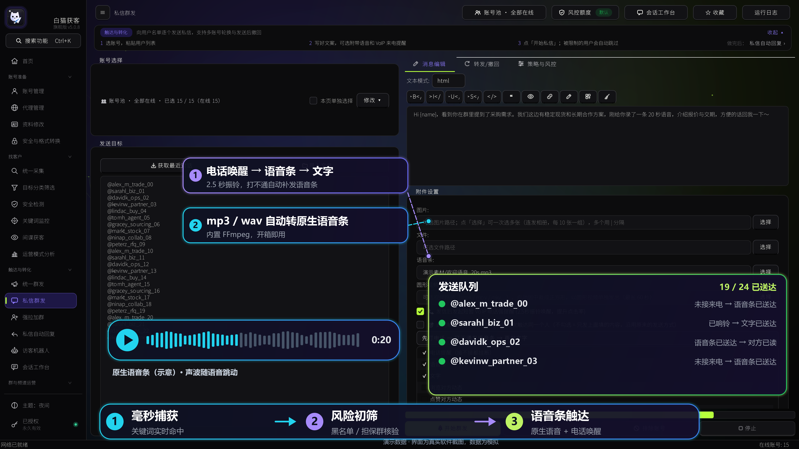
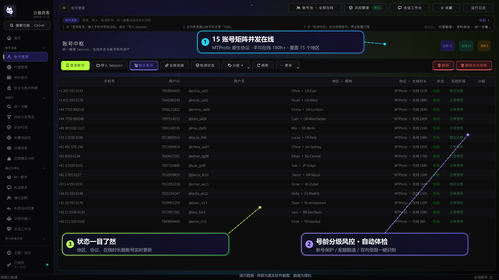
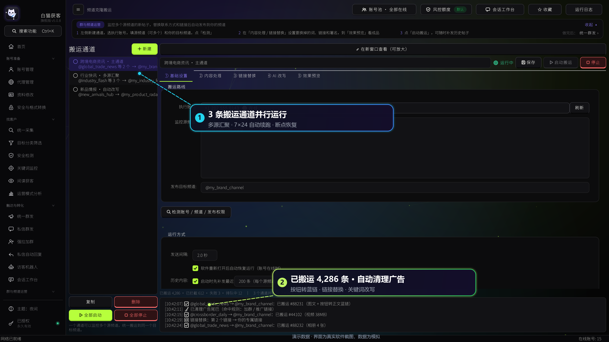

<div align="center">
  <a href="https://tg.web3baimao.com">
    
  </a>
  <h1>白猫工作室 · TG 自动获客助手（旗舰商业版）</h1>
  <p><strong>专为 Telegram 全域海外精准引流、商机雷达监听、拟真多维私信触达、万人社群裂变与 AI 智能体接管打造的工业级获客中枢</strong></p>
  <p>
    <a href="https://github.com/oxbaimao/whitecat-tg-assistant-commercial-build/releases/latest"></a>
    <a href="https://github.com/oxbaimao/whitecat-tg-assistant-commercial-build/releases"></a>
    <a href="https://bai-mao.gitbook.io/bai-mao-docs/"></a>
    
  </p>
  <p>
    <a href="https://tg.web3baimao.com"><strong>🌐 官方网站</strong></a> | 
    <a href="https://bai-mao.gitbook.io/bai-mao-docs/"><strong>📖 GitBook 完整实战教程</strong></a> | 
    <a href="https://t.me/oxbaimao"><strong>💬 官方在线客服 (@oxbaimao)</strong></a> | 
    <a href="https://t.me/wchjbot"><strong>📱 手机免客户端获客 Bot (@wchjbot)</strong></a>
  </p>
</div>

---

> 🚀 **最新版本：旗舰商业版 v5.0.20**
> 
> • **🚚 频道克隆重磅升级**：补发历史上限大幅提升至 **10,000 条**！新增 Telegram 限流友好休眠提示、单步超时自愈、数字 ID 频道支持；  
> • **🚪 退群与定时清理**：账号页新增「批量安全退群」，剧本面板新增「全局待发定时消息扫描与清理」；  
> • **💬 会话工作台重构**：四栏分栏自适应布局、深浅主题极致对比度、快捷话术点击即填、附件安全保护；  
> • **🤖 60 项 MCP 智能体生态**：新增聊天媒体全量下载（带文件大小回读比对）与聊天记录任意时间段完整导出（对标官方 Desktop）。  
> 
> 💡 **开箱即用，新机器绑定自带 3 小时全功能免费试用！** [👉 查看 v5.0.20 完整更新说明](./docs/getting_started/whats_new_5_0_20.md)

---

## 🎬 30 秒，看懂 WhiteCat 全链路获客闭环

https://github.com/user-attachments/assets/51769e6a-a864-4e25-9962-42ae43a6ec82

<p align="center"><sub>真实软件界面实录。从「公域关键词秒级捕获」到「多账号真人拟真触达」再到「会话工作台成单转化为一体」。</sub></p>

---

## 📥 官方正版安装包高速下载

支持 **Windows、macOS (Apple Silicon & Intel) 及 Linux**。请只从官方发布页下载并校验哈希。

| 操作系统 / 芯片 | 版本形态 | 推荐度 / 说明 | 下载地址 | SHA-256 校验码 |
| :--- | :--- | :--- | :--- | :--- |
| **Windows x64** | **安装版 (Setup.exe)** | 🌟 **最推荐**（自带自动更新） | [WhiteCat-TG-Assistant-5.0.20-Setup.exe](https://github.com/oxbaimao/whitecat-tg-assistant-commercial-build/releases/download/v5.0.20/WhiteCat-TG-Assistant-5.0.20-Setup.exe) | `d256a8454c71614da9a083edc1982c0de31c6fd5fdd65c2e7496f46846179655` |
| **Windows x64** | **绿色便携版 (.zip)** | 解压即用，适合 U 盘 / 多开 | [WhiteCat-TG-Assistant-5.0.20-Windows-x64-Portable.zip](https://github.com/oxbaimao/whitecat-tg-assistant-commercial-build/releases/download/v5.0.20/WhiteCat-TG-Assistant-5.0.20-Windows-x64-Portable.zip) | `994464a8b5f76675e079c6822259c78cb1ecba689c143fd4f43409fd0e0d9233` |
| **Linux x86_64** | **便携版 (.tar.gz)** | 64 位图形桌面，解压 `./start.sh` | [WhiteCat-TG-Assistant-5.0.20-Linux-x64-Portable.tar.gz](https://github.com/oxbaimao/whitecat-tg-assistant-commercial-build/releases/download/v5.0.20/WhiteCat-TG-Assistant-5.0.20-Linux-x64-Portable.tar.gz) | `21e66c838a03c6bcc327fad6633067214deacf0e8e8d486f8f009fc25cef39d7` |
| **macOS Apple 芯片**<br>(M1 / M2 / M3 / M4) | **DMG 安装版 (v5.0.19)** | 🍎 原生适配，拖入即装 | [WhiteCat-TG-Assistant-5.0.19-macOS-arm64.dmg](https://github.com/oxbaimao/whitecat-tg-assistant-commercial-build/releases/download/v5.0.20/WhiteCat-TG-Assistant-5.0.19-macOS-arm64.dmg) | `cb494ef23964aea31da7f8cdbaa58bf433a61848edf973e837bd237cb42a7830` |
| **macOS Intel 芯片** | **DMG 安装版 (v5.0.19)** | 老款 Intel Mac 专属构建 | [WhiteCat-TG-Assistant-5.0.19-macOS-x64.dmg](https://github.com/oxbaimao/whitecat-tg-assistant-commercial-build/releases/download/v5.0.20/WhiteCat-TG-Assistant-5.0.19-macOS-x64.dmg) | `0162e2e70f10bd3acacd235218b59940a107769a2d46c51fc59c5823dbf16cf0` |

> 💡 **安装提示**：
> 1. **Windows**：首次运行若提示「Windows 已保护你的电脑」，点击 **更多信息 → 仍要运行**；
> 2. **macOS**：首次打开若提示安全拦截，在「系统设置 → 隐私与安全性」中点击「仍要打开」；
> 3. **极速体验**：下载运行即享免费全功能试用。需要正式卡密或商务咨询请联系官方客服 [@oxbaimao](https://t.me/oxbaimao)。

---

## 🤖 提示词智能体（Prompt Agent）：复制这段话，交给你的 AI

**全行业首家深度打通 Anthropic Model Context Protocol (MCP 4.1) 协议！**  
不管您使用 **Claude Desktop、Cursor、Google Antigravity、Muse、GrokBot 还是自建 Agent**，无需学习繁琐界面，只需把以下提示词发给您的智能体，它就能自动读懂协议、接管获客：

```text
请帮我对接 WhiteCat TG 自动获客助手（支持 60 项标准 MCP 商业工具）。
请按照官方接入标准，通过终端命令或 MCP 客户端连接本地获客底座：
1. 本地 MCP 端点已就绪：支持一键调度账号池、商机监听、拟真私信群发与炒群。
2. 帮我执行以下获客策略：
   - 检查当前在线账号池健康度与号龄风控额度；
   - 监控目标行业公开群组中包含「求购、换汇、报价、现货、合作」的商机线索；
   - 对命中线索自动执行信誉排查与黑名单比对，剔除违规号与同行诈骗号；
   - 调度空闲账号以「原生语音条 + 拟真图文」多形态对纯净客户进行私信接待与线索沉淀。
```

> 🎯 **Agent 调度优势**：AI 具备自主决策与风控边界意识，支持「先预览 (`dry_run=true`) → 确认关键风险 → 真实发送」，绝不违规发包，杜绝误操作。

---

## 🔥 为什么全球 Telegram 营销团队都选择 WhiteCat？

### 解决传统营销的 4 大绝望痛点：
1. ❌ **“手动发信封号封到怀疑人生？”**  
   👉 **WhiteCat 解法**：底层基于 Telethon MTProto 纯原生协议，多 Session 独立指纹隔离，一号一代理自动智能绑定。配备号龄分级风控算法、频率随机抖动、动态打字状态模拟。
2. ❌ **“公域群里商机转瞬即逝，刷屏看不过来？”**  
   👉 **WhiteCat 解法**：0 秒级毫秒并发关键词监听！支持多词组、多群组并行监控，命中即刻高亮并弹窗提醒。
3. ❌ **“同行老赖、钓鱼号假询价防不胜防？”**  
   👉 **WhiteCat 解法**：独家内置「商机信誉风控库」与权威担保公群探针，秒级比对黑名单，导出时自动一键剔除高危号，确保转化池 100% 纯净高意向！
4. ❌ **“私信被限制双向，发不出消息？”**  
   👉 **WhiteCat 解法**：业内首创「突破私信限制——回复动态触达」！通过浏览潜客公开 Story、点赞、以「回复了你的动态」送达消息；配合电话震铃唤醒、原生圆形视频、真实波形语音条，触达打开率暴涨 3~5 倍！

---

## 🎯 四大核心王牌引擎，打造获客闭环

<table>
  <tr>
    <td width="50%">
      <h3>1. 关键词商机雷达 × 信用风控流水线</h3>
      
      <ul>
        <li><b>0 秒级关键词极速监听</b>：多规则、多词库并行，毫秒级捕获求购意向；</li>
        <li><b>黑名单自动标记剔除</b>：比对跑分、老赖、欺诈库，导出自动去杂质；</li>
        <li><b>监听即转化流水线</b>：命中后无缝流转，指定账号自动多维跟进。</li>
      </ul>
    </td>
    <td width="50%">
      <h3>2. 万人大群精准深度采集 × 多维私信</h3>
      
      <ul>
        <li><b>万人大群高并发采集</b>：毫秒级提取成员，智能剔除僵尸号与机器人；</li>
        <li><b>「最近发言人」精准挖掘</b>：按时间倒序锁定活跃度最高的真实买家；</li>
        <li><b>原生声学波形语音条</b>：真实录音跳动波形，彻底打破冰冷文字推销。</li>
      </ul>
    </td>
  </tr>
  <tr>
    <td width="50%">
      <h3>3. 矩阵账号多活防封 × 智能分阶段养号</h3>
      
      <ul>
        <li><b>冷号/半熟号/成号分级</b>：针对不同号龄自动匹配每日安全发信额度；</li>
        <li><b>SpamBot 全自动申诉</b>：遇到限制自动完成人机验证与申诉流转，提取精确解封时间；</li>
        <li><b>失效代理与账号一键释放</b>：自动解绑失效 IP，保障网络资源最大化利用。</li>
      </ul>
    </td>
    <td width="50%">
      <h3>4. 频道全自动克隆搬运 × AI 矩阵炒群</h3>
      
      <ul>
        <li><b>10,000 条历史一键搬运</b>：自动过滤广告违禁词、替换专属联系方式；</li>
        <li><b>多马甲角色扮演 AI 炒群</b>：多账号模拟专家、买家、水军自动跟帖暖群；</li>
        <li><b>剧本回放 + 随机表情点赞</b>：支持精准定时、引用回复与随机表情互动。</li>
      </ul>
    </td>
  </tr>
</table>

---

## 💼 22 项全功能商业模块覆盖

| 模块大类 | 商业核心能力明细 |
| :--- | :--- |
| **🤖 智能体与自动化** | 全量 60 项标准 MCP 工具池、AI Agent 自然语言接管、一键配置本机所有 AI 客户端、Stdio 高速管道 |
| **🛡️ 账号与底层运维** | 矩阵账号池管理、跨机器会话格式互转（Session/Tdata/Pyrogram/Zip）、SpamBot 自动申诉诊断、代理智能绑定与名额释放 |
| **🚀 引流与潜客裂变** | 目标群全套 1:1 人设克隆伪装、万人群成员秒级提取、批量安全加群、批量强制拉人进群、批量全自动创建超级群与频道 |
| **📡 监控与线索触达** | 7×24 小时关键词实时监听、原生波形语音条推送、回复动态突破双向触达、电话震铃唤醒、万人群聊按群名漏斗分流广播 |
| **💬 社群活跃与客服** | 自研 AI 矩阵炒群引擎、多角色剧本回放与随机点赞、四栏会话工作台、私信自动回复客服、10000 条频道内容自动克隆搬运 |

---

## 💎 用户反馈最多的实用升级（真实体验）

- 🎯 **退群管理与全局定时消息扫描**：账号加满 500 群退不掉？一键扫描账号全部已加入群组，按关键词精准筛选退出；停止的任务还在群里发定时广告？一键扫描账号在所有群内的待发定时消息，彻底扫除干净！
- 🎯 **会话工作台全新四栏**：白天黑夜主题完美适配，快捷话术一点即填，附件防误触保护，客服接待效率翻倍！
- 🎯 **导入账号「拖进来就能用」**：无论对方发来的是 Zip 压缩包、文件夹还是 Tdata，直接拖进软件自动校验解压入库，防穿透、防解压炸弹。

---

## 🔒 隐私与安全承诺

- **100% 数据本地化**：所有 Telegram Session 凭证、聊天记录及客户线索均加密保存在您的本地电脑，**绝不上云、绝不向任何服务器回传**！
- **商业合规**：内置官方标准 Telegram MTProto 接口，请在合规与授权范围内开展营销及客服活动。

---

## 🤝 购买激活与官方技术支持

- **🛒 购买卡密 / 商务合作**：[Telegram 在线客服 (@oxbaimao)](https://t.me/oxbaimao)
- **📱 移动端随时随地获客**：[获客机器人 (@wchjbot)](https://t.me/wchjbot)
- **🌐 官方网站**：[https://tg.web3baimao.com](https://tg.web3baimao.com)
- **📖 完整图文手册**：[https://bai-mao.gitbook.io/bai-mao-docs/](https://bai-mao.gitbook.io/bai-mao-docs/)
- **👑 渠道合伙人**：支持 OEM 贴牌定制（独立品牌 Logo、独立域名、独立客户端），欢迎团队洽谈！

---

## 🔍 热门搜索关联词与引流标签 (SEO Keywords)

> 💡 **核心业务词**：  
> `Telegram 获客助手` · `Telegram 营销系统` · `Telegram 关键词监控` · `TG 采集群成员` · `Telegram 群发软件` · `TG 私信群发` · `Telegram AI 炒群` · `Telegram 自动拉群` · `TG 批量加群` · `Telegram 养号防封` · `Telegram 搬运频道` · `Telegram 克隆频道` · `TG 查定时消息` · `Telegram 验证码自动破解` · `Telegram 机器人探查` · `TG 申诉解封` · `Telegram 导出聊天记录` · `Telegram 媒体文件下载` · `Telegram 营销机器人` · `TG 全域获客神器` · `电报引流软件` · `电报获客工具` · `电报群发协议` · `电报僵尸号过滤` · `电报多账号管理`
> 
> 🌐 **Global & Overseas Traffic Keywords**：  
> `Telegram Marketing Tool` · `Telegram Scraper` · `Telegram Mass DM` · `Telegram Auto Sender` · `Telegram Lead Generation` · `Telegram Member Scraper` · `Telegram Channel Clone` · `Telegram Captcha Solver` · `Telegram Group Scraper` · `Telegram Marketing Software` · `Telegram Multi Account Manager` · `Telegram Growth Tool` · `Telegram Anti Ban` · `Telegram Bot Automation` · `Telegram MTProto Client` · `TG Marketing Bot` · `TG User Scraper` · `Telegram Bulk Messenger` · `Telegram Outreach Tool`
> 
> 🤖 **AI Agent & MCP Keywords**：  
> `Telegram MCP Server` · `Model Context Protocol Telegram` · `Claude Telegram Agent` · `Cursor Telegram MCP` · `Antigravity Telegram` · `GrokBot Telegram` · `Muse Telegram` · `Telegram AI Agent` · `Telegram 自然语言获客` · `LLM Telegram Automation` · `AI 自动化引流`
> 
> 🚀 **行业垂类场景词**：  
> `Web3 Telegram 营销` · `加密货币社群裂变` · `外贸精准获客` · `跨境电商私域引流` · `海外独立站推广` · `海外公域截流转化` · `Telegram 智能客服系统` · `Telegram 协议号批量登录` · `Session转Tdata` · `Telegram 批量踢设备`

---

---

<p align="center">
  <strong>WhiteCat Studio · 白猫工作室</strong><br>
  <sub>致力于打造全球领先的 Telegram 跨境获客基础设施与 AI 自动化中枢</sub>
</p>
