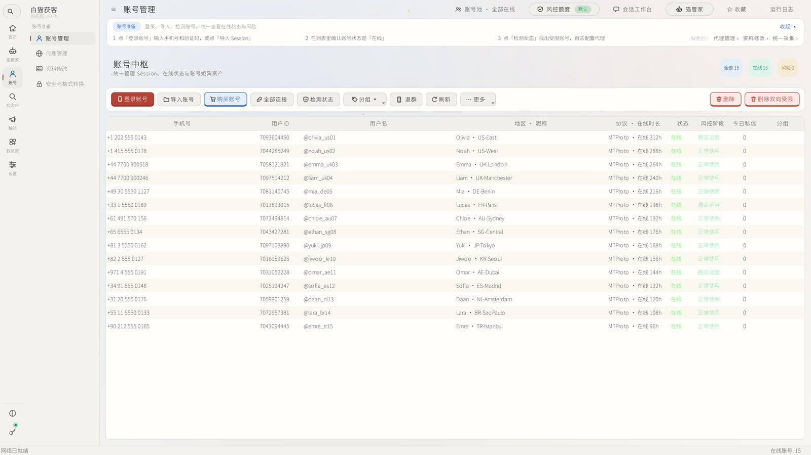
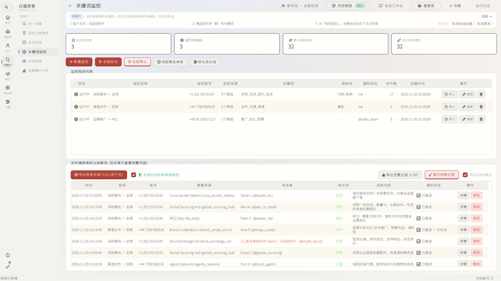
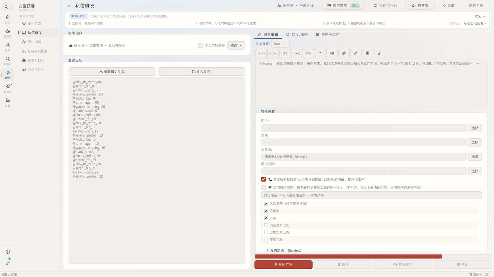
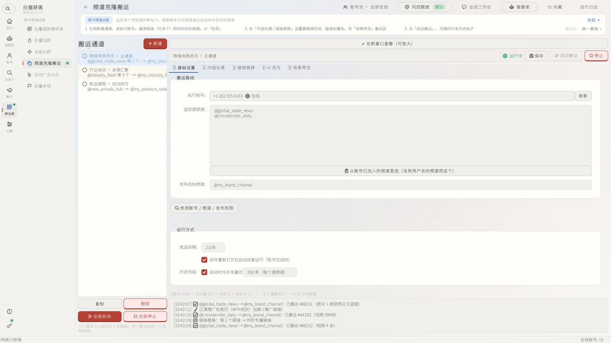

  

<h1 align="center">白猫工作室 · TG 全域获客与社群治理官方文档</h1>

  <strong>桌面客户端（22 个功能模块 + 猫管家 AI 助手 + 62 项 MCP） × 手机端云端机器人（@wchjbot）</strong>

  
  
  

---

## 从哪里开始

| 你是 | 先读这个 |
| :--- | :--- |
| 第一次用 | [你想做什么？按目标找功能](getting_started/goals.md)，然后 [下载与安装](getting_started/desktop_install.md) 和 [试用、购买与激活](getting_started/activation_and_trial.md) |
| 想用一句话让软件干活 | [23. 猫管家](manual/23_cat_butler.md) → [24. 配置模型接口](manual/24_cat_api_setup.md) → [26. 提示词库（一键复制）](manual/26_prompt_library.md) |
| 想在手机上遥控 | [25. 配置 Telegram 机器人](manual/25_phone_remote.md) |
| 遇到问题 | [按症状查原因](faq/03_by_symptom.md) |
| 想让 Claude / Cursor 等接管 | [MCP 一键配置](mcp/01_quickstart.md) |

---

## 软件长什么样

下面是 6.0 的真实界面（日间主题，账号与数据均为演示用模拟数据）。

### 账号矩阵：多账号在线、号龄分级风控

  

### 关键词监控：命中词高亮，风控黑名单标记

  

### 私信触达：文字、语音条、电话提醒

  

### 频道克隆搬运

  

---

## 双端矩阵

- **电脑桌面客户端**：22 个功能模块，覆盖账号管理、独占代理、成员采集、关键词监控、群发与私信、强拉、批量加群、AI 炒群、频道克隆、机器人探查等；6.0 新增**猫管家**（一句话让软件干活）和**手机遥控**（用你自己的 Telegram 机器人）。
- **手机端获客机器人 [@wchjbot](https://t.me/wchjbot)**：免安装，云端监听公开群里的商机并推送。

---

## 官方在线手册

在线阅读（和本仓库同步）：**[https://baimao.gitbook.io/baimao-docs/](https://baimao.gitbook.io/baimao-docs/)**

## 文档导航

- **[快速上手](getting_started/architecture.md)**：生态架构、安装、激活；
- **[手机端获客机器人（@wchjbot）](mobile_bot/01_overview.md)**：群监听、调优、广播、月卡；
- **[电脑端 26 篇手册](USER_MANUAL.md)**：22 个功能模块 + 猫管家、模型接口、机器人配置、提示词库；
- **[MCP 智能体协议专区](mcp/01_quickstart.md)**：一键配置、62 项工具参考、提示词库；
- **[安全防封与常见问题](faq/01_anti_ban.md)**：防风控秘籍、按症状查原因。

---

  WhiteCat Studio · 白猫工作室　|　客服 <a href="https://t.me/oxbaimao">@oxbaimao</a>

