# 通读：电脑端全功能手册（6.0.1）

> 这是把 01 到 26 篇手册合在一起的通读版，内容与单篇完全一致；日常查阅建议直接看左侧目录里的单篇。

# 01. 账号管理

> **一句话结论**：账号管理是所有功能的起点。先在这里把账号登录或导入进来、连上线、检测好状态，其他功能才能用它们干活。

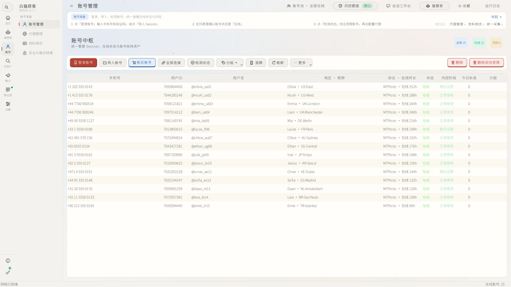

页面标题是「账号中枢」，顶部有三个计数：**全部、在线、风险**，一眼看出账号池的健康度。

---

## 一、工具栏上每个按钮是干什么的

| 按钮 | 作用 |
| :--- | :--- |
| 风控额度：默认 | 每个账号每 24 小时能发多少消息、进多少群的上限。默认按号龄分阶段（新号严、老号逐步放开）；点这里可以看明细，也可以自定义或关闭（关闭后风险自负） |
| 登录账号 | 输入手机号，用验证码登录一个账号 |
| 导入账号 | 导入 session / tdata / 压缩包（zip）。**可以直接把文件、文件夹或压缩包拖进下面的列表**，软件自动识别格式 |
| 购买账号 | 打开官方推荐的账号渠道 |
| 全部连接 | 把列表里的账号批量连上线 |
| 检测状态 | 核实每个账号的真实状态（正常 / 冻结 / 双向受限 / 失效） |
| 分组 | 给账号分组，批量任务里可以按分组一键选账号 |
| 退群 | 让选中的账号批量退群 |
| 刷新 | 重新读取列表 |
| 更多 | 批量 API 上号、迁移旧 Session、导出、断开、申诉、打开数据目录 |
| 删除 / 删除双向受限 | 删除选中账号；或一键删除状态为双向受限、冻结、封禁、需人工验证的账号 |

列表的列：手机号、用户 ID、用户名、名字、姓氏、状态、风控阶段、今日私信、分组。

---

## 二、第一次使用：把账号导进来

1. 点「导入账号」，选 session 文件、tdata 文件夹或 zip 压缩包；也可以直接把它们拖进列表；
2. 勾选要启用的账号，点「全部连接」；
3. 看「状态」列，显示在线就说明账号进入了就绪池，其他功能可以调度它；
4. 再点一次「检测状态」，确认没有受限账号。

没有现成的账号文件，就点「登录账号」，输入手机号并输入收到的验证码。

> 新买来的账号，先去 [02. 代理管理](manual/02_proxy.md) 给它绑定固定代理，再去 [03. 安全与格式转换](manual/03_convert.md) 做一次体检，然后静置 12～24 小时再开始业务。

---

## 三、检测状态：结果怎么看

「检测状态」只记录**核实过的**结论：

- **冻结**：按 Telegram 自己的冻结信号判断；
- **双向受限**：只认本次 @SpamBot 的**新回复**，不会读到旧回复；临时受限会显示解封时间；
- **未核实**：@SpamBot 没回复、被限流或回复看不懂时显示「未核实」。**未核实不是状态，不会覆盖账号已有的状态，也不要当成正常。**

注意：
- 确认账号正常后，之前遗留的「受限」标记会自动解除（否则风控会一直隔离它）；
- 某个群里被禁言只代表在那个群发不了言，**不会**让整个账号变成受限；
- 冻结检测按 Telegram 公开的信号编写，没有在大量真实被冻结的账号上验证；遇到问题可以用「查询 SpamBot 完整回复」取原文反馈。

---

## 四、受限账号怎么办

- **剔除 / 删除受限账号**：只清理**已核实**的账号；没连上的账号不算受限，不会被清理；标记为受限的会先重新检测，确认了才处理。
- **申诉**（在「更多」里）：选中受限账号点「申诉」，软件自动走完 @SpamBot 的流程：
  - 遇到人机验证时，会用你电脑上的浏览器（优先 Chrome）打开验证页，页面上的验证自己通过，通过后软件自动继续；
  - **「已提交」只表示申诉资料已提交，不等于已解封**。官方复核通常要几个小时到一两天，官方没有承诺时限，期间不要重复申诉；
  - 之后再点「检测状态」核实是否真的解除。

---

## 五、账号分组

工具栏「分组」可以：新建分组（同时放入选中账号）、把选中账号加入或移出、重命名、删除。

- 一个账号可以在多个组，表格有「分组」列；
- 删除分组不会删账号；删除账号会自动从分组里移走；
- 采集、群发、加群等页面选账号时可以按分组一键选。

---

## 六、让猫管家帮你做

```text
检查我所有账号的真实状态，哪些能正常发消息，哪些受限或掉线？每个受限的告诉我原因，没法核实的要写「未核实」。
```

更多说法见 [26. 提示词库](manual/26_prompt_library.md)。

---

## 七、常见问题

**一批账号都显示「错误」？**
最常见的原因是同一个 session 被多处同时使用（从号商买来的号，卖家手里留有同一把登录密钥）。见 [按症状查原因](faq/03_by_symptom.md)，买来的号建议用 [03 安全与格式转换](manual/03_convert.md) 里的「卖家号接管」换成自己的新会话。

**导入后账号一直是待连接？**
检查代理能否直连 Telegram；检查该 session 是否已在其他设备被强制登出。

**新号能不能马上大量发？**
不能。风控额度会按号龄限制；建议静置 12～24 小时再开始，并且一个 IP 不要同时登录几十个账号。

---

# 02. 代理管理

> **一句话结论**：给每个账号配一个固定的代理出口，一号一 IP，是防关联封号最基础的一步。流程只有四步：**粘贴代理 → 测试 → 生成分配方案 → 应用并验证**。

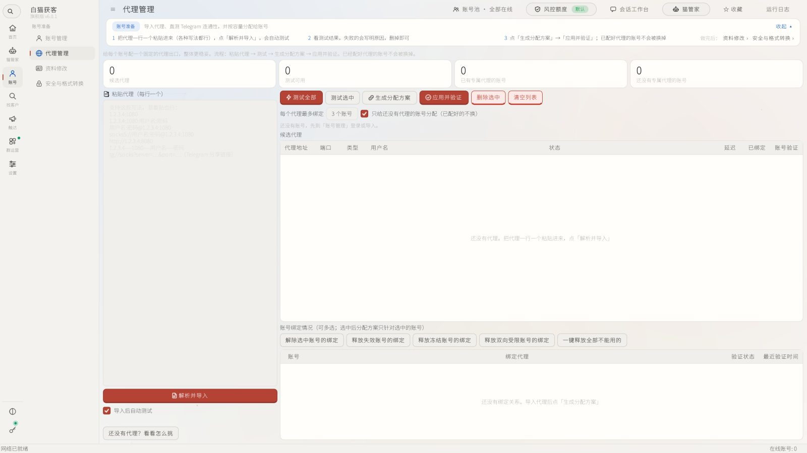

页面顶部有四个统计：**候选代理、测试可用、已有专属代理的账号、还没有专属代理的账号**，一眼看出还差多少。已经配好代理的账号不会被换掉。

---

## 一、操作步骤

### 1. 粘贴代理
把代理一行一个粘进「粘贴代理」框，格式常见的有：

```text
IP:端口:用户名:密码
socks5://用户名:密码@IP:端口
```

点「**解析并导入**」。勾选「导入后自动测试」会在导入后立刻测一遍。不知道怎么挑代理，点「还没有代理？看看怎么挑」。

### 2. 测试
- 「测试全部」或「测试选中」：并发检测真实连通性（直测 Telegram）和延迟；
- 列表列：代理地址、端口、类型、用户名、状态、延迟、已绑定、账号验证。

### 3. 生成分配方案
- 「每个代理最多绑定 N 个账号」：范围 1～3，**建议 1～3，越少越稳**；
- 勾选「只给还没有代理的账号分配（已配好的不换）」；
- 在下方「账号绑定情况」里可以多选账号，选中后方案只针对选中的账号；
- 点「**生成分配方案**」，先看方案，再决定要不要应用。

### 4. 应用并验证
点「**应用并验证**」：软件把代理绑定到账号，并**验证账号真的通过这个代理连上了**，结果记在「验证状态」「最近验证时间」。

---

## 二、释放代理名额

账号被封、失效或已删除后，它们还占着代理名额。下面几个按钮只**解除绑定**，不删账号、不断连接：

| 按钮 | 处理谁 |
| :--- | :--- |
| 解除选中账号的绑定 | 你选中的账号；仍在线的账号下次连接时按需重新分配 |
| 释放失效账号的绑定 | 已核实失效（Session 失效 / 被封禁）和已从列表删除的账号 |
| 释放冻结账号的绑定 | 已核实「冻结」的账号（来自「检测状态」的结论） |
| 释放双向受限账号的绑定 | 已核实「双向受限」的账号 |
| 一键释放全部不能用的 | 以上全部一次处理 |

**只处理已核实的账号**：离线、连接失败这类「没连上」的账号不算失效，不会被释放。

---

## 三、选代理的建议

- 优先**住宅代理或机房原生静态 IP**；
- 代理所在的国家 / 地区，最好和账号手机号的国家区号一致；
- 一个代理绑 1～3 个账号，不要更多。

> 没有代理就连接账号时，账号会走你这台电脑的本机网络，和别的号共用一个 IP，容易被关联。猫管家连接这类账号之前会先弹出确认。

---

## 四、让猫管家帮你做

```text
哪些账号还没有绑定专属代理？给我一个一号一 IP 的绑定方案预览，先别执行。
```

---

## 五、常见问题

**测试全部失败？**
先确认代理的格式、账号密码正确；再确认这台电脑能访问该代理（防火墙、本机网络）。

**导入了代理，但列表是空的？**
格式不对时会被丢弃。每行一个，字段用冒号分隔，或使用 `协议://` 的完整写法。

**分配方案里有的账号没有代理？**
代理数量不够：候选代理数乘以「每个代理最多绑定」不够账号数。再导入一些，或调大这个数（最大 3）。

---

# 03. 安全与格式转换

> **一句话结论**：账号买来先在这里做一遍体检：改掉两步验证、踢出前任设备、换一套匹配的设备参数、必要时接管卖家会话，再放心使用。格式互转也在这里。所有密码只保存在本机的加密配置里。

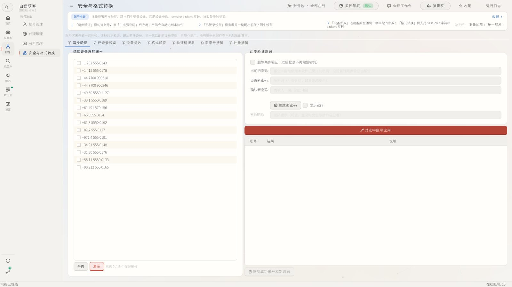

页面分 7 个页签，按「买来的号」的处理顺序排列：

| 页签 | 用来做什么 |
| :--- | :--- |
| ① 两步验证 | 给账号设置 / 更换 / 删除两步验证密码 |
| ② 已登录设备 | 查看账号登录在哪些设备上，踢出陌生设备 |
| ③ 设备参数 | 设置账号登录时对 Telegram 报告的「设备型号、系统、软件版本」 |
| ④ 格式转换 | session / tdata / 字符串 之间互相转换 |
| ⑤ 验证码接收 | 把软件里的账号登录到别的设备时，第一时间拿到验证码 |
| ⑥ 卖家号接管 | 单个买来的号：换出只属于你的新密钥 |
| ⑦ 批量接管 | 一次接管很多个买来的号 |

---

## ① 两步验证

1. 在「选择要处理的账号」里勾选账号（只列在线账号）；
2. 填「设置新密码」（至少 8 位），再确认一遍；可点「生成强密码」；可填「密码提示」；
3. 「当前旧密码」留空 = 自动使用本软件记录过的密码；没设置过两步验证也留空；
4. 选项「删除两步验证」：勾上后以后登录不再需要密码；
5. 点「对选中账号应用」；完成后可点「复制成功账号和新密码」保存。

---

## ② 已登录设备

刚买来的账号建议先「踢出其他设备」，把前一个主人和陌生设备都清掉。

- 「查询登录设备」：列出设备、软件、IP、地区、最近活跃；
- 「踢出选中的设备」「踢出其他所有设备（只保留本软件）」；
- 「批量踢出所有在线账号的其他设备」：一次处理所有在线账号，每个账号只保留本软件的登录，做完会**重新读取设备列表核实**；没连接的账号会跳过。

> 账号登录不满 24 小时时，Telegram 可能限制踢出其他设备，页面里有对应的提示。

---

## ③ 设备参数

每个账号登录时会向 Telegram 报告「我是什么设备」。型号、系统、软件版本要互相匹配（比如 iPhone 就该配 iOS），一眼看上去不对劲的组合更容易被风控。

1. 选「设备类型」：随机（任意平台）、电脑 · Windows、电脑 · macOS、苹果 · iPhone / iPad、安卓手机；
2. 点「按所选类型随机一套匹配的参数」，或自己填设备型号、系统版本、软件版本；
3. 选「范围」：全局默认（所有没单独设置的账号），或只用于选中的某个账号；
4. 点「保存」。「清除该账号的单独设置」可以回到全局默认。

---

## ④ 格式转换

支持 Telethon `.session`、Pyrogram `.session`、两种字符串、Telegram Desktop tdata 之间**任意互转**，全部在本机完成，不联网。

1. 点「选择文件…」或「选择文件夹（批量 / tdata）…」，选一个文件夹可以一次转换里面所有账号；
2. 「转换成」选目标格式，「保存到」选输出位置；
3. tdata 设置过本地密码才需要填「源 tdata 本地密码」；转成 tdata 且文件里没有账号 ID 时才需要填「账号 ID」（只对单个账号生效）；
4. 点「开始转换」；或点「**转换并导入账号管理**」：不管原来是什么格式，自动转成本软件使用的 Telethon session 并加入账号管理（需要联网验证登录状态）；
5. 「打开输出文件夹」查看结果。

---

## ⑤ 验证码接收

要把软件里的账号登录到手机、平板或另一台电脑时：

1. 在「监听账号」下拉里选中这个账号，点「开启监听」；
2. 再去新设备上登录；Telegram 的验证码会发到已登录的客户端，软件会第一时间显示；
3. 点「复制验证码」，或勾选「收到后自动复制」。

---

## ⑥ 卖家号接管（单个）

买来的 session / tdata 和卖家共享同一把登录密钥，**卖家手里留有副本，只踢设备杀不掉**。接管 = 把卖家的密钥当成一次性的「接码桥」，换出只属于你的新密钥，再让卖家的密钥作废。

1. 选「卖家给的 .session 文件，或 tdata 文件夹」，或从账号池选择已导入的号（**接管会另用一份工作区副本，同一把密钥同一时刻只能有一个客户端：在线的号请先在账号池里断开**）；
2. 手机号（包裹里没有时才填）；tdata 本地密码、卖家给的两步验证密码（没有就不填）；
3. 可先点「预览（离线，不连接 Telegram）」看看会做什么，再点「体检：列出账号登录的设备」，勾选需要「保留」的设备；
4. 选项：「先由卖家会话清掉账号上其他设备」（推荐，只动别人的会话，卖家密钥在新会话验明之前原样保留）、「给新会话设置两步验证」（软件生成强密码，只保存到本机文件）；
5. 点「开始接管…」；如果验证码没有在卖家会话里收到，页面会要你输入拿到的验证码并「提交验证码」；
6. 看「进度与结果」；需要时点「继续（resume）」；接管完成但新会话没能放进账号库时点「补入账号库」；「打开新两步验证密码所在文件夹」可找到新密码。

安全设计：新会话没验明之前绝不会注销卖家会话；账号有两步验证而密码缺失或不对时会干净中止，卖家密钥原样保留；验证码、2FA、密钥不会出现在日志里；接管期间账号处于隔离状态，不参与业务动作。

---

## ⑦ 批量接管

1. 点「选择文件夹并扫描…」（里面可以有很多 `.session` 文件或很多个 tdata 号包，可以多层目录），或点「加入账号池里的离线号」；
2. 表格里勾选号包；卖家给了两步验证密码但包里没有时，点「给勾选的号提供 2FA…」；
3. 「同时接管的号数（线程）」建议 1～3：每个号都会请求一次官方登录验证码，同时太多会被 Telegram 限流；
4. 选项同单个接管；点「开始批量接管…」；
5. 每个号的状态见表格：「等验证码」的号请到 ⑥ 里提交验证码，「部分完成」的号到点后在 ⑥ 点继续。

---

## 让猫管家帮你做

```text
我刚买了一批账号，请先帮我检查哪些账号上还登录着别的设备，给我一个处理方案预览，先别执行。
```

接管类动作会要求你明确确认。

---

## 常见问题

**转换后账号登录不上？**
确认源格式本身有效；tdata 有本地密码要填；转 tdata 缺账号 ID 要填。

**为什么接管后账号还有别的设备？**
你自己的别的客户端（比如接码用的）也登录着这个号时，先「体检」并勾选保留。

---

# 04. 设置：AI 接口、网络、风控额度与 MCP

> **一句话结论**：设置页集中了全局参数：AI 接口、网络、界面、账号风控额度、手机端机器人入口，以及让外部 AI Agent（Claude、Cursor 等）接管软件的 **MCP 服务**。改完点右上角「保存全部配置」。

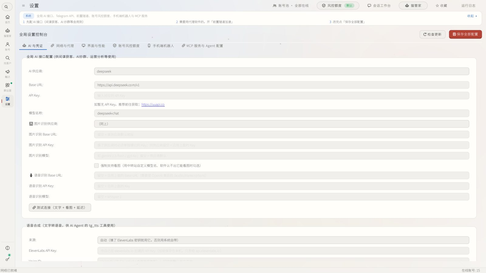

页面标题「全局设置控制台」，右上有「检查更新」和「保存全部配置」。6 个页签：

| 页签 | 内容 |
| :--- | :--- |
| AI 与凭证 | 全局 AI 接口、图片 / 语音识别、语音合成、Telegram API |
| 网络与代理 | 智能网络、手动指定本地代理 |
| 界面与性能 | 界面语言、动效、缓存释放 |
| 账号风控额度 | 每个账号每 24 小时的私信、发言、拉人、进群上限 |
| 手机端机器人 | @wchjbot 入口 |
| MCP 服务与 Agent 配置 | 一键配置本机 AI Agent、MCP 开关、连通性测试 |

---

## 一、AI 与凭证

### 全局 AI 接口
供「间谍获客、AI 炒群、运营分析、入群验证兜底」等功能使用。

| 项 | 说明 |
| :--- | :--- |
| AI 供应商 | openai / deepseek / ollama / gemini / mcp_agent |
| Base URL、API Key、模型名称 | 按所选供应商填写；没有 Key 可到 <https://uuapi.co> 获取 |
| mcp_agent | **不需要 API Key**：软件需要 AI 文字时，请求排队，由已经通过 MCP 接入的 AI Agent 代答 |
| 图片识别 / 语音识别 | 主模型便宜但不能看图时，图片题交给这里单独配置的看图模型；语音识别默认 `whisper-1` |
| 测试连接 | 一次测文字、看图和延迟 |

> **猫管家有它自己的模型设置**（猫管家页右上角「设置」），和这里互不影响；想沿用这里的配置，在猫管家设置里点「沿用『设置』里的 AI 配置」。详见 [24. 配置模型接口（API）](manual/24_cat_api_setup.md)。

### 语音合成（文字转语音）
供 AI Agent 的 `tg_tts` 工具使用：来源可选「自动 / ElevenLabs / 系统自带（Windows、macOS，本地免费）」。ElevenLabs 需要你自己的 API Key 和 Voice ID，会把要合成的文字发给它并消耗你自己的字符额度；系统没有中文语音包时，软件会如实告诉你，不会用英文声音念中文。生成的音频可作为「统一群发」的语音条，或在 VoIP 电话里播放。

### Telegram API
商业版已预置默认 API 凭证，通常无需修改；如需使用自己的，可以在这里覆盖。

---

## 二、网络与代理

- **智能网络（推荐）**：软件自动检测并选择最佳网络通路；先开软件后开加速软件、或中途切换节点，都会自动恢复，无需设置。「重新检测」可以手动再测一次；
- **手动指定本地代理（高级）**：仅在智能网络无法识别你的代理软件时才需要。勾选「启用手动代理」，选隧道类型（socks5 / http），填本地地址和端口，或点「自动探测本地代理」。手动指定的优先使用，失效时自动退回智能检测。

---

## 三、界面与性能

- **界面语言**：跟随系统语言 / 简体中文 / 繁體中文 / English，选完立即生效；
- **界面动效**：自动（推荐，电脑较慢时自动关闭）/ 始终开启 / 关闭（最省资源）；
- **缓存释放**：账号的 Session 文件里会堆积缓存，账号多时占几百 MB。点「扫描占用」看可释放的空间，再点「清理账号缓存」或「清理临时缓存文件」。

---

## 四、账号风控额度

软件默认按账号的「号龄阶段」限制每天能私信、群内发言、拉人、进群的数量，用来保护新号。这里把决定权交给你：

| 额度模式 | 含义 |
| :--- | :--- |
| 按号龄分阶段限额（默认） | 新号几乎不能主动发信，随天数逐步放开；红灯账号（被封、失效、@SpamBot 受限）暂停 |
| 自定义全局额度 | 每个账号统一用你填的数字（私信、群内发言、拉人进群、进群 / 进频道，每 24 小时） |
| 关闭额度拦截 | 不限额，**风险自负** |

改完点「应用额度设置（立即生效）」。额度对猫管家和 MCP 同样生效。

---

## 五、MCP 服务与 Agent 配置

MCP 让外部 AI Agent（Claude、Codex、Cursor、Antigravity、Gemini CLI、Windsurf、VS Code 等）直接调度软件的全部核心能力，目前共 **62 项**工具。

1. 勾选「允许导出并由 Agent 按需启动 MCP 全功能接管」；
2. **「仅只读模式」默认关闭**：关闭时 Agent 可以执行真实发信、群发、建群等操作；只想让 Agent 看数据就勾上；
3. 点「**一键配置本机所有 Agent（并验证能真正连上）**」：自动识别本机已安装的 Agent，把本程序的 MCP 服务写进它们的配置，并验证真的连得上；下面每个 Agent 一行，显示状态，需要时点「写入」；
4. 备用：「复制『官方新手提示词』」「复制『小白一键配置提示词』」「复制通用 MCP JSON」「导出 OpenAI Tools Schema」；
5. 点「测试 MCP 连通性」确认可用。

> 有副作用的工具默认 `dry_run=true`，Agent 必须先预览、把副作用告诉你并等你确认。账号风控额度对 MCP 同样生效。详见 [MCP 一键配置](mcp/01_quickstart.md) 与 [62 项工具参考](mcp/03_tools_reference.md)。

---

## 常见问题

**改了设置没生效？**
点右上角「保存全部配置」。风控额度要点「应用额度设置」。

**一键配置后 Agent 里看不到工具？**
重启对应的 Agent；仍不行点「刷新状态」，看是否显示「指向旧位置」，点「写入」修复。

---

# 05. 统一采集：成员采集与群组频道采集

> **一句话结论**：这个页面有两种采集：**成员采集**（从别人的群里采出成员和最近发言的人，做成客户名单）和**群组频道采集**（按关键词到搜索机器人里找公开的群和频道）。采到的名单可以一键带去分类、私信或加群。

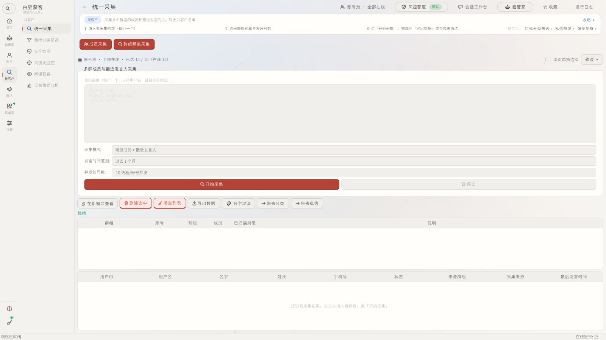

页面顶部是账号池：可以「按分组选择」账号，或勾选「本页单独选择」让这个页面用自己的账号选择；「选择全部」「仅选在线」「清空选择」「刷新账号」。没有账号时点「去账号管理」。

---

## 一、成员采集

用来采**多个群里的成员和最近发言的人**。

### 步骤
1. 在账号池里选好在线账号；
2. 在「目标群组」里一行一个填群：支持用户名、链接或群组 ID；
3. 选「**采集模式**」：可见成员 + 最近发言人 / 仅可见成员 / 仅最近发言人；
4. 选「**发言时间范围**」：过去 1 个月 / 3 个月 / 1 年（越近，后面私信的回复率越高）；
5. 「并发账号数」：1～200 路；实际同时工作的账号 = min(并发线程, 账号数, 群数)；
6. 点「**开始采集**」。

### 看结果
- 上方是**每群一行的实时进度表**：群组、账号、阶段、成员数、已扫描消息、说明；每个群读完新成员立刻进下方列表；
- 下方是结果列表：用户 ID、用户名（带 `@`）、名字、姓氏、手机号、状态、来源群组、采集来源、最后发言时间；
- 点「在新窗口查看」，可以搜索、筛选、全选、复制、导出；

### 采完以后
| 按钮 | 作用 |
| :--- | :--- |
| 导出数据 | 保存为 CSV |
| 名字过滤 | 按「目标分类筛选」里设置的关键词和重复名字规则，把疑似广告 / 批量注册的成员移出列表（先预览数量，确认后才移除） |
| 带去分类 | 把名单追加到 [13. 目标分类筛选](manual/13_target_classifier.md) 的输入框（不会自动开始） |
| 带去私信 | 把名单追加到 [08. 私信群发](manual/08_private_send.md) 的目标框（不会自动开始） |
| 删除选中 / 清空列表 | 整理列表 |

### 小知识
- 群数不多于可用账号数、读「最近发言人」时，闲置账号会按时间段分摊同一个大群（最多再借 7 个账号）；借来的账号读不了的那段由主账号补读，仍失败会如实标「结果不完整」；
- 隐藏了成员列表的群，用「仅最近发言人」仍能采到真实说话的人。

---

## 二、群组频道采集

按关键词到搜索机器人和 Telegram 搜索里，找**公开的群组 / 频道**。

1. 「关键词」一行一个（例如：营销、跨境电商、加密货币）；
2. 勾选「搜索源」；还可以「添加搜索机器人」（输入 `@somebot` 或链接），「删除选中的自定义源」；
3. 「每个机器人最多翻 N 页」（1～10）、「并发线程」（1～10，并发越高越容易触发限流）；
4. 点「开始搜索」，会弹出「实时动态」窗口边搜边显示；
5. 结果窗口里可以筛选、全选、复制、导出；用「带去分类」或「带去加群」把链接送到下一步（不会自动开始，可以只带选中的一部分）。

> 搜索机器人的回复格式和翻页没有在大量真实环境验证过，出现结果不全属于正常，请如实反馈。

---

## 三、让猫管家帮你做

```text
请从这个群采集成员：【群链接】。只要最近 30 天发过言的真人，过滤掉机器人和死号，采集完告诉我数量并导出 CSV。
```

```text
帮我搜索和「【行业关键词】」相关的 Telegram 群和频道，列出名称、人数、是否活跃，我挑选后再决定加哪些。
```

---

## 四、常见问题

**采到的人很少？**
群设置了隐藏成员，改用「仅最近发言人」；或把发言时间范围放宽。

**采集一半停了？**
账号被限流时会放慢并提示；降低并发线程，换账号再试。

**导出的 CSV 乱码？**
用支持 UTF-8 的软件打开（比如 WPS / Excel 里选 UTF-8 导入）。

---

# 06. 关键词监控

> **一句话结论**：监听群里的关键词，有人提到就立刻记成线索，并可以转发通知给你。它盯着几百个群、不用你 24 小时刷屏，客户刚发出需求你就能第一时间联系。

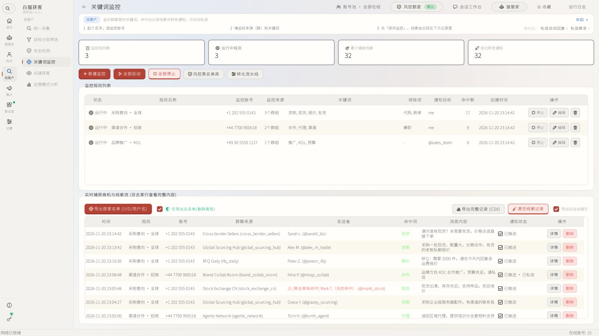

页面顶部四个统计：**监控规则数、运行中规则、累计捕获线索、成功转发通知**。下面左边是「监控规则列表」，右边是「实时捕获商机与线索流」（双击某行查看完整内容）。

---

## 一、三步开始

### 1. 新建监控
点「新建监控」，填写：

| 项 | 说明 |
| :--- | :--- |
| 名称（必填） | 如「币圈群-兼职线索」 |
| 监控账号（必填） | 用哪个在线账号来监听；账号要已加入目标群 |
| 监控来源 | 每行一个：`@group`、`-1001234` 或 `me`；**留空 = 监听该账号所有已加入的群聊**。也可以点按钮从账号已加入的群里勾选 |
| 关键词（必填） | 每行一个，**命中任意一个就触发** |
| 排除词 | 每行一个，消息里含此词就忽略（如：机器人、广告、招聘） |
| 关键词按正则匹配 | 需要时勾选；默认是普通文字匹配 |
| 区分英文字符大小写 | 默认不区分 |
| 通知转发到 | `me`（收藏夹）、`@用户` 或数字 ID，留空不转发 |
| 命中风控黑名单的发信人后，仍然继续通知 | 默认命中黑名单的人不再通知，勾选后仍通知（但会红色高危标记） |
| Webhook | 命中时 POST 一份 JSON 到你的地址，留空不推送 |
| 信誉核验公群 | 选填：核验发信人是否在这个担保公群里 |

### 2. 启动
点「全部启动」（或在规则行里单独启动）。规则状态显示运行中，就开始后台监听。

### 3. 看线索
群里有人触发关键词，右侧线索流里会出现一行：时间、规则、账号、群聊来源、发送者、命中词、消息内容、通知状态。**双击一行**看完整内容、发送者信誉和风控状态。

---

## 二、导出与风控黑名单

| 按钮 | 作用 |
| :--- | :--- |
| 导出获客名单（UID / 用户名） | 只导出去重后的 `@用户名` 或 UID，方便一键导入「私信群发」或「强拉加群」 |
| 仅导出白名单（剔除高危） | 导出时自动比对风控黑名单库，剔除高危 / 恶意用户 |
| 导出完整记录（CSV） | 整张线索表 |
| 导出后自动清空 | 导出后自动清空线索记录，不再二次确认 |
| 清空线索记录 | 手动清空 |
| 风控黑名单库 | 管理恶意用户黑名单；命中时红色高危预警，可对恶意用户一键拉黑 |
| 转化流水线 | 监听即转化：命中后自动去重、过滤机器人 / 黑名单、分配已养号账号并模拟真人私信（推荐替代旧版自动私信） |

> 风控信誉核验：自动比对本地黑名单库（跑分、老赖、同行等标签），**只用真实读到的数据**，读不到的显示未核验。

---

## 三、让猫管家帮你做

```text
帮我监听这几个群里出现下面这些关键词的消息：求购、现货、报价、批发。命中后记录成线索并通知我。先告诉我要用哪个账号、监听哪些群，我确认再开始。
```

```text
看一下最近关键词监控命中了多少条线索，哪些词命中最多，有没有命中风控黑名单的发信人？
```

---

## 四、常见问题

**为什么没有命中？**
账号没加入这个群；关键词写错；排除词太宽；规则没启动。「监控来源」留空会监听账号所有已加入的群。

**误报很多？**
加「排除词」；对反复出现的无关发言人用风控黑名单拉黑。

**能自动私信命中的人吗？**
用「转化流水线」。它会去重、过滤机器人和黑名单，用养号账号模拟真人私信，并受账号风控额度限制。

---

# 07. 统一群发

> **一句话结论**：向群或频道评论区批量发送文字、图片、语音条、圆形视频、投票、联系人名片和内联机器人消息。多账号轮流发，开始前先预检账号和额度，发送后回读核实消息真的在对话里。

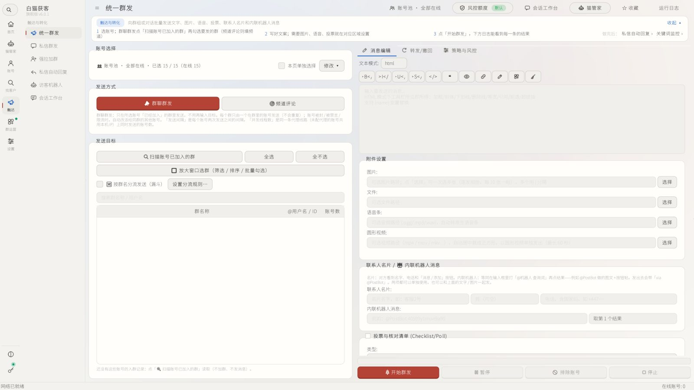

页面分三块：**账号选择**（同统一采集的账号池）、**发送方式与目标**、**三个页签（消息编辑 / 转发撤回 / 策略与风控）**。

---

## 一、两种发送方式

### 群聊群发
只在所选账号**已经加入**的群里发，**不用输入目标**。

1. 点「扫描账号已加入的群」：读取所选账号的对话列表（不加群、不发消息），更新下面的群清单；
2. 勾选要发的群（「全选 / 全不选」；账号和群很多时点「放大窗口选群」按名称、类型、账号数、人数筛选，再一键勾选）；
3. **每个群只由一个在群里的账号发送，不会重复**；账号被封、被禁言、限流时，自动改派给同群的其他账号。

「按群名分流发送（漏斗）」：按群名里的关键词把不同内容分给不同的群，互不串（例如群名带「北京」的群发北京版文案），点「设置分流规则…」配置。

### 频道评论
向开启了讨论组的频道的帖子发评论。目标用「获取已加入的频道」或「导入文件」填入；可勾选「评论前先让账号加入频道」。评论模式：最新或历史帖子 / 未来的帖子（实时挂机监听）/ 指定帖子 ID 或链接。

---

## 二、消息编辑页签

| 内容 | 说明 |
| :--- | :--- |
| 文本 | 支持 html / md 两种模式，工具条有加粗、斜体、下划线、删除线、等宽、引用块 |
| 图片 | 点「选择」可一次选多张，会作为一组相册连发（每 10 张一组，文案作为说明） |
| 文件 | 任意文件 |
| 语音条 | 音频（.ogg / .mp3 / .wav）自动转成原生语音条；安装版已内置转码组件 |
| 圆形视频 | 任意视频自动居中裁成正方形、最长 60 秒，以原生圆形视频**单独**发出（不能带文字，文案会另发一条） |
| 联系人名片 | 对方看到名字、电话和「消息 / 添加」按钮 |
| 内联机器人消息 | 填「@机器人 查询词」，每个发送账号用自己的身份向机器人查询；内容必须是该账号有权使用的 |
| 投票与核对清单 | 类型选「核对清单（Checklist）」或「普通投票（Poll）」，可设置允许他人新增任务、标记完成、多选 |
| 发信后发起短暂 VoIP 电话 | 2.5 秒振铃唤醒，提升点击率 |
| 触达顺序 | 勾选后按步骤依次触达同一个人（如：先打电话、打不通发语音条、再发文字） |
| 对方的动态（Stories） | 浏览、点赞、或把内容以「回复了你的动态」发出；对方没有动态时可改发普通私信 |

> 核对清单（Checklist）是 Telegram 高级会员功能：发送账号没有开通会员时，这种方式会发送失败。

---

## 三、转发 / 撤回页签

- **转发模式**：填「源群组」和「消息 ID」（多个用逗号），启用后忽略文本与附件，把已有消息转发出去；
- **自动撤回**：发送后自动撤回，可设置撤回延迟；「假消息」不为空时先替换成这段内容再撤回，为空则直接删除。

---

## 四、策略与风控页签

| 项 | 说明 |
| :--- | :--- |
| 发送并发 | 群聊群发里每群一个账号；这个数字是「同一条代理线路」上同时发送的账号数，不同代理线路互不影响；越大越快，越容易触发风控 |
| 操作间隔 / 休息间隔 | 每次操作之间等多久（秒） |
| 循环控制 | 启用循环发送、循环间隔、最大轮次（0 = 无限） |
| 发不出去的群怎么办（自动修复） | **默认关闭，有风险**：开启后每轮发完，对「没人能发」的群由轻到重处理：账号被禁言则退群重进再过验证（额度不够就不退）、仍不行则让其他健康账号加入并过验证；会占用入群额度。不开启时发不出去的群只在结束时汇总，可放进「待补群清单」自己处理 |
| 防封与重试 | 「提示双向后尝试次数」默认 0（直接换下一个账号，推荐）；「忽略 Telegram 限流冷却」**高风险，默认关闭**：限流后账号自动进入冷却，目标换下一个账号 |

---

## 五、开始发送

1. 点「开始群发」，先弹出**预检面板**：账号状态、今日风控额度、预计耗时、可发的群数、风险提示；异常账号自动排除，确认后才开始；
2. 发送中可以「暂停 / 继续」；「排除账号」让刚被风控的账号从下一条起不再参与，不必暂停；
3. 发送后软件**回读核实消息确实存在**，日志写出消息 ID 与耗时；限流不再在后台悄悄等待，而是按设置冷却或改派；
4. 结束后汇总每个群的结果；没有可用账号的群可放进「待补群清单」，到「批量加群」载入补进去。

---

## 六、让猫管家帮你做

```text
把这条消息发到我加入的这几个群里：「【内容】」。每个群之间随机间隔，先给我预览发送计划，确认后再开始。
```

---

## 七、常见问题

**为什么有的群没发出去？**
群里所有账号都发不了：被管理员单独禁言、账号失效、被踢，或额度不够。结束时会列出原因。

**新号能直接群发吗？**
不建议。风控额度会限制新号；先养号 3 天以上。

---

# 08. 私信群发

> **一句话结论**：向一份用户名单逐个发私信。支持文字、图片、语音条、圆形视频、联系人名片、内联机器人消息，还能先浏览 / 点赞对方的动态再发消息，多账号轮换，被限制的用户自动跳过。

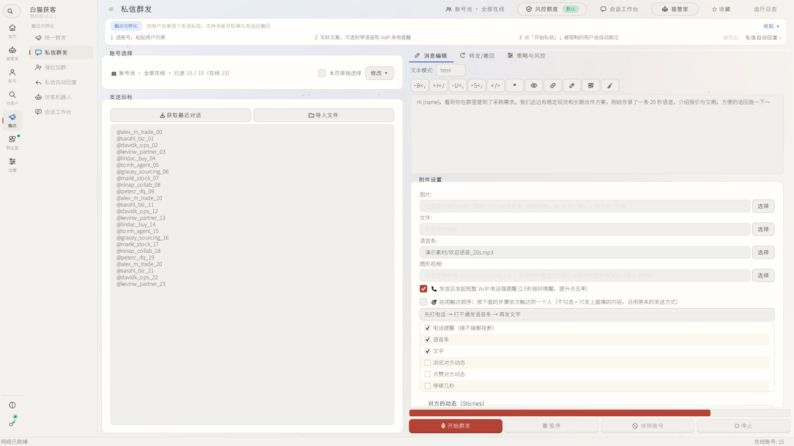

页面顶部的三步提示：**1 选账号，粘贴用户列表；2 写好文案，可选附带语音和 VoIP 来电提醒；3 点「开始群发」，被限制的用户会自动跳过**。

---

## 一、三步开始

### 1. 选账号并填目标
- 在左边「账号选择」里选账号（可按分组选）；
- 在「发送目标」框里**一行一个用户名**（`@用户名` 或 `+国家码手机号`）；也可以点「获取最近对话」从在线账号读取最近的对话，或「导入文件」导入采集的名单；
- 从 [05. 统一采集](manual/05_collect.md) 来的名单，点「带去私信」就会追加到这里（不会自动开始）。

> **手机号也能当目标**：先查通讯录，没有就临时导入联系人解析，解析完立刻删除；对方没注册或隐私不允许时会说明原因。

### 2. 写消息
「消息编辑」页签里：
- 文本模式 html / md，工具条有加粗、斜体、下划线、删除线、等宽、引用块等；
- 变量：`{name}` 会换成对方的昵称，例如 `Hi {name}，在某某群看到您在找……`；
- 「附件设置」：图片（可选多张，连发相册）、文件、语音条、圆形视频；
- 「发信后发起短暂 VoIP 电话强提醒」：2.5 秒振铃唤醒；
- 联系人名片、内联机器人消息的用法和 [07. 统一群发](manual/07_unified_send.md) 一样。

### 3. 开始
点「开始群发」，先看**预检面板**：账号状态与私信额度、预计耗时；新号 / 养号阶段额度很低时会提示，并可一键跳到「设置 → 账号风控额度」调整。确认后开始。

---

## 二、触达顺序：像真人一样先混脸熟

勾选「启用触达顺序」后，按步骤依次触达同一个人；**不勾选 = 只发上面填的内容**。

预设顺序有：先混脸熟（浏览动态 → 点赞 → 停顿 → 文字）、图片 → 文字、文字 → 图片、圆形视频 → 文字、语音条 → 文字、文字 → 联系人名片，以及带电话的顺序。也可以选「自定义步骤」：从浏览动态、点赞、电话提醒、转发并置顶、文字、图片、文件、语音条、圆形视频、名片、内联机器人消息、停顿里勾选并排序。

规则：
- 每一步失败只记日志、继续下一步；缺内容的步骤跳过；所有步骤都没做成才算这个人失败；
- 启用顺序后，「发信后打电话」与「浏览 / 点赞」改由步骤决定。

### 对方的动态（Stories）
- **浏览**对方的动态（全部标记已读）；
- **点赞**（可选表情，也可随机）；
- **内容回复到对方的动态**：对方聊天列表里显示「回复了你的动态」+ 你的内容，文字、图片、文件、语音条、圆形视频都可以；
- 选「最新 / 最早 / 随机一条」；「对方没有动态时改发普通私信」可以兜底；对方挂在个人主页的置顶动态也会被使用。

注意：回复动态**绕不过对方开启的「付费消息」**；Telegram Premium 账号可以绕过「仅联系人可发」的限制。批量对陌生人浏览 / 点赞同样有被风控的可能，请控制节奏。

---

## 三、策略与风控

「策略与风控」页签的各项（并发、操作间隔、休息间隔、循环、自动修复、重试策略）和 [07. 统一群发](manual/07_unified_send.md) 相同。私信相关的建议：

- 每个账号每天控制在 20～40 条精准私信以内；
- 「提示双向后尝试次数」保持默认 0，遇到双向限制直接换下一个账号；
- 「忽略 Telegram 限流冷却」保持关闭（高风险）；
- 额度和风控按私信计，受「账号风控额度」限制。

发送后软件**回读核实消息确实存在**；限流时按设置冷却，不再静默等待；对方开启付费消息时，失败原因会明确写出。发送中可以「暂停 / 继续」，也可以「排除账号」。

---

## 四、让猫管家帮你做

```text
我想给下面这批用户发私信，内容是：「【话术】」。请先预览：用哪些账号、每个号发多少条、预计要多久、会不会超过风控额度。我确认之后再真正发送。
【粘贴用户名单】
```

---

## 五、常见问题

**对方收不到 / 显示失败？**
对方关闭了陌生人私信、开启了付费消息，或账号被限制。失败原因会写在结果里。

**回复率低怎么办？**
先发小批量测试话术；话术结尾用轻量提问；用「先混脸熟」顺序；先用 [11. 资料修改](manual/11_profile.md) 把账号包装成和行业匹配的人设。

---

# 09. 强拉加群

> **一句话结论**：用多个账号并发把一批用户拉进**你自己的群**。拉入才算拉入：软件会回读核实对方真的在群里，隐私受限的人不会被算成功。**默认先预览，不会一上来就真实执行。**

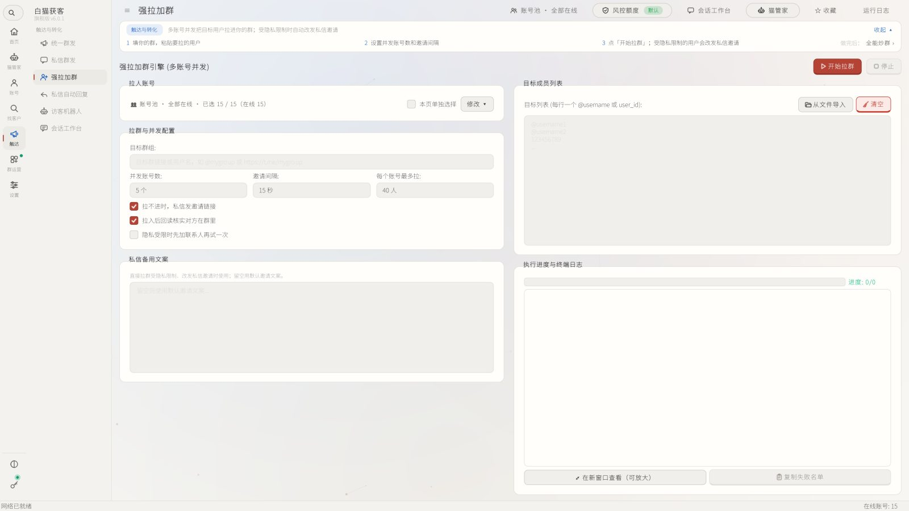

---

## 一、开始前先确认

- 负责拉人的账号**已加入目标群**，并且在群里有拉人的权限；
- 目标群允许普通成员拉人（或这些账号是管理员）；
- 你有一份目标成员名单：每行一个 `@username` 或 `user_id`。

点「开始拉群」时，软件会**先做预检**：逐个核实选中的账号确实在目标群里、有拉人权限；不合格的自动排除并写明原因（例如「不在目标群里」「目标群不允许普通成员拉人」）；同时显示今日「拉人」风控额度和预计耗时。

---

## 二、设置与步骤

1. 在「拉人账号」里选账号；
2. 「目标群组」填链接或用户名，如 `@mygroup` 或 `https://t.me/mygroup`；
3. 「目标成员列表」一行一个，或点「从文件导入」；
4. 「拉群与并发配置」：

| 项 | 说明 |
| :--- | :--- |
| 并发账号数 | 同时执行拉群的账号数（不超过可用账号数）；没配独享代理的账号并发超过 3 会有提醒 |
| 邀请间隔 | 同一个账号两次邀请之间的间隔（2～300 秒，上下浮动 20%） |
| 每个账号最多拉 | 每个账号本次最多发起多少次邀请（0 = 不限）；Telegram 对拉人管得很严，新号每天只有几十个甚至更少，超过会被限制 |
| 拉不进时，私信发邀请链接 | 对方隐私设置不允许被拉时，改发私信邀请链接；**只算「已发邀请」，对方点了才入群，不计入「拉入」** |
| 拉入后回读核实对方在群里 | 多一次读取，结果更可信；接口说成功但对方其实不在群里的，不算成功 |
| 隐私受限时先加联系人再试一次 | 成功率低，会在账号里留下联系人记录，不会向对方暴露手机号；默认关闭 |

5. 「私信备用文案」：改发私信邀请时使用，留空用默认邀请文案；
6. 点「开始拉群」；进度和终端日志在下方，「在新窗口查看（可放大）」；
7. 结束后点「复制失败名单」，把没拉成功的用户粘回目标列表重试。

---

## 三、结果怎么看

- **已拉入**：回读确认对方真的在群里；
- **已发邀请**：隐私受限，已改发私信邀请，不等于对方进群；
- **失败**：原因用人话写出，结束时汇总；
- 遇到限流或被限制主动联系陌生人的账号，会单独冷却，不会反复撞墙。

---

## 四、让猫管家帮你做

```text
把这批用户拉进我的群【群链接】。先预览：每个账号拉几个人、哪些人因为隐私设置拉不进、会不会超额度。不要真的执行。
【粘贴用户名单】
```

---

## 五、建议

- 自建群在强拉前先铺垫一些真实讨论记录（可以用 [15. 全能炒群](manual/15_ai_hype.md)），避免新用户进群看到空群就退；
- 新群前几天循序渐进，拉人规模逐步放大；
- 每号单次不要拉太多，间隔不要太短。

---

# 10. 批量加群（含养号与入群验证）

> **一句话结论**：让多个账号批量加入一批群或频道，加群后可以模拟真人阅读；遇到入群验证（点按钮、算术题、私聊机器人）软件会自动处理，处理不了的交给 AI。加群有每账号每日额度，量大需要多天，这也是养号的节奏。

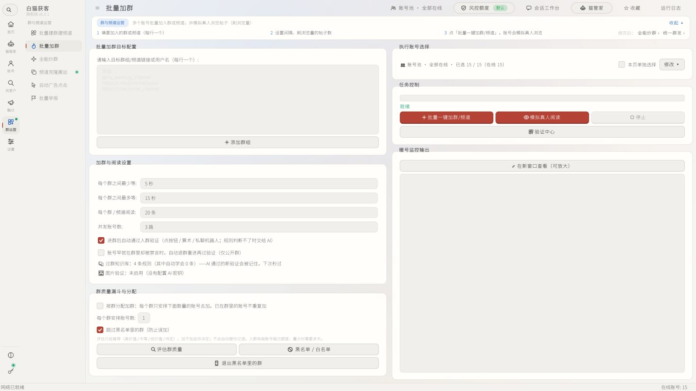

---

## 一、基本步骤

1. 「批量加群目标配置」里一行一个填群或频道的链接 / 用户名；或点「添加群组」弹窗里粘贴多个；群发时发现没有可用账号的群，点「载入待补群清单」一键载入；
2. 在「执行账号选择」里选账号；
3. 「加群与阅读设置」：

| 项 | 说明 |
| :--- | :--- |
| 每个群之间最少等 / 最多等 | 随机间隔（秒），越慢越安全 |
| 每个群 / 频道阅读 | 「模拟真人阅读」时每个群或频道从最新往前看几条（1～1000）；**会真实计入频道浏览量** |
| 并发账号数 | 多账号并行、单账号内部串行 |
| 进群后自动通过入群验证 | 点按钮 / 算术 / 私聊机器人；规则判断不了时交给 AI（用「设置 → AI 与凭证」里配置的接口） |
| 账号早就在群里却被禁言时，自动退群重进再过验证 | 仅公开群；账号入群额度不够时不会退群，避免回不去 |

4. 点「**批量一键加群 / 频道**」，先弹出**预检**：账号有没有被冻结、每个账号已加入多少群还能再加多少、今日入群额度、AI 是否就绪、预计耗时与「按每日额度约需几天」；确认后开始；
5. 想只养号不加新群，点「**模拟真人阅读**」；
6. 「停止」随时终止。

---

## 二、群质量漏斗与分配

- **按群分配加群**：开启后每个群只安排下面数量的账号去加（1～5 个），已在群里的账号不重复加；关闭（默认）时每个选中的账号都加入每个群，适合养号；
- **跳过黑名单里的群**：防止误加；
- **评估群质量**：只读取群的公开信息和最近消息打分，**不加群、不发消息**；结果只给推荐（高价值 / 中等 / 低价值 / 待定），加不加由你决定，软件不会自动替你过滤；
- **黑名单 / 白名单**：管理不想加的群和一定要保留的群；
- **退出黑名单里的群**：扫描所选账号已加入的群，找出在黑名单里的，由你勾选并设置并发后批量退出；白名单的群永不推荐退出；私有群会标出，退出后需要邀请链接才能回来。

---

## 三、入群验证

- 支持的类型：点按钮、算术题、私聊机器人、「先加入某频道，再点『完成验证』」等；
- **过群知识库**：AI 通过的新验证会被记住，下次秒过（页面显示已有多少条规则）；
- 图片验证需要配置能看图的 AI（没配置时显示「未启用」）；
- 「**验证中心**」：最近一次批量加群里**没通过验证**的群，在这里看到验证消息（文字 / 按钮 / 图片 / 语音）并处理；
- 找不到群时先用全局搜索兜底，再换账号重试，最后给出人话提示。

---

## 四、让猫管家帮你做

```text
让这几个账号加入下面这些群，并模拟真人浏览一下帖子。先告诉我加群的节奏，避免一次加太多。
【群链接，每行一个】
```

---

## 五、建议

- 新号第一周只加群和自然阅读，第二周再开启轻量私聊；
- 并发超过 3 而账号还在用本机网络时会提醒，可一键跳到 [代理管理](manual/02_proxy.md)；
- 入群额度受「账号风控额度」限制，量大分多天做。

---

# 11. 资料修改

> **一句话结论**：批量修改账号的名字、用户名、简介和头像，让一批账号看起来像真实、统一的客服或专家人设；也可以一键套用某个目标账号或目标群里真实用户的资料。

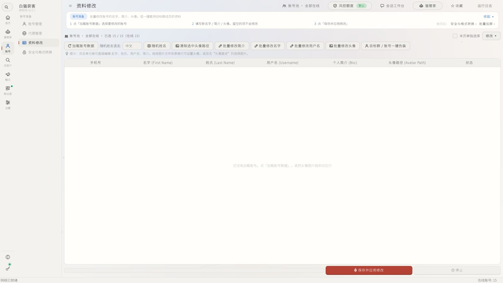

---

## 一、操作步骤

1. 点「**加载账号数据**」，把账号的当前资料读进表格（列：手机号、名字、姓氏、用户名、个人简介、头像路径、状态）；
2. 直接**双击单元格**编辑名字、姓氏、用户名、简介；**把图片拖到表格行**可设置头像，或双击「头像路径」列选择图片；
3. 点「**保存并应用修改**」，软件逐个账号提交，结果写在「状态」列；「停止」可中断。

---

## 二、批量工具

| 按钮 | 作用 |
| :--- | :--- |
| 随机姓名 | 按「随机姓名语言」（中文 / 英文）给选中的行生成名字 |
| 批量修改名字 | 批量填写名字 |
| 批量修改简介 | 批量填写简介 |
| 批量修改用户名 | 按「前缀 + 随机后缀」生成，或粘贴一份名单按顺序对应选中的账号；被占用时自动换随机后缀重试 |
| 批量修改头像 | 从文件夹给账号分配头像 |
| 清除选中头像路径 | 去掉已选的头像 |
| 目标群 / 账号一键伪装 | 取指定目标账号或目标群里**真实用户**的名字、用户名、简介和头像，填入表格里选中的行（没选中则填全部）；改的是表格里的内容，确认后再「保存并应用」 |

> 用户名需要全网唯一；被占用时软件会换后缀重试。头像要用你有权使用的图片。

---

## 三、让猫管家帮你做

```text
我想把【这几个账号】的头像、名字和简介改成统一的品牌形象：名字「【名字】」，简介「【简介】」。先预览，不要直接改。
```

---

## 四、建议

- 新买的号先改资料、再绑代理、再静置，最后才发信；
- 人设要和你的业务相符（客服、顾问、采购），简介里不要放违规词；
- 一次不要把大批账号改成一模一样的名字，容易被识别成批量号。

---

# 12. 安全检测

> **一句话结论**：输入一个 `@用户名` 或用户 ID，查询这个账号的**诈骗风险信号、历史名称和共同群组**，在联系陌生人、接受合作前先判断对方靠不放心。


---

## 一、怎么用

1. 在「查询目标」输入 `@用户名`（如 `@abc`）或纯数字的**用户 ID**；**用户 ID 查询更准确**；
2. 点「开始检测」，状态栏显示进度；
3. 结果分成几块：

| 区块 | 内容 |
| :--- | :--- |
| 风险信号 | 对方账号的风险信号（具体项目以软件显示为准） |
| 账户基本信息 | 名字、用户名、ID 等 |
| 历史名称 / 历史用户名 | 对方改过的名字和用户名 |
| 所在群组（共同群组） | 你的账号和对方共同所在的群：名称、类型、链接 |
| 近期发言 | 在哪些群、什么时间、说了什么 |

---

## 二、怎么看结果

- **风险信号有标记**：谨慎对待，不要预付款、不要点陌生链接；
- **历史名称频繁变化**：可能是改名躲避记录的号；
- **共同群组**：能看出对方活跃在哪些圈子；可以去那些群里了解对方口碑；
- 查不到或读不到的信息会如实显示，不会编造。

---

## 三、让猫管家帮你做

```text
帮我查一下这个用户有没有诈骗风险信号、历史用户名和共同群组：【@用户名 或 ID】。
```

---

## 四、常见问题

**提示没有在线账号？**
先到 [账号管理](manual/01_account.md) 连接账号。

**用户名查不到？**
用户名可能已改，改用用户 ID 查询。

---

# 13. 目标分类筛选

> **一句话结论**：手里有一批用户名、链接或 ID，不知道哪些是真人、哪些是群、机器人或频道？粘进来，软件自动分成**群组、用户、机器人、频道**，还能按名字规则把疑似广告号和批量注册号过滤掉，再把干净的名单一键带去私信或加群。

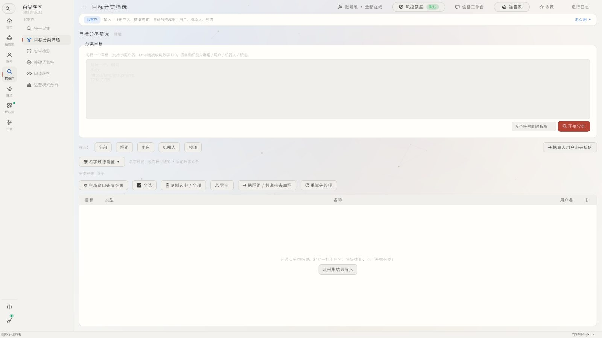

---

## 一、操作步骤

1. 「分类目标」里每行一个：`@用户名`、`t.me` 链接或纯数字 UID；也可以点「从采集结果导入」；
2. 「个账号同时解析」：1～100，每个在线账号同一时刻只解析一条（避免被限流）；实际并发 = min(这里的数字, 在线账号数)；
3. 点「开始分类」；
4. 看结果：顶部「筛选」按钮切换 全部 / 群组 / 用户 / 机器人 / 频道；表格列：目标、类型、名称、用户名、ID；
5. 解析失败或未处理的（例如账号被限流），点「重试失败项」，已成功的保留。

---

## 二、名字过滤

点「名字过滤设置」展开（设置会保存）：

- **过滤名字 / 用户名里含这些关键词的**：每行或用逗号分隔一个（如：主页、招商、注册、送、号商），「恢复默认关键词」回到默认；
- **过滤重复名字**：同一个名字出现 N 次及以上（2～1000）就过滤——批量注册的号通常名字雷同；默认整组都过滤，勾选「每组保留第一个」则每个名字留一个；
- 「显示」下拉：通过过滤的 / 被过滤的（看原因）/ 全部。

---

## 三、用结果

| 按钮 | 作用 |
| :--- | :--- |
| 把真人用户带去私信 | 只带「用户」类型（机器人、频道、群不带），追加到 [私信群发](manual/08_private_send.md) 的目标框，不会自动开始 |
| 把群组 / 频道带去加群 | 只带通过名字过滤的群组和频道，追加到 [批量加群](manual/10_warmup.md) 的目标框，不会自动开始 |
| 复制选中 / 全部 | 没选行时复制当前显示的全部；复制的是 `@用户名`（没有用户名用原目标） |
| 导出 | 保存结果 |
| 在新窗口查看结果 | 结果多时用独立窗口：搜索、按类型筛选、全选、复制、导出、带去私信 / 加群 |

---

## 四、让猫管家帮你做

```text
我有一批用户名和链接，在下面。请分成「真人用户、群组、机器人、频道」四类，告诉我各有多少。
【粘贴名单】
```

---

## 五、常见问题

**为什么有些目标分不出类型？**
目标已失效、改名或账号被限流。用「重试失败项」再试。

**名字过滤会不会误伤真人？**
可能。先选「被过滤的（看原因）」检查一遍，再决定是否调整关键词。

---

# 14. 批量举报

> **一句话结论**：让多个账号轮流对**同一个目标**（用户、群、频道或某条消息）发起举报。只用于举报真实存在的违规内容，不要滥用。

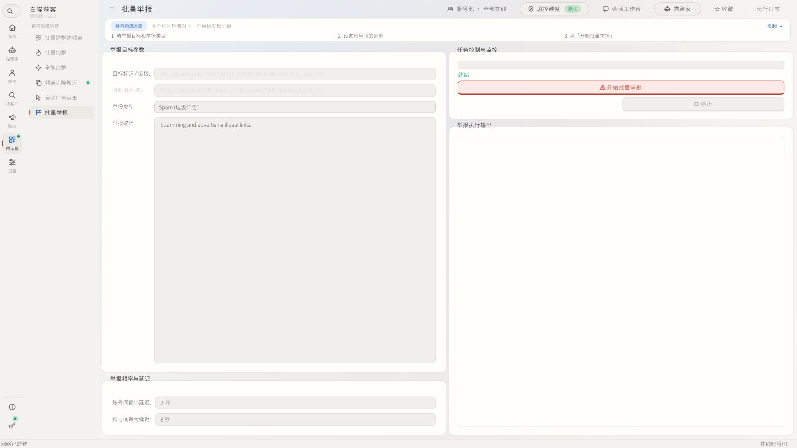

---

## 一、操作步骤

1. 选「执行账号」（在线账号）；
2. 「举报目标参数」：
   - 「目标标识 / 链接」：`@username`、`-1001234567`，或消息链接 `https://t.me/xxx/123`；
   - 「消息 ID（可选）」：多个用逗号分隔；上面填了消息链接时可以不填；
3. 「举报类型」：Spam（垃圾广告）/ Violence（暴力内容）/ Pornography（成人色情）/ Child Abuse（虐待儿童）/ Other（其它原因 / 自定义）；选 Other 时填「举报描述」；
4. 「举报频率与延迟」：设置「账号间最小延迟」和「账号间最大延迟」（秒），越慢越自然；
5. 点「开始批量举报」，下方「举报执行输出」显示每个账号的结果；「停止」随时终止。

---

## 二、让猫管家帮你做

```text
用这几个账号轮流举报这个垃圾广告群：【@群用户名】，类型选垃圾广告。先告诉我会用哪些账号、间隔多久，我确认再做。
```

举报属于对外动作，猫管家会先让你确认。

---

## 三、注意

- 只举报真实违规的内容；虚假、恶意举报可能让你的账号被限制；
- 举报是否被受理由 Telegram 决定，软件只负责提交，不保证结果；
- 间隔不要设太短，账号之间错开。

---

# 15. 全能炒群

> **一句话结论**：让多个账号在群里自然地聊起来，带热气氛。两种玩法：**AI 智能生成**（让大模型扮演多个角色自动聊）和**预设剧本回放**（回放你自己编辑的话术文件，可以多角色、引用、带图片、按北京时间定时）。

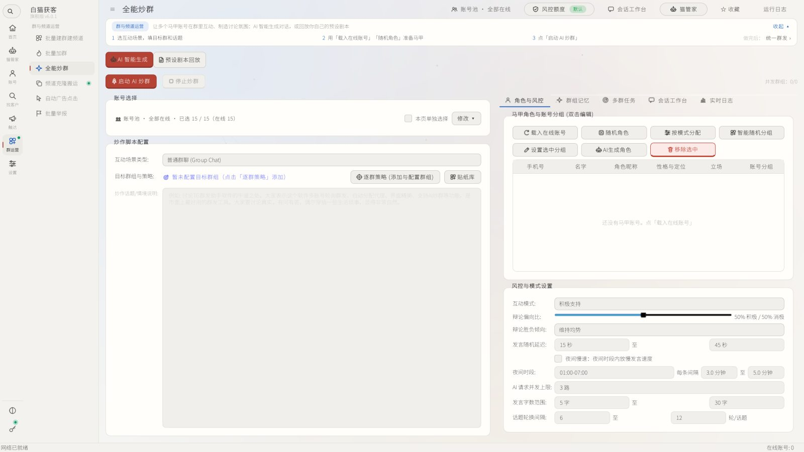

页面顶部切换「AI 智能生成」和「预设剧本回放」。AI 智能生成使用「设置 → AI 与凭证」里配置的 AI 接口。

---

## 一、预设剧本回放

### 剧本文件怎么写
一个文本文件（UTF-8 或 GBK），**每行一条**：

```text
账号编号:[rN]正文||图片<HH:MM:SS>
```

- 账号编号：第几个参与账号发这句；
- `[rN]` 引用：引用某条消息；引用方式在设置里选「按账号编号」（引用该账号最近发出的消息，推荐）或「按物理行号」（引用话术文件的第 N 行）；
- `||图片`：这一行附带一张图片，图片到「图片文件夹」里按文件名找；
- `<HH:MM:SS>`：带这个的行按**北京时间**定时发出（交给 Telegram 的定时队列）；不带的是实时消息。

没有现成话术时，点「**从参考群聊天生成剧本…**」：读取参考群最近的聊天，自动整理成剧本文件（只读，不发送）。写好后点「**校验剧本**」检查格式。

### 任务设置
| 项 | 说明 |
| :--- | :--- |
| 任务名称 / 目标群组 | 目标群需要账号已在群里 |
| 参与账号 | 剧本里的账号编号按这里的顺序对应；「对齐模式」下编号 k 对应第 k 个账号（超出时循环） |
| 初次发言延迟 / 再次发言延迟 | 随机区间（秒） |
| 每日运行时段 | 如 `10:00-23:30`（北京时间，只约束实时消息）；留空 = 全天 |
| 夜间慢速 | 夜间时段内放慢发言（例如 01:00-07:00 每 3～5 分钟才发一条），像真人夜里偶尔冒泡 |
| 随机点赞 | 剧本账号发言后，其他账号按概率给它点一个正能量表情（只对实时行生效） |
| 演几轮 | 1～365 轮；定时消息第 k 轮落在第 k 天 |
| 发言前先阅读群消息 | 默认勾选：每个账号开口前先把群里的消息标记已读 |
| 转发非任务账号的发言 | 默认关闭：群里有真人说话时转给你指定的人或群，方便人工接管；**未在真实 Telegram 环境验证** |
| 不转发机器人发的消息 | 默认勾选，转发群不会那么吵 |

点「保存为任务」，然后在「剧本任务」列表里「开始 / 暂停 / 继续 / 停止 / 载入设置 / 删除」。进度与报告里，**定时消息只算「已提交定时队列」，不是已发送**。

### 清理定时消息
- 「清除群内定时任务」：清掉这个任务的账号在目标群里「还没发出」的定时消息（已发出的不受影响）；
- 「查所有群的定时消息」：任务停了或删了，已交给 Telegram 的定时消息仍会发出；这个按钮扫描账号加入的所有群，看哪些群里还有待发的定时消息，并可清理。

---

## 二、AI 智能生成

让大模型扮演多个角色自动聊天：设置话题、人设、参与账号和节奏，点「启动 AI 炒群」；「停止炒群」随时停止。先确认 AI 接口已经配置好并通过「测试连接」。

---

## 三、让猫管家帮你做

```text
在【群链接】里用 3 个账号做一场自然的讨论，话题是「【话题】」，人设分别是：老用户、新用户、咨询者。先把对话脚本发给我看，确认后再发。
```

---

## 四、建议

- 群里有真人时，节奏放慢，别刷屏；
- 先用小号在自己的测试群里试一遍剧本；
- 新群先铺垫真实讨论，再做强拉，见 [09. 强拉加群](manual/09_force_invite.md)。

---

# 16. 间谍获客

> **一句话结论**：监听**同行的群**，发现有购买意向的人后，由闲置账号私聊引导。默认的「隐形潜伏模式」只监听和私聊，**绝不在群里发言**，封号风险最低。

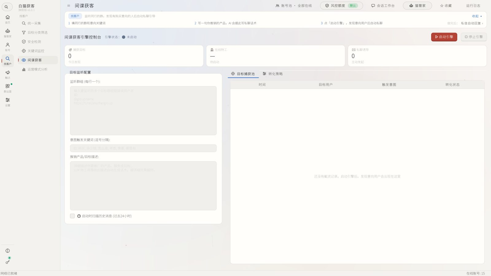

页面顶部是「间谍获客引擎控制台」：引擎状态、「启动引擎 / 停止引擎」，以及四个统计：**捕获目标、今日发现、在线特工、私聊诱导**。下面分两个页签：**目标捕获池**（看截流记录）和**转化策略**（设置怎么做）。

---

## 一、设置步骤

### 目标监听配置
- 「监听群组」一行一个；
- 「意图触发关键词」用逗号分隔，如：购买、多少钱、怎么卖、考虑、需要、哪里有；
- 「推销产品 / 目标描述」：告诉 AI 你卖什么，用来生成私聊话术和判断意图；
- 「启动时扫描历史消息（过去 24 小时）」：引擎启动时先检索过去 24 小时的聊天记录，匹配的也会被捕获。

### 转化策略
| 项 | 说明 |
| :--- | :--- |
| 作业模式：隐形潜伏（推荐） | 零封号风险：只监听意图并私聊，绝不在群内发言 |
| 作业模式：双簧戏法 | 特工在群内回复暗示、帮腔，再私聊；适合管理宽松的群，风险更高 |
| 启用 AI 商业意图二次核验 | 群友触发关键词后，大模型结合你的产品判断是真需求还是随口吐槽、反讽、闲聊，只打真需求 |
| 激活主动私聊触达 | 捕获意向后由闲置账号发起私聊 |
| 触达方式 | 直接发送 AI 定制私聊文案；或：先打电话振铃 → 失败转语音条 → 再发 AI 文字 |
| 备用语音条 | VoIP 电话不通时备用发送的语音条文件（.ogg / .mp3） |

设置好后点「启动引擎」。截流记录在「目标捕获池」里：时间、目标用户、触发意图、转化状态。

---

## 二、闭环：会话工作台

间谍触达的潜在客户一旦回复私信，会自动实时推送到侧边栏的「会话工作台」，由你的人工一键跟进。

---

## 三、让猫管家帮你做

```text
监听这几个同行的群，发现有购买意向的人就私聊引导，我卖的是「【产品描述】」。用隐形潜伏模式，不要在群里发言。先告诉我会用哪些账号、监听哪些群，我确认再开始。
```

---

## 四、注意

- AI 意图判定和私聊文案用的是「设置 → AI 与凭证」里的接口，需要先配好；
- 监听的群需要账号已经加入；
- 私聊同样受账号风控额度限制，不要一次触达太多人。

---

# 17. 访客机器人

> **一句话结论**：用你自己的 Telegram 机器人，给**访问过你机器人的用户**自动回复一条带按钮的消息，支持文字或图片、内联按钮和阅后即焚。需要你先在 @BotFather 创建机器人并拿到 **API Token**。

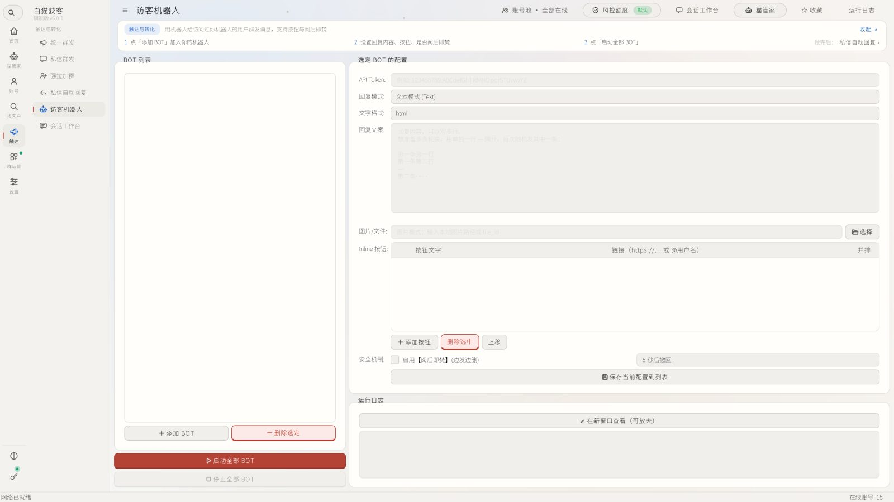

页面分两部分：左边「选定 BOT 的配置」，右边「BOT 列表」和「运行日志」。

---

## 一、先拿到机器人 Token

在 [@BotFather](https://t.me/BotFather) 发送 `/newbot` 创建机器人，拿到形如 `123456789:ABCdefGHIjklMNOpqrSTUvwxYZ` 的 token。详细步骤见 [25. 配置 Telegram 机器人](manual/25_phone_remote.md) 的第一步（创建机器人的步骤相同；这里的机器人和手机遥控用的机器人建议**分开**）。**token 不要发给任何人。**

---

## 二、配置一个机器人

1. 点「添加 BOT」，在「API Token」里粘贴 token；
2. 「回复模式」选「文本模式（Text）」或「图片模式（Image）」；图片模式在「图片 / 文件」里选本地图片，或填 `file_id`；
3. 「文字格式」html / md，在「回复文案」里写内容；
4. 「Inline 按钮」：点「添加按钮」，填「按钮文字」和「链接」（`https://…` 或 `@用户名`），可设置「并排」，「上移」调整顺序；
5. 「安全机制」：勾选「启用阅后即焚（边发边删）」，设置「N 秒后撤回」（1～600 秒）；
6. 点「保存当前配置到列表」。

---

## 三、运行

- 在「BOT 列表」里可以管理多个机器人：「添加 BOT」「删除选定」「启动全部 BOT」「停止全部 BOT」；
- 运行日志在下方，「在新窗口查看（可放大）」。

---

## 四、让猫管家帮你做

```text
用我的访客机器人给访问过它的用户发一条通知：「【内容】」。先告诉我会发给多少人，我确认再发。
```

---

## 五、注意

- 机器人只能给**主动和它说过话**（点过 Start）的用户发消息，这是 Telegram 的限制；
- 机器人 token 泄露后，在 BotFather 里 `/revoke` 作废并换新 token。

---

# 18. 私信自动回复

> **一句话结论**：客户私信你的账号后自动回复，防止客户流失。两种模式：**固定话术**（随机抽取一条）和 **AI 智能营销**（用你写的人设提示词让 AI 接待）。

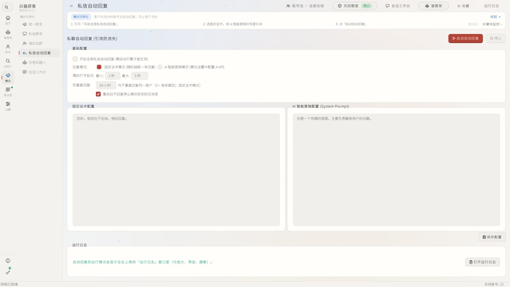

---

## 一、设置步骤

1. 勾选「**开启全局私信自动回复**」（需要点「启动自动回复」引擎才生效）；
2. 选「回复模式」：
   - **固定话术模式**：在「固定话术配置」里写多条话术，每次随机抽一条；
   - **AI 智能营销模式**：在「AI 智能营销配置（System Prompt）」里写人设和规则，需要先在「设置 → AI 与凭证」里配置 AI 接口；
3. 「模拟打字延迟」：最小 / 最大（秒），让回复像真人在打字；
4. 「防重复回复」：N 小时内不重复回复同一客户（固定话术模式；0 = 每条都回）；记录保存在本机；
5. 「重启后不回复停止期间收到的旧消息」：避免重新启动后把老客户又回复一遍；
6. 点「保存配置」，再点「启动自动回复」；运行情况在右上角的「运行日志」里（可放大、筛选、搜索）。

---

## 二、让猫管家帮你做

```text
帮我给【某个账号】开启私信自动回复：客户第一次私信时回复「【欢迎语】」，包含「价格」两个字时回复「【报价说明】」。先预览规则，再启用。
```

---

## 三、建议

- 话术里留一个轻量提问，引导对方继续对话；
- 有真人客服时，用会话工作台接手后续对话；
- AI 模式记得写清楚「哪些话题不能答」，避免乱承诺价格；
- 想让自动回复覆盖多个账号，先在 [账号管理](manual/01_account.md) 里确认这些账号都在线。

---

# 19. 频道克隆搬运

> **一句话结论**：监控一个或多个**源频道**的新帖子，替换掉联系方式和链接后，自动发布到**你自己的频道**。一个「搬运通道」可以监控多个源频道，统一搬运到同一个目标频道。

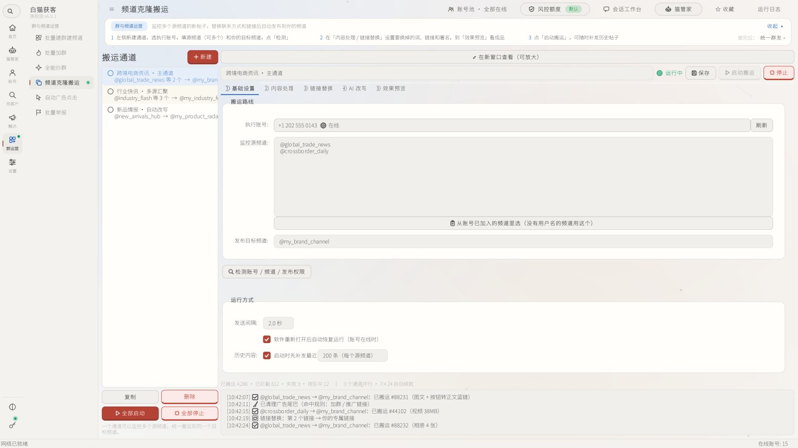

页面上方是搬运通道的操作：「新建 / 复制 / 删除 / 全部启动 / 全部停止」，运行状态和统计（已搬运、已拦截、失败、排队中）。下面是五个页签。

---

## 一、五个页签

### ① 基础设置（搬运路线 + 运行方式）
| 项 | 说明 |
| :--- | :--- |
| 通道名称 | 如「科技资讯 → 我的频道」 |
| 执行账号 | 用哪个账号搬运；**需要是目标频道的管理员** |
| 监控源频道 | 一行一个：`@news_channel`、`https://t.me/xxx`、私密邀请链接 `https://t.me/+AbCdEf`、或 `-100…` 的 ID；没有用户名的频道点「从账号已加入的频道里选」 |
| 发布目标频道 | 你自己的频道，如 `@my_channel` |
| 检测账号 / 频道 / 发布权限 | 开始前检查一遍 |
| 发送间隔 | 每发一条后至少等多久（0～600 秒），越大越像真人、越不容易限流 |
| 软件重新打开后自动恢复运行 | 账号在线时自动恢复 |
| 启动时先补发最近 N 条 | 每个源频道 1～10000 条；通道运行中也可以「补发最近 N 条」，或粘贴某条消息的链接「从这条起补发」 |

### ② 内容处理
- **搬运哪些内容**：图片 / 视频 / 文件 / 语音（带说明文字一起搬）、贴纸 / 动图表情、自动删除文末的引流 / 联系方式（如订阅、投稿、`@xxx`）；
- **原帖下方的按钮**：把链接按钮转成文字链接（推荐，入口不丢）/ 直接丢弃按钮；
- **文字替换**：每行 `原词 => 新词`，例如 `@old_service => @my_service`；只写原词不写箭头 = 把这个词删掉；以 `re:` 开头可用正则；
- **拦截不想搬的帖子**：每行一个词，帖子里出现就整条不搬（含蓝色链接和按钮里的文字）；
- **加上我的署名**：给每条帖子加开头和结尾，如「联系我 @my_service」。

### ③ 链接替换
样式不变，只改点开后的跳转地址；正文里的蓝色链接、直接写出的网址、按钮里的网址都会处理。方式：不替换 / 全部统一替换成我的链接 / 按出现顺序依次换成不同链接 / 只替换指定位置的链接（填第几个链接、第几行按钮）。

### ④ AI 改写
可选。开启后每条文字都交给 AI 重写一遍再发布；「我的专属信息」让 AI 把原文里的联系方式和竞品名替换成你的；可编辑「改写指令」，「恢复默认指令」回到默认。注意：AI 重写会重排文字，**原帖的加粗、链接等样式不会保留**；需要先在「设置 → AI 与凭证」配好 AI 接口。

### ⑤ 效果预览
左边贴一段原帖文字，右边实时显示按当前规则搬运后的样子（**不会真的发送，也不含 AI 改写**），点「刷新预览」。

---

## 二、启动与运行

1. 先点「检测账号 / 频道 / 发布权限」；
2. 在「⑤ 效果预览」里试几段文字，确认替换结果；
3. 点「保存」，再点「启动搬运」；
4. 搬运过程中看统计：已搬运、已拦截、失败、排队中。遇到 Telegram 限流时会给出友好的休眠提示，不会硬撞。

---

## 三、让猫管家帮你做

```text
监控这几个源频道，把新帖子里的联系方式和链接替换成我的，再发到我的频道【@我的频道】。先告诉我会替换哪些内容。
【源频道，每行一个】
```

---

## 四、注意

- 只搬运你有权转载的内容，注意源频道的版权；
- 目标频道的账号必须是管理员，否则发布失败；
- 补发历史条数多时，发送间隔要放宽。

---

# 20. 自动广告点击

> **一句话结论**：让账号自动点击某个频道里最近的广告消息。设置只有两项：目标频道和检查多少条消息。

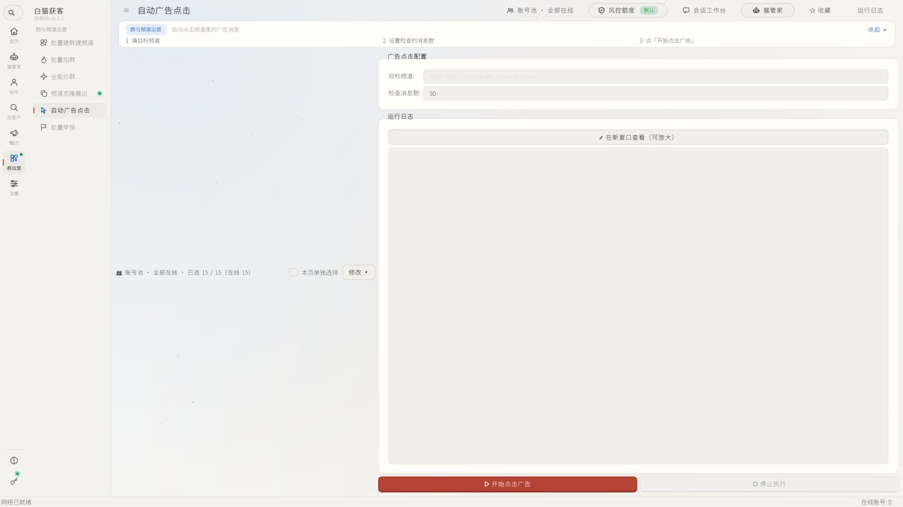

---

## 一、操作步骤

1. 选执行账号（在线账号）；
2. 「广告点击配置」：
   - 「目标频道」：如 `https://t.me/target_channel_name`；
   - 「检查消息数」：检查最近多少条消息（1～1000）；
3. 点「开始点击广告」，运行日志里显示结果（「在新窗口查看（可放大）」）；「停止执行」随时终止。

---

## 二、让猫管家帮你做

```text
用这几个账号检查这个频道最近 50 条消息里的广告并点击：【频道链接】。先告诉我会用哪些账号，我确认再做。
```

---

## 三、注意

- 账号需要已能访问该频道；
- 频繁点击同一批广告可能被判定为异常行为，控制频率；
- 点击购买、支付类按钮在猫管家里默认关闭，需要你明确放开。

---

# 21. 批量建群建频道

> **一句话结论**：多个账号轮流批量创建超级群、频道或普通群，可以自动生成公开用户名，并把频道挂到账号主页。页面按 5 步从上到下填，最后点「开始批量创建」。

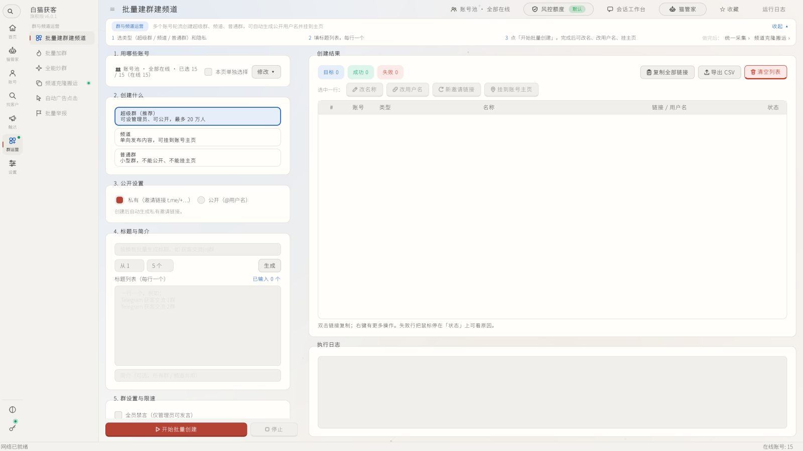

---

## 一、五步设置

### 1. 用哪些账号
选在线账号；没有选账号时页面会提示「还没有选择账号」。

### 2. 创建什么
| 类型 | 特点 |
| :--- | :--- |
| 超级群（推荐） | 可设管理员、可公开，最多 20 万人 |
| 频道 | 单向发布内容，可挂到账号主页 |
| 普通群 | 小型群，不能公开、不能挂主页 |

### 3. 公开设置
- **私有**：创建后自动生成私有邀请链接（`t.me/+…`）；
- **公开**：设置 `@用户名`；「用户名规则」可选「前缀 + 随机」或「前缀 + 序号」，前缀可选（如 `vipgroup`，字母开头）；示例：`@cut76`、`@wpel1`、`@e2xla`。

### 4. 标题与简介
- 「按模板批量生成标题」：如 `获客交流{n}群`，`{n}` 会替换成序号；设置起始序号和个数（1～500），点「生成」，追加到下面的标题列表；也可以直接一行一个手填；
- 「简介」（可选）：所有群 / 频道共用。

### 5. 群设置与限速
- 「全员禁言（仅管理员可发言）」；
- 「新成员可见入群前的历史消息」；
- 「每个间隔 N 到 M 秒」（2～600）、「每号最多 N 个」（1～100）——创建太快、太多会触发限制，建议放慢。

点「**开始批量创建**」；「停止」随时终止。

---

## 二、创建结果

页面上方「创建结果」显示：目标、成功、失败。表格列：序号、账号、类型、名称、链接、用户名、状态。

- 「复制全部链接」「导出 CSV」「清空列表」；
- 选中一行后：「改名称」「改用户名」「新邀请链接」「挂到账号主页」（**只有频道可以挂到账号主页**）；
- 双击链接复制，右键有更多操作；失败行把鼠标停在「状态」上看原因。

> 创建群属于对外动作，在猫管家里默认关闭或只预览，需要你明确确认。

---

## 三、让猫管家帮你做

```text
我想批量创建 5 个超级群，名字前缀「【前缀】」，由这几个账号各建一个。先预览会怎么建、有没有风险，我确认再做。
```

---

## 四、建议

- 新号不要短时间内建很多个；
- 公开用户名要符合 Telegram 规则，被占用会失败；
- 建好后接着用 [09. 强拉加群](manual/09_force_invite.md) 或 [15. 全能炒群](manual/15_ai_hype.md) 运营。

---

# 22. 运营模式分析与机器人探查

> **一句话结论**：用真实读到的数据研究别人是怎么运营的。**先给事实，再给 AI 解读；读不到的会如实写出，绝不提供示例数据。** 两个页签：**社群与频道运营分析**（研究一个群或频道）和**机器人功能探查**（研究一个机器人有哪些功能）。

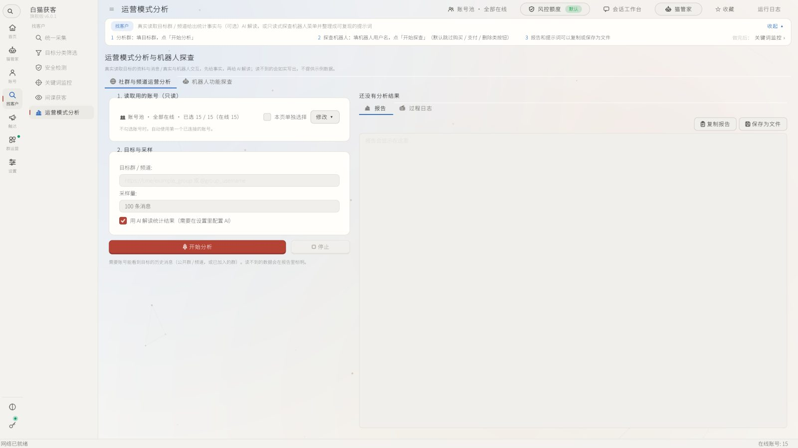

---

## 一、社群与频道运营分析

1. 「读取用的账号（只读）」选账号；
2. 「目标群 / 频道」填 `https://t.me/example_group` 或 `@group_username`；账号需要能看到目标的历史消息（公开群 / 频道，或已加入的群）；
3. 「采样量」：读取最近的 20～1000 条消息作为样本。**样本只代表这一小段时间，不代表整个社群**；
4. 勾选「用 AI 解读统计结果」（需要在设置里配置 AI）：先给纯统计事实，再让 AI 按 5 个维度解读；没配置 AI 或调用失败时，只给纯事实并写明「未调用 AI」及原因；
5. 点「开始分析」，在「报告」页签查看，可「复制报告」。

---

## 二、机器人功能探查

1. 「探查用的账号」：不勾选时自动使用第一个已连接的账号；
2. 「目标机器人」：`@WalletBot` 或 `WalletBot`；
3. 「探查深度」：1～4 层菜单；「点击上限」：5～80 次，每次点击之间随机停顿 1～2 秒，避免限流；
4. 选项：
   - **跳过可能产生费用 / 不可逆的按钮（推荐，默认开启）**：不点购买、支付、充值、提现、确认、删除、退出等按钮；
   - 「试一下它声明的指令」：最多试 3 个安全的指令；
   - 「整理成复现提示词」：有 AI 时由 AI 润色；
5. 点「开始探查」。

**无论怎么设置，探查都不会点外链、小程序、支付发票，也不会分享手机号或位置**，这些属于泄露隐私或没有意义的动作。

结果在几个页签里：**菜单树**（机器人的菜单结构）、**复现提示词**（可「复制提示词」「保存为文件」）、**过程日志**。也可以点「复制给 AI Agent 的指令（MCP 完整探查）」，让外部 AI Agent 做更完整的探查。

> 探查只用真实与机器人交互得到的内容；没有账号或读不到数据时，会返回明确的错误，不会给你一棵虚构的菜单树。

---

## 三、让猫管家帮你做

```text
分析这个群的运营方式：【群链接】。给我发言活跃度、常见话题、有没有营销话术，只用真实读到的数据，读不到就直接告诉我。
```

```text
帮我探查这个机器人有哪些功能：【@机器人用户名】。只读式探查，不要点外链、支付或分享手机号的按钮，最后整理成一份菜单结构。
```

---

## 四、常见问题

**报告里很多项是「读不到」？**
账号看不到该群的历史消息。加入这个群，或换公开群 / 频道。

**探查到一半停了？**
达到点击上限，或对方机器人限流。调高上限、放慢后重试。

---

# 23. 猫管家：用一句话让软件干活

> **一句话结论**：猫管家是软件里的 AI 助手。你用自然语言说需求，它调用软件自带的 62 项工具真实去做；**有副作用的动作先给你看确认卡，你点头才执行**。它用的是你自己的模型额度，对话和账号数据都不经过我们的服务器。

猫管家是 6.0 的核心功能，也是最适合新手的入口：不用记每个功能在哪，直接说你要做什么。

---

## 一、先做两件事

| 步骤 | 做什么 | 详细教程 |
| :--- | :--- | :--- |
| 1 | 填一个模型接口（API）：没有它猫管家无法工作 | [24. 配置模型接口（API）](manual/24_cat_api_setup.md) |
| 2 | （可选）绑定自己的 Telegram 机器人，在手机上遥控 | [25. 配置 Telegram 机器人（手机遥控）](manual/25_phone_remote.md) |

配好之后，直接看 [26. 猫管家提示词库](manual/26_prompt_library.md)，里面的每一条都可以一键复制，粘进猫管家就能用。

---

## 二、在哪里找到它

- **首页**：「今天想做什么？」下面的输入框，写好点「交给猫管家」，会跳到猫管家页并把这句话填进输入框（不会自动发送，你确认后再发）；
- **顶部**：「猫管家」按钮，直接打开完整对话页；
- **左侧**：图标栏里的猫管家分类。

猫管家页的布局：左边是会话列表（可新建对话、搜索会话），中间是对话，底部是输入框（旁边有模型名、权限模式和发送键），右上角有「设置」和「审计」。

---

## 三、怎么说话

直接说你要做什么。例如：

```text
看看今天哪些账号能发消息
```

猫管家会先查真实数据再回答；**没有账号或读不到数据时，它会明确告诉你，不会编造数据**。更多可直接复制的说法见 [提示词库](manual/26_prompt_library.md)。

### 附件
- 把文件（账号压缩包、tdata、文本等）或图片拖进窗口，或按 `Ctrl+V` 粘贴截图；
- 图片会作为图片发给模型，**需要你的模型支持看图**，不支持时软件会如实告诉你「这次没有看到图片」。

### 多会话与停止
- 左侧可以新建对话（主要聊天 + 旁聊），对话自动保存；
- 任务进行中会显示「处理中 · 已用时」；点「停止」会给出一份**真实发生了什么**的报告，不会假装没做；
- 后台任务（比如一个长时间的采集）完成或出错时，会在对话里通知你。

---

## 四、权限模式：哪些事会先问你

输入框旁边可以切换模式。动作按风险分四档：

| 动作类型 | 询问 | 自动 / 接受本机改动 | 计划 | 完全放开 |
| :--- | :--- | :--- | :--- | :--- |
| 只读查看（查账号、查状态） | 直接做 | 直接做 | 直接做 | 直接做 |
| 本机改动（改配置、绑代理） | 确认卡 | 直接做 | 只预览 | 直接做 |
| 对外动作（发消息、加群、拉人） | 确认卡 | 确认卡 | 只预览 | 直接做 |
| 关键动作（不可逆 / 影响大） | 强确认卡 | 强确认卡 | 只预览 | 直接做 |

- **询问**：最稳妥，除了只读以外都会先问你；
- **自动 / 接受本机改动**：本机上的小改动直接做，对外动作仍要确认；
- **计划**：只出方案和预览，什么都不真正执行，适合先看它打算怎么做；
- **完全放开**：需要输入确认短语。放开后验证码、密码这类内容也可能随对话发给你的模型服务商，**请自行评估后果**。设置里的「记住完全放开」默认关闭，只对当前对话生效。

### 确认卡长什么样
对外动作会弹出一个「需要你确认」窗口，写明**要做什么、会产生什么后果**；勾选「我已了解后果，确认执行」后点「批准并执行」才会真正做，点「拒绝」就取消。**回车默认是「拒绝」，不会误批。** 关键动作的窗口标题是「关键动作 · 需要你强确认」，要求更严。

### 没有代理就连接账号
如果某个账号**没有绑定专属代理**，猫管家连接它之前会先弹出确认：没有代理时它会走你这台电脑的本机网络，和别的号共用一个 IP，容易被关联。建议先导入代理，再让猫管家预览「一号一 IP」的绑定方案。

---

## 五、它能做什么

猫管家能调用软件里几乎所有的功能，和 MCP 一致：账号管理、代理、成员采集、关键词监控、群发与私信、强拉、批量建群加群、AI 炒群、频道克隆、机器人创建与探查、账号限制检测与申诉、语音合成、打开网页核实结果等。完整列表见 [62 项 MCP 工具参考](mcp/03_tools_reference.md)。

三条底线：
- **结果要名副其实**：发送后回读消息是否真在对话里，拉人后回读对方是否真在群里；做不到核实的写「未核实」；
- **隐私**：手机号换成别名，验证码、密码、密钥不进对话；
- **安全默认**：点购买 / 支付按钮、创建群、拉入第三方机器人这类动作默认关闭或只预览，需要你明确放开。

---

## 六、常见问题

**Q：提示「请先填写模型接口地址、模型名和 API Key」？**
A：见 [24. 配置模型接口（API）](manual/24_cat_api_setup.md)。如果用的是本机 Ollama，API Key 可以留空。

**Q：设置窗口反复报错或文字被压住？**
A：这是 6.0.0 的问题，**升级到 6.0.1** 已修复。

**Q：猫管家说「做完了」，怎么确认是真的？**
A：发送、拉人这类动作，软件会回读核实；做不到核实的会写「未核实」。你也可以点右上角「审计」，查看它调用了哪些工具、结果如何（只记录工具、动作、档位和结果，不含参数内容）。

**Q：它回答得很慢或很贵？**
A：「全部工具」模式每轮对话会多消耗约 2.6 万 token。在设置里把工具范围改成「精简」（8 个常用工具）可以省 token，但很多事做不了。

**Q：它会自动付款吗？**
A：默认不会。点击购买 / 支付按钮这类动作默认关闭，需要你明确放开。

> **如实说明**：猫管家目前只在本地测试环境验证过，没有在大量真实 Telegram 场景里验证，**建议先用小号、小范围试用**。

---

# 24. 配置模型接口（API）：让猫管家动起来

> **一句话结论**：猫管家需要你提供一个**兼容 OpenAI 接口格式**的模型服务。你只要拿到三样东西：**接口地址、模型名、API Key**，填进「猫管家 · 模型设置」就行，约 1 分钟。

---

## 一、先理解三个词

| 名称 | 是什么 | 例子 |
| :--- | :--- | :--- |
| **接口地址**（Base URL） | 模型服务的入口，通常以 `/v1` 结尾 | `https://api.deepseek.com/v1` |
| **模型名** | 你要用哪一个模型，要和服务商后台显示的一致 | 以服务商后台为准 |
| **API Key** | 你的专属密钥，相当于账号密码，**不要发给任何人** | 一长串字符，常以 `sk-` 开头 |

> **费用谁出？** 用你自己的服务商账号，按它的价格计费；软件和我们都不经手这笔钱。

---

## 二、方案选择

| 方案 | 适合谁 | 优点 | 要注意 |
| :--- | :--- | :--- | :--- |
| **DeepSeek**（预设） | 想便宜、中文好 | 价格低，软件里有预设 | 注册并充值后才能调用 |
| **OpenAI**（预设） | 已经有 OpenAI 账号 | 稳定，支持看图的模型多 | 部分地区需要自备网络环境 |
| **聚合平台** | 不想分别注册多家 | 一个 Key 用多家模型 | 第三方服务，按其条款使用；软件里推荐的是 <https://uuapi.co> |
| **本机 Ollama** | 想完全不花钱、数据不出本机 | 免费、离线 | 需要本机有足够内存 / 显卡；小模型可能做不好复杂任务 |

> 无论选哪家，模型**需要支持工具调用（function calling）**，否则猫管家无法调用软件里的工具；要发图片给猫管家，模型还要**支持看图**。具体哪个模型支持，请看服务商的模型说明。

---

## 三、通用步骤（以任意服务商为例）

### 第 1 步：拿到 API Key
1. 打开服务商网站，注册并登录；
2. 进入「API Keys」（或「密钥管理」）页面，点「创建新的 Key」；
3. **立刻复制保存**：大多数服务商只在创建时显示一次完整 Key；
4. 确认账户里有可用额度（有的需要先充值）。

### 第 2 步：记下接口地址和模型名
- 接口地址：服务商文档里叫 Base URL / API Endpoint；
- 模型名：服务商的模型列表里复制，**注意大小写和连字符**。

### 第 3 步：填进软件
1. 打开「猫管家」页，点右上角「设置」（第一次使用也会自动提示）；
2. **预设**下拉选 deepseek / openai / ollama / 自定义，选预设会自动带出接口地址和一个默认模型名；
3. 检查「接口地址」「模型」是否和你在服务商后台看到的一致，不一致就改；
4. 把 **API Key** 粘进去（输入框里显示为圆点，加密保存在本机）；
5. **工具范围**：默认「全部工具」；想省 token 选「精简」；
6. 点「保存」（英文系统显示 Save）。

如果软件「设置」里已经配过 AI 接口，可以直接点「沿用『设置』里的 AI 配置」，不用重复填。

### 第 4 步：试一句
回到猫管家页，输入：

```text
你好，请告诉我你现在能用哪些工具，并列出我有几个账号在线
```

如果它能回答并且列出了账号数量，说明配置成功。

---

## 四、各方案的具体填法

### DeepSeek
- 预设选 `deepseek`，接口地址会带出 `https://api.deepseek.com/v1`；
- 模型名：预设会带出一个默认值；如果调用时报「模型不存在」，去 DeepSeek 后台的模型列表复制它**当前**提供的模型名替换；
- API Key：在 DeepSeek 开放平台创建。

### OpenAI
- 预设选 `openai`，接口地址 `https://api.openai.com/v1`；
- 模型名：预设会带出一个默认值，可以改成你账号可用的任意支持工具调用的模型；
- API Key：在 OpenAI 平台创建。

### 聚合平台 / 其他兼容服务
- 预设选「自定义」；
- 接口地址、模型名、API Key 全部按该平台文档填写；
- 接口地址要能直接在 `…/v1/chat/completions` 这种路径上工作；写到 `/v1` 为止，不要多写后面的路径。

### 本机 Ollama（免费）
1. 安装 Ollama，并在终端执行 `ollama pull <模型名>` 下载一个**支持工具调用**的模型；
2. 软件里预设选 `ollama`，接口地址 `http://localhost:11434/v1`；
3. 模型名填你刚下载的那个（和 `ollama list` 里的名字一致）；
4. **API Key 留空即可**。

> 本机小模型处理多步任务容易出错；先用只读的问题（查账号、查状态）试，再让它做对外动作，并保持「询问」模式。

---

## 五、常见问题

**Q：提示「请先填写模型接口地址、模型名和 API Key」？**
A：三项有一项为空。Ollama 例外，Key 可以留空。

**Q：发送后报 401 / 403 / Invalid API Key？**
A：Key 复制不全或多了空格；Key 已被删除；账户没有额度；或这个 Key 不能访问你填的模型。

**Q：报 404 / 模型不存在？**
A：模型名不对（大小写、连字符）。到服务商后台复制。

**Q：报 429 / 限流？**
A：服务商限制了请求频率或额度用完，稍等或充值；也可以把工具范围改成「精简」减少单次用量。

**Q：连接超时？**
A：这台电脑访问不了该服务商。国内网络访问海外服务可能需要自备网络环境；也可以换国内可直连的服务商或聚合平台。

**Q：Key 会被泄露吗？**
A：Key 加密保存在本机，不会上传到我们的服务器；对话内容会发送给**你填写的**模型服务商。想最大程度保密，用本机 Ollama。

---

# 25. 配置 Telegram 机器人：用手机遥控猫管家

> **一句话结论**：在 @BotFather 创建一个**你自己的**机器人，把它的 token 填进猫管家设置，配对一次，之后就能在手机上对猫管家说话、批准动作，不用开远程桌面。

---

## 一、你需要准备

- 一个能正常使用的 Telegram 账号（用来创建机器人和当「主人」）；
- 电脑上的软件保持开着并联网（机器人是软件在你电脑上跑的，关了软件手机就遥控不了）；
- 已经按 [24. 配置模型接口（API）](manual/24_cat_api_setup.md) 配好模型。

---

## 二、第 1 步：在 @BotFather 创建机器人并拿到 token

1. 在 Telegram 里搜索并打开 [@BotFather](https://t.me/BotFather)（认准蓝色认证标记）；
2. 发送：

```text
/newbot
```

3. 它会问机器人的**显示名**，随便起，比如「我的猫管家」；
4. 再问**用户名**：必须以 `bot` 结尾且全网唯一，比如 `my_cat_butler_bot`；
5. 成功后 BotFather 会回一条消息，里面有一行 **token**，格式像 `123456789:AAxxxxxxxxxxxxxxxxxxxxxxxxxxxxxxxxx`；
6. 点一下这行 token 就能复制。

> **token 是机器人的钥匙，不要发给任何人。** 如果泄露了：在 BotFather 里发送 `/revoke` 选择这个机器人，会作废旧 token 并生成新的，然后在软件里换成新的（换 token 后原来的配对会自动作废，需要重新配对）。

---

## 三、第 2 步：填进软件

1. 打开猫管家页 → 右上角「设置」（也可以点页面上方提示条「用手机远程操作：输入你的 Telegram 机器人 token…」）；
2. 往下找到「**Telegram 机器人远程控制**」；
3. 勾选「启用」；
4. 把 token 粘进「**机器人 token**」（显示为圆点，加密保存在本机）；
5. 「**远程权限模式**」选一个（默认「自动」）：

| 模式 | 手机上会发生什么 |
| :--- | :--- |
| 询问 | 除只读外都先弹确认按钮 |
| 自动 / 接受本机改动 | 本机小改动直接做，对外动作仍要确认 |
| 计划 | 只给方案和预览，不执行 |
| 完全放开 | 需要先在电脑上输入确认短语；**关键动作在手机上仍然要两步确认** |

   权限模式**只能在电脑上改**，手机上改不了；
6. 点「**保存并连接**」。「状态」一栏会显示「已连接 @你的机器人用户名」，同时提示「还没有配对」。

如果 token 格式不对，软件会提示 token 有问题，请回 BotFather 重新复制整行。

---

## 四、第 3 步：配对（只做一次）

1. 在软件里点「**生成配对码**」，会显示一行提示，里面有你的机器人用户名和一串配对码；
2. 在手机上打开你的机器人，点「Start」，然后发送：

```text
/pair 配对码
```

（把「配对码」换成软件里显示的那串）

3. 机器人回复配对成功，软件的状态变成「已配对：你的名字」。

规则：
- **配对码 10 分钟内有效，只能用一次**，输错 5 次作废，作废后重新点「生成配对码」；
- 配对成功后，机器人**只认你本人在私聊里**的消息和按钮，群里的消息和其他人的消息一律不理；
- 关闭设置窗口后配对码仍然有效。

---

## 五、在手机上怎么用

直接对机器人说话，和在电脑上对猫管家说一样；常用命令：

| 命令 | 作用 |
| :--- | :--- |
| `/help` | 查看用法（也有底部快捷按钮） |
| `/new` | 开始新对话 |
| `/stop` | 停止当前任务 |
| `/status` | 查看软件的整体状态 |
| `/accounts` | 查看账号列表（手机号已打码） |
| `/mode` | 查看当前远程权限模式 |

- 也可以直接**发文件**给机器人（比如账号压缩包，20MB 以内），然后说「导入这个文件」；
- 需要你批准的动作，会在手机上弹出**内联按钮**，点按钮批准；**关键动作要点两次**；
- 一次只处理一个任务；上一个没结束时再发会提示你等它结束或 `/stop`。

---

## 六、安全设计

- **只认你一个人**：配对后，群里的消息和其他人一律忽略；
- **先确认再执行**：真实动作要你点按钮才执行；
- **手机号打码**：手机上看到的是「账号A」这样的别名，验证码和密码不会进入对话；
- **启动时丢弃离线期间积压的消息**，避免软件一开机就把旧指令全执行了；
- **换了机器人 token，原来的配对自动作废**；点「解除配对」，这个机器人就不再听任何人的。

---

## 七、常见问题

**Q：状态一直是「未连接」？**
A：先确认勾选了「启用」、token 整行复制没有多余空格、点了「保存并连接」；再检查这台电脑能不能访问 Telegram（需要时在系统层面配置网络）。

**Q：发了 `/pair` 没反应或提示无效？**
A：配对码过期（超过 10 分钟）、已用过或输错 5 次。重新点「生成配对码」。

**Q：机器人回复「不认识你」之类？**
A：你还没配对，或者你用的不是配对时那个账号。

**Q：想让别人也能用？**
A：不支持，这是故意的：机器人只认配对的那一个人。

**Q：电脑关了还能遥控吗？**
A：不能。机器人运行在软件里，软件关了就不在线。

> **如实说明**：手机遥控目前只在本地测试环境验证过，真实机器人连接尚未大范围验证，建议先在小号上试用。

---

# 26. 猫管家提示词库：复制就能用

> **怎么用**：把鼠标移到下面任意一个灰色代码块上，右上角会出现**复制按钮**，点一下复制，粘进猫管家的输入框发送就行。方括号 `【】` 里的内容换成你自己的。
> **安全默认**：凡是会真实发送、加群、拉人、改账号的操作，猫管家都会先**预览并让你确认**；下面的提示词里也特意写了「先预览」。第一次用建议保持「询问」模式。

---

## 一、新手起步

**我不知道从哪开始**
```text
我是新手。请先查看我现在有几个账号、几个在线、有没有绑代理，然后告诉我下一步最该做什么，一步一步带我走。
```

**看看今天的整体情况**
```text
给我看一个今天的运营概览：账号状态、今天发送了多少条、成功率多少、有没有受限账号、运行中的任务有哪些。
```

**你能做什么**
```text
请列出你能帮我做的事，按「账号、找客户、联系客户、群运营、风控」分类，每类给一两个我可以直接说的例子。
```

---

## 二、账号与代理

**检查账号状态**
```text
检查我所有账号的真实状态，哪些能正常发消息，哪些受限或掉线？每个受限的告诉我原因，没法核实的要写「未核实」。
```

**导入账号压缩包**（可以直接把文件拖进聊天窗口，再发这句）
```text
请把我刚发的账号压缩包导入进来。先告诉我里面识别到几个账号、什么格式，导入前先让我确认。
```

**哪些账号还没绑代理**
```text
哪些账号还没有绑定专属代理？给我一个一号一 IP 的绑定方案预览，先别执行。
```

**导入代理并分配**
```text
我有一批代理，格式是 IP:端口:用户名:密码，在下面。请先校验能不能连通 Telegram，再给我一个按容量分配给账号的方案，先预览。
【把代理粘贴在这里】
```

**账号分组**
```text
把状态正常、号龄较老的账号分到「发送号」组，把新号分到「采集号」组。先告诉我会怎么分，我确认再做。
```

**批量改资料**
```text
我想把【这几个账号】的头像、名字和简介改成统一的品牌形象：名字「【名字】」，简介「【简介】」。先预览，不要直接改。
```

---

## 三、找客户

**采集群成员**
```text
请从这个群采集成员：【群链接】。只要最近 30 天发过言的真人，过滤掉机器人和死号，采集完告诉我数量并导出 CSV。
```

**监听关键词**
```text
帮我监听这几个群里出现下面这些关键词的消息：求购、现货、报价、批发。命中后记录成线索并通知我。先告诉我要用哪个账号、监听哪些群，我确认再开始。
【群链接，每行一个】
```

**查看监控命中**
```text
看一下最近关键词监控命中了多少条线索，哪些词命中最多，有没有命中风控黑名单的发信人？
```

**找群**
```text
帮我搜索和「【行业关键词】」相关的 Telegram 群和频道，列出名称、人数、是否活跃，我挑选后再决定加哪些。
```

**分类一批目标**
```text
我有一批用户名和链接，在下面。请分成「真人用户、群组、机器人、频道」四类，告诉我各有多少。
【粘贴名单】
```

**检查一个用户安不安全**
```text
帮我查一下这个用户有没有诈骗风险信号、历史用户名和共同群组：【@用户名 或 ID】。
```

---

## 四、联系客户

**私信群发（先预览）**
```text
我想给下面这批用户发私信，内容是：「【话术】」。请先预览：用哪些账号、每个号发多少条、预计要多久、会不会超过风控额度。我确认之后再真正发送。
【粘贴用户名单】
```

**带语音条的触达**
```text
把下面这段文字转成语音，作为语音条发给这批用户。先生成预览让我听一下，满意再发。
文字：【文字内容】
```

**统一群发到群**
```text
把这条消息发到我加入的这几个群里：「【内容】」。每个群之间随机间隔，先给我预览发送计划，确认后再开始。
```

**设置自动回复**
```text
帮我给【某个账号】开启私信自动回复：客户第一次私信时回复「【欢迎语】」，包含「价格」两个字时回复「【报价说明】」。先预览规则，再启用。
```

**强拉（先预览）**
```text
把这批用户拉进我的群【群链接】。先预览：每个账号拉几个人、哪些人因为隐私设置拉不进、会不会超额度。不要真的执行。
【粘贴用户名单】
```

---

## 五、群与频道运营

**批量建群**
```text
我想批量创建 5 个超级群，名字前缀「【前缀】」，由这几个账号各建一个。先预览会怎么建、有没有风险，我确认再做。
```

**批量加群并养号**
```text
让这几个账号加入下面这些群，并模拟真人浏览一下帖子。先告诉我加群的节奏，避免一次加太多。
【群链接，每行一个】
```

**AI 炒群**
```text
在【群链接】里用 3 个账号做一场自然的讨论，话题是「【话题】」，人设分别是：老用户、新用户、咨询者。先把对话脚本发给我看，确认后再发。
```

**频道克隆搬运**
```text
监控这几个源频道，把新帖子里的联系方式和链接替换成我的，再发到我的频道【@我的频道】。先告诉我会替换哪些内容。
【源频道，每行一个】
```

---

## 六、风控与申诉

**账号被限制了**
```text
这个账号发消息老是失败：【手机号】。请做一次账号限制检测，告诉我是冻结、双向受限，还是只是某个群里被禁言，并给出下一步建议。
```

**发起申诉**
```text
帮我对【手机号】这个受限账号发起申诉，先告诉我需要哪些资料、会怎么申诉，我确认之后再提交。提交后请再检测一次，告诉我有没有真的解除。
```

**检查风控额度**
```text
我今天每个账号的发信额度还剩多少？有没有快到上限的？
```

---

## 七、机器人

**创建机器人**
```text
帮我在 BotFather 里创建一个机器人，名字「【名字】」，用户名「【用户名】_bot」，用【某个账号】操作。先告诉我步骤，我确认再做。
```

**访客机器人群发**
```text
用我的访客机器人给访问过它的用户发一条通知：「【内容】」。先告诉我会发给多少人，我确认再发。
```

**探查一个机器人**
```text
帮我探查这个机器人有哪些功能：【@机器人用户名】。只读式探查，不要点外链、支付或分享手机号的按钮，最后整理成一份菜单结构。
```

---

## 八、分析与复盘

**研究一个同行的群**
```text
分析这个群的运营方式：【群链接】。给我发言活跃度、常见话题、有没有营销话术，只用真实读到的数据，读不到就直接告诉我。
```

**打开网页核实结果**
```text
我已经在浏览器里完成了验证。请重新检测一下这个账号的状态，告诉我限制有没有真的解除。
```

**一份今日复盘**
```text
根据今天的发送记录和线索，帮我写一份简短复盘：做了什么、成功率、值得跟进的线索、明天建议。只写真实数据。
```

---

## 小技巧

- **一次只说一件事**，说清楚「对谁、做什么、用哪个账号」，猫管家出错的概率更小；
- 想让它先给方案，就加一句「**先预览，不要执行**」，或把模式切到「计划」；
- 不确定能不能做，直接问「你能做这件事吗」；
- 重要的操作，让它「**做完后回读核实告诉我**」；
- 想省 token：在设置里把工具范围改成「精简」，只做简单的事。
