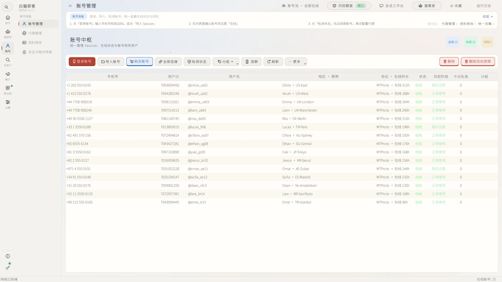

# 01. 账号管理

> **一句话结论**：账号管理是所有功能的起点。先在这里把账号登录或导入进来、连上线、检测好状态，其他功能才能用它们干活。



页面标题是「账号中枢」，顶部有三个计数：**全部、在线、风险**，一眼看出账号池的健康度。

---

## 一、工具栏上每个按钮是干什么的

| 按钮 | 作用 |
| :--- | :--- |
| 风控额度：默认 | 每个账号每 24 小时能发多少消息、进多少群的上限。默认按号龄分阶段（新号严、老号逐步放开）；点这里可以看明细，也可以自定义或关闭（关闭后风险自负） |
| 登录账号 | 输入手机号，用验证码登录一个账号 |
| 导入账号 | 导入 session / tdata / 压缩包（zip）。**可以直接把文件、文件夹或压缩包拖进下面的列表**，软件自动识别格式 |
| 购买账号 | 打开官方推荐的账号渠道 |
| 全部连接 | 把列表里的账号批量连上线 |
| 检测状态 | 核实每个账号的真实状态（正常 / 冻结 / 双向受限 / 失效） |
| 分组 | 给账号分组，批量任务里可以按分组一键选账号 |
| 退群 | 让选中的账号批量退群 |
| 刷新 | 重新读取列表 |
| 更多 | 批量 API 上号、迁移旧 Session、导出、断开、申诉、打开数据目录 |
| 删除 / 删除双向受限 | 删除选中账号；或一键删除状态为双向受限、冻结、封禁、需人工验证的账号 |

列表的列：手机号、用户 ID、用户名、名字、姓氏、状态、风控阶段、今日私信、分组。

---

## 二、第一次使用：把账号导进来

1. 点「导入账号」，选 session 文件、tdata 文件夹或 zip 压缩包；也可以直接把它们拖进列表；
2. 勾选要启用的账号，点「全部连接」；
3. 看「状态」列，显示在线就说明账号进入了就绪池，其他功能可以调度它；
4. 再点一次「检测状态」，确认没有受限账号。

没有现成的账号文件，就点「登录账号」，输入手机号并输入收到的验证码。

> 新买来的账号，先去 [02. 代理管理](02_proxy.md) 给它绑定固定代理，再去 [03. 安全与格式转换](03_convert.md) 做一次体检，然后静置 12～24 小时再开始业务。

---

## 三、检测状态：结果怎么看

「检测状态」只记录**核实过的**结论：

- **冻结**：按 Telegram 自己的冻结信号判断；
- **双向受限**：只认本次 @SpamBot 的**新回复**，不会读到旧回复；临时受限会显示解封时间；
- **未核实**：@SpamBot 没回复、被限流或回复看不懂时显示「未核实」。**未核实不是状态，不会覆盖账号已有的状态，也不要当成正常。**

注意：
- 确认账号正常后，之前遗留的「受限」标记会自动解除（否则风控会一直隔离它）；
- 某个群里被禁言只代表在那个群发不了言，**不会**让整个账号变成受限；
- 冻结检测按 Telegram 公开的信号编写，没有在大量真实被冻结的账号上验证；遇到问题可以用「查询 SpamBot 完整回复」取原文反馈。

---

## 四、受限账号怎么办

- **剔除 / 删除受限账号**：只清理**已核实**的账号；没连上的账号不算受限，不会被清理；标记为受限的会先重新检测，确认了才处理。
- **申诉**（在「更多」里）：选中受限账号点「申诉」，软件自动走完 @SpamBot 的流程：
  - 遇到人机验证时，会用你电脑上的浏览器（优先 Chrome）打开验证页，页面上的验证自己通过，通过后软件自动继续；
  - **「已提交」只表示申诉资料已提交，不等于已解封**。官方复核通常要几个小时到一两天，官方没有承诺时限，期间不要重复申诉；
  - 之后再点「检测状态」核实是否真的解除。

---

## 五、账号分组

工具栏「分组」可以：新建分组（同时放入选中账号）、把选中账号加入或移出、重命名、删除。

- 一个账号可以在多个组，表格有「分组」列；
- 删除分组不会删账号；删除账号会自动从分组里移走；
- 采集、群发、加群等页面选账号时可以按分组一键选。

---

## 六、让猫管家帮你做

```text
检查我所有账号的真实状态，哪些能正常发消息，哪些受限或掉线？每个受限的告诉我原因，没法核实的要写「未核实」。
```

更多说法见 [26. 提示词库](26_prompt_library.md)。

---

## 七、常见问题

**一批账号都显示「错误」？**
最常见的原因是同一个 session 被多处同时使用（从号商买来的号，卖家手里留有同一把登录密钥）。见 [按症状查原因](../faq/03_by_symptom.md)，买来的号建议用 [03 安全与格式转换](03_convert.md) 里的「卖家号接管」换成自己的新会话。

**导入后账号一直是待连接？**
检查代理能否直连 Telegram；检查该 session 是否已在其他设备被强制登出。

**新号能不能马上大量发？**
不能。风控额度会按号龄限制；建议静置 12～24 小时再开始，并且一个 IP 不要同时登录几十个账号。

---

<p align="center">
  <a href="../USER_MANUAL.md">返回总目录</a> | <a href="02_proxy.md">下一篇：代理管理</a>
</p>
