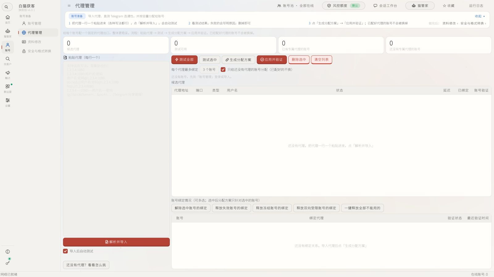

# 02. 代理管理

> **一句话结论**：给每个账号配一个固定的代理出口，一号一 IP，是防关联封号最基础的一步。流程只有四步：**粘贴代理 → 测试 → 生成分配方案 → 应用并验证**。



页面顶部有四个统计：**候选代理、测试可用、已有专属代理的账号、还没有专属代理的账号**，一眼看出还差多少。已经配好代理的账号不会被换掉。

---

## 一、操作步骤

### 1. 粘贴代理
把代理一行一个粘进「粘贴代理」框，格式常见的有：

```text
IP:端口:用户名:密码
socks5://用户名:密码@IP:端口
```

点「**解析并导入**」。勾选「导入后自动测试」会在导入后立刻测一遍。不知道怎么挑代理，点「还没有代理？看看怎么挑」。

### 2. 测试
- 「测试全部」或「测试选中」：并发检测真实连通性（直测 Telegram）和延迟；
- 列表列：代理地址、端口、类型、用户名、状态、延迟、已绑定、账号验证。

### 3. 生成分配方案
- 「每个代理最多绑定 N 个账号」：范围 1～3，**建议 1～3，越少越稳**；
- 勾选「只给还没有代理的账号分配（已配好的不换）」；
- 在下方「账号绑定情况」里可以多选账号，选中后方案只针对选中的账号；
- 点「**生成分配方案**」，先看方案，再决定要不要应用。

### 4. 应用并验证
点「**应用并验证**」：软件把代理绑定到账号，并**验证账号真的通过这个代理连上了**，结果记在「验证状态」「最近验证时间」。

---

## 二、释放代理名额

账号被封、失效或已删除后，它们还占着代理名额。下面几个按钮只**解除绑定**，不删账号、不断连接：

| 按钮 | 处理谁 |
| :--- | :--- |
| 解除选中账号的绑定 | 你选中的账号；仍在线的账号下次连接时按需重新分配 |
| 释放失效账号的绑定 | 已核实失效（Session 失效 / 被封禁）和已从列表删除的账号 |
| 释放冻结账号的绑定 | 已核实「冻结」的账号（来自「检测状态」的结论） |
| 释放双向受限账号的绑定 | 已核实「双向受限」的账号 |
| 一键释放全部不能用的 | 以上全部一次处理 |

**只处理已核实的账号**：离线、连接失败这类「没连上」的账号不算失效，不会被释放。

---

## 三、选代理的建议

- 优先**住宅代理或机房原生静态 IP**；
- 代理所在的国家 / 地区，最好和账号手机号的国家区号一致；
- 一个代理绑 1～3 个账号，不要更多。

> 没有代理就连接账号时，账号会走你这台电脑的本机网络，和别的号共用一个 IP，容易被关联。猫管家连接这类账号之前会先弹出确认。

---

## 四、让猫管家帮你做

```text
哪些账号还没有绑定专属代理？给我一个一号一 IP 的绑定方案预览，先别执行。
```

---

## 五、常见问题

**测试全部失败？**
先确认代理的格式、账号密码正确；再确认这台电脑能访问该代理（防火墙、本机网络）。

**导入了代理，但列表是空的？**
格式不对时会被丢弃。每行一个，字段用冒号分隔，或使用 `协议://` 的完整写法。

**分配方案里有的账号没有代理？**
代理数量不够：候选代理数乘以「每个代理最多绑定」不够账号数。再导入一些，或调大这个数（最大 3）。

---

<p align="center">
  <a href="01_account.md">上一篇：账号管理</a> | <a href="03_convert.md">下一篇：安全与格式转换</a>
</p>
