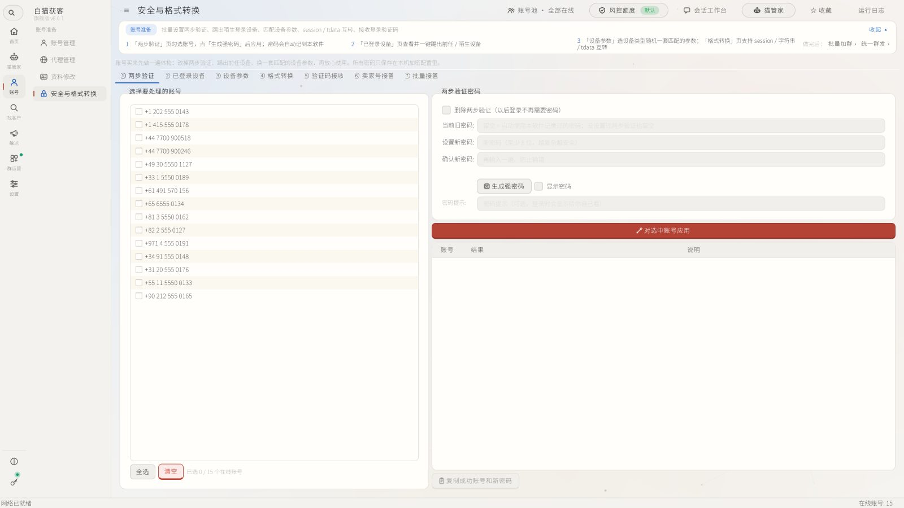

# 03. 安全与格式转换

> **一句话结论**：账号买来先在这里做一遍体检：改掉两步验证、踢出前任设备、换一套匹配的设备参数、必要时接管卖家会话，再放心使用。格式互转也在这里。所有密码只保存在本机的加密配置里。



页面分 7 个页签，按「买来的号」的处理顺序排列：

| 页签 | 用来做什么 |
| :--- | :--- |
| ① 两步验证 | 给账号设置 / 更换 / 删除两步验证密码 |
| ② 已登录设备 | 查看账号登录在哪些设备上，踢出陌生设备 |
| ③ 设备参数 | 设置账号登录时对 Telegram 报告的「设备型号、系统、软件版本」 |
| ④ 格式转换 | session / tdata / 字符串 之间互相转换 |
| ⑤ 验证码接收 | 把软件里的账号登录到别的设备时，第一时间拿到验证码 |
| ⑥ 卖家号接管 | 单个买来的号：换出只属于你的新密钥 |
| ⑦ 批量接管 | 一次接管很多个买来的号 |

---

## ① 两步验证

1. 在「选择要处理的账号」里勾选账号（只列在线账号）；
2. 填「设置新密码」（至少 8 位），再确认一遍；可点「生成强密码」；可填「密码提示」；
3. 「当前旧密码」留空 = 自动使用本软件记录过的密码；没设置过两步验证也留空；
4. 选项「删除两步验证」：勾上后以后登录不再需要密码；
5. 点「对选中账号应用」；完成后可点「复制成功账号和新密码」保存。

---

## ② 已登录设备

刚买来的账号建议先「踢出其他设备」，把前一个主人和陌生设备都清掉。

- 「查询登录设备」：列出设备、软件、IP、地区、最近活跃；
- 「踢出选中的设备」「踢出其他所有设备（只保留本软件）」；
- 「批量踢出所有在线账号的其他设备」：一次处理所有在线账号，每个账号只保留本软件的登录，做完会**重新读取设备列表核实**；没连接的账号会跳过。

> 账号登录不满 24 小时时，Telegram 可能限制踢出其他设备，页面里有对应的提示。

---

## ③ 设备参数

每个账号登录时会向 Telegram 报告「我是什么设备」。型号、系统、软件版本要互相匹配（比如 iPhone 就该配 iOS），一眼看上去不对劲的组合更容易被风控。

1. 选「设备类型」：随机（任意平台）、电脑 · Windows、电脑 · macOS、苹果 · iPhone / iPad、安卓手机；
2. 点「按所选类型随机一套匹配的参数」，或自己填设备型号、系统版本、软件版本；
3. 选「范围」：全局默认（所有没单独设置的账号），或只用于选中的某个账号；
4. 点「保存」。「清除该账号的单独设置」可以回到全局默认。

---

## ④ 格式转换

支持 Telethon `.session`、Pyrogram `.session`、两种字符串、Telegram Desktop tdata 之间**任意互转**，全部在本机完成，不联网。

1. 点「选择文件…」或「选择文件夹（批量 / tdata）…」，选一个文件夹可以一次转换里面所有账号；
2. 「转换成」选目标格式，「保存到」选输出位置；
3. tdata 设置过本地密码才需要填「源 tdata 本地密码」；转成 tdata 且文件里没有账号 ID 时才需要填「账号 ID」（只对单个账号生效）；
4. 点「开始转换」；或点「**转换并导入账号管理**」：不管原来是什么格式，自动转成本软件使用的 Telethon session 并加入账号管理（需要联网验证登录状态）；
5. 「打开输出文件夹」查看结果。

---

## ⑤ 验证码接收

要把软件里的账号登录到手机、平板或另一台电脑时：

1. 在「监听账号」下拉里选中这个账号，点「开启监听」；
2. 再去新设备上登录；Telegram 的验证码会发到已登录的客户端，软件会第一时间显示；
3. 点「复制验证码」，或勾选「收到后自动复制」。

---

## ⑥ 卖家号接管（单个）

买来的 session / tdata 和卖家共享同一把登录密钥，**卖家手里留有副本，只踢设备杀不掉**。接管 = 把卖家的密钥当成一次性的「接码桥」，换出只属于你的新密钥，再让卖家的密钥作废。

1. 选「卖家给的 .session 文件，或 tdata 文件夹」，或从账号池选择已导入的号（**接管会另用一份工作区副本，同一把密钥同一时刻只能有一个客户端：在线的号请先在账号池里断开**）；
2. 手机号（包裹里没有时才填）；tdata 本地密码、卖家给的两步验证密码（没有就不填）；
3. 可先点「预览（离线，不连接 Telegram）」看看会做什么，再点「体检：列出账号登录的设备」，勾选需要「保留」的设备；
4. 选项：「先由卖家会话清掉账号上其他设备」（推荐，只动别人的会话，卖家密钥在新会话验明之前原样保留）、「给新会话设置两步验证」（软件生成强密码，只保存到本机文件）；
5. 点「开始接管…」；如果验证码没有在卖家会话里收到，页面会要你输入拿到的验证码并「提交验证码」；
6. 看「进度与结果」；需要时点「继续（resume）」；接管完成但新会话没能放进账号库时点「补入账号库」；「打开新两步验证密码所在文件夹」可找到新密码。

安全设计：新会话没验明之前绝不会注销卖家会话；账号有两步验证而密码缺失或不对时会干净中止，卖家密钥原样保留；验证码、2FA、密钥不会出现在日志里；接管期间账号处于隔离状态，不参与业务动作。

---

## ⑦ 批量接管

1. 点「选择文件夹并扫描…」（里面可以有很多 `.session` 文件或很多个 tdata 号包，可以多层目录），或点「加入账号池里的离线号」；
2. 表格里勾选号包；卖家给了两步验证密码但包里没有时，点「给勾选的号提供 2FA…」；
3. 「同时接管的号数（线程）」建议 1～3：每个号都会请求一次官方登录验证码，同时太多会被 Telegram 限流；
4. 选项同单个接管；点「开始批量接管…」；
5. 每个号的状态见表格：「等验证码」的号请到 ⑥ 里提交验证码，「部分完成」的号到点后在 ⑥ 点继续。

---

## 让猫管家帮你做

```text
我刚买了一批账号，请先帮我检查哪些账号上还登录着别的设备，给我一个处理方案预览，先别执行。
```

接管类动作会要求你明确确认。

---

## 常见问题

**转换后账号登录不上？**
确认源格式本身有效；tdata 有本地密码要填；转 tdata 缺账号 ID 要填。

**为什么接管后账号还有别的设备？**
你自己的别的客户端（比如接码用的）也登录着这个号时，先「体检」并勾选保留。

---

<p align="center">
  <a href="02_proxy.md">上一篇：代理管理</a> | <a href="04_mcp_settings.md">下一篇：设置与 MCP</a>
</p>
