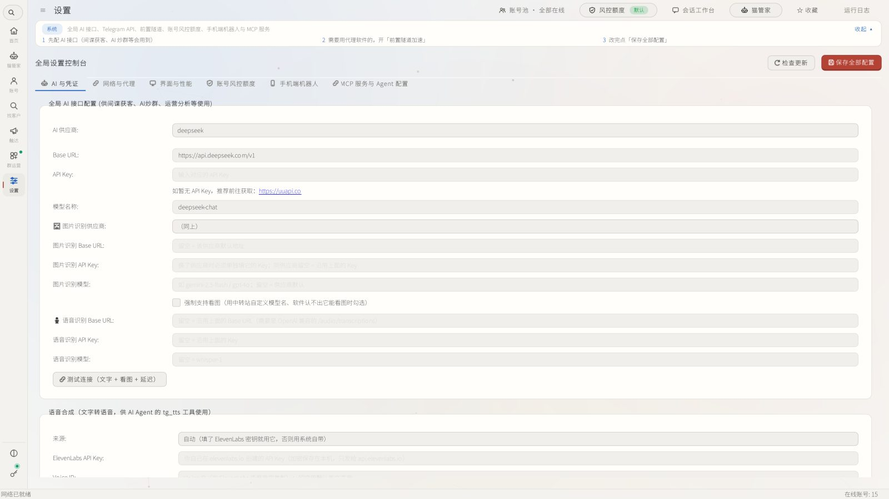

# 04. 设置：AI 接口、网络、风控额度与 MCP

> **一句话结论**：设置页集中了全局参数：AI 接口、网络、界面、账号风控额度、手机端机器人入口，以及让外部 AI Agent（Claude、Cursor 等）接管软件的 **MCP 服务**。改完点右上角「保存全部配置」。

页面标题「全局设置控制台」，右上有「检查更新」和「保存全部配置」。6 个页签：

| 页签 | 内容 |
| :--- | :--- |
| AI 与凭证 | 全局 AI 接口、图片 / 语音识别、语音合成、Telegram API |
| 网络与代理 | 智能网络、手动指定本地代理 |
| 界面与性能 | 界面语言、动效、缓存释放 |
| 账号风控额度 | 每个账号每 24 小时的私信、发言、拉人、进群上限 |
| 手机端机器人 | @wchjbot 入口 |
| MCP 服务与 Agent 配置 | 一键配置本机 AI Agent、MCP 开关、连通性测试 |

---

## 一、AI 与凭证

### 全局 AI 接口
供「间谍获客、AI 炒群、运营分析、入群验证兜底」等功能使用。

| 项 | 说明 |
| :--- | :--- |
| AI 供应商 | openai / deepseek / ollama / gemini / mcp_agent |
| Base URL、API Key、模型名称 | 按所选供应商填写；没有 Key 可到 <https://uuapi.co> 获取 |
| mcp_agent | **不需要 API Key**：软件需要 AI 文字时，请求排队，由已经通过 MCP 接入的 AI Agent 代答 |
| 图片识别 / 语音识别 | 主模型便宜但不能看图时，图片题交给这里单独配置的看图模型；语音识别默认 `whisper-1` |
| 测试连接 | 一次测文字、看图和延迟 |

> **猫管家有它自己的模型设置**（猫管家页右上角「设置」），和这里互不影响；想沿用这里的配置，在猫管家设置里点「沿用『设置』里的 AI 配置」。详见 [24. 配置模型接口（API）](24_cat_api_setup.md)。

### 语音合成（文字转语音）
供 AI Agent 的 `tg_tts` 工具使用：来源可选「自动 / ElevenLabs / 系统自带（Windows、macOS，本地免费）」。ElevenLabs 需要你自己的 API Key 和 Voice ID，会把要合成的文字发给它并消耗你自己的字符额度；系统没有中文语音包时，软件会如实告诉你，不会用英文声音念中文。生成的音频可作为「统一群发」的语音条，或在 VoIP 电话里播放。

### Telegram API
商业版已预置默认 API 凭证，通常无需修改；如需使用自己的，可以在这里覆盖。

---

## 二、网络与代理

- **智能网络（推荐）**：软件自动检测并选择最佳网络通路；先开软件后开加速软件、或中途切换节点，都会自动恢复，无需设置。「重新检测」可以手动再测一次；
- **手动指定本地代理（高级）**：仅在智能网络无法识别你的代理软件时才需要。勾选「启用手动代理」，选隧道类型（socks5 / http），填本地地址和端口，或点「自动探测本地代理」。手动指定的优先使用，失效时自动退回智能检测。

---

## 三、界面与性能

- **界面语言**：跟随系统语言 / 简体中文 / 繁體中文 / English，选完立即生效；
- **界面动效**：自动（推荐，电脑较慢时自动关闭）/ 始终开启 / 关闭（最省资源）；
- **缓存释放**：账号的 Session 文件里会堆积缓存，账号多时占几百 MB。点「扫描占用」看可释放的空间，再点「清理账号缓存」或「清理临时缓存文件」。

---

## 四、账号风控额度

软件默认按账号的「号龄阶段」限制每天能私信、群内发言、拉人、进群的数量，用来保护新号。这里把决定权交给你：

| 额度模式 | 含义 |
| :--- | :--- |
| 按号龄分阶段限额（默认） | 新号几乎不能主动发信，随天数逐步放开；红灯账号（被封、失效、@SpamBot 受限）暂停 |
| 自定义全局额度 | 每个账号统一用你填的数字（私信、群内发言、拉人进群、进群 / 进频道，每 24 小时） |
| 关闭额度拦截 | 不限额，**风险自负** |

改完点「应用额度设置（立即生效）」。额度对猫管家和 MCP 同样生效。

---

## 五、MCP 服务与 Agent 配置

MCP 让外部 AI Agent（Claude、Codex、Cursor、Antigravity、Gemini CLI、Windsurf、VS Code 等）直接调度软件的全部核心能力，目前共 **62 项**工具。

1. 勾选「允许导出并由 Agent 按需启动 MCP 全功能接管」；
2. **「仅只读模式」默认关闭**：关闭时 Agent 可以执行真实发信、群发、建群等操作；只想让 Agent 看数据就勾上；
3. 点「**一键配置本机所有 Agent（并验证能真正连上）**」：自动识别本机已安装的 Agent，把本程序的 MCP 服务写进它们的配置，并验证真的连得上；下面每个 Agent 一行，显示状态，需要时点「写入」；
4. 备用：「复制『官方新手提示词』」「复制『小白一键配置提示词』」「复制通用 MCP JSON」「导出 OpenAI Tools Schema」；
5. 点「测试 MCP 连通性」确认可用。

> 有副作用的工具默认 `dry_run=true`，Agent 必须先预览、把副作用告诉你并等你确认。账号风控额度对 MCP 同样生效。详见 [MCP 一键配置](../mcp/01_quickstart.md) 与 [62 项工具参考](../mcp/03_tools_reference.md)。

---

## 常见问题

**改了设置没生效？**
点右上角「保存全部配置」。风控额度要点「应用额度设置」。

**一键配置后 Agent 里看不到工具？**
重启对应的 Agent；仍不行点「刷新状态」，看是否显示「指向旧位置」，点「写入」修复。

---

  <a href="03_convert.md">上一篇：安全与格式转换</a> | <a href="05_collect.md">下一篇：统一采集</a>

