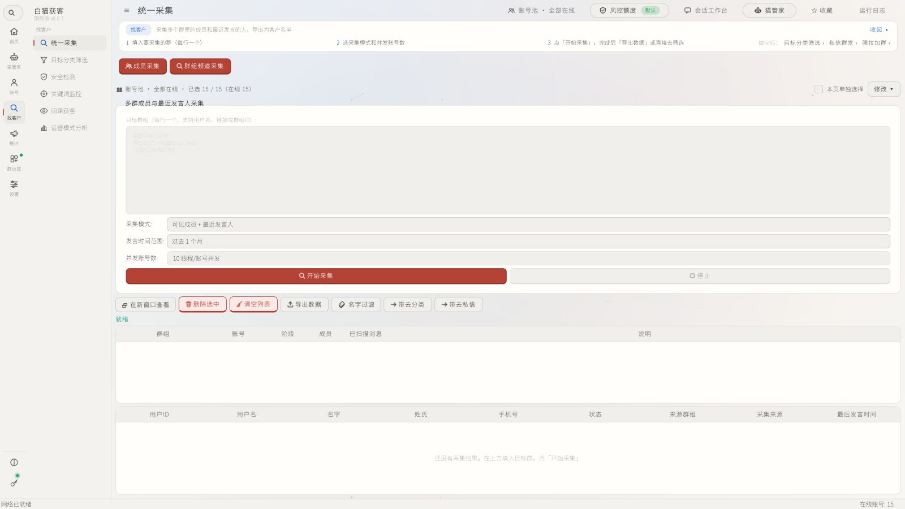

# 05. 统一采集：成员采集与群组频道采集

> **一句话结论**：这个页面有两种采集：**成员采集**（从别人的群里采出成员和最近发言的人，做成客户名单）和**群组频道采集**（按关键词到搜索机器人里找公开的群和频道）。采到的名单可以一键带去分类、私信或加群。



页面顶部是账号池：可以「按分组选择」账号，或勾选「本页单独选择」让这个页面用自己的账号选择；「选择全部」「仅选在线」「清空选择」「刷新账号」。没有账号时点「去账号管理」。

---

## 一、成员采集

用来采**多个群里的成员和最近发言的人**。

### 步骤
1. 在账号池里选好在线账号；
2. 在「目标群组」里一行一个填群：支持用户名、链接或群组 ID；
3. 选「**采集模式**」：可见成员 + 最近发言人 / 仅可见成员 / 仅最近发言人；
4. 选「**发言时间范围**」：过去 1 个月 / 3 个月 / 1 年（越近，后面私信的回复率越高）；
5. 「并发账号数」：1～200 路；实际同时工作的账号 = min(并发线程, 账号数, 群数)；
6. 点「**开始采集**」。

### 看结果
- 上方是**每群一行的实时进度表**：群组、账号、阶段、成员数、已扫描消息、说明；每个群读完新成员立刻进下方列表；
- 下方是结果列表：用户 ID、用户名（带 `@`）、名字、姓氏、手机号、状态、来源群组、采集来源、最后发言时间；
- 点「在新窗口查看」，可以搜索、筛选、全选、复制、导出；

### 采完以后
| 按钮 | 作用 |
| :--- | :--- |
| 导出数据 | 保存为 CSV |
| 名字过滤 | 按「目标分类筛选」里设置的关键词和重复名字规则，把疑似广告 / 批量注册的成员移出列表（先预览数量，确认后才移除） |
| 带去分类 | 把名单追加到 [13. 目标分类筛选](13_target_classifier.md) 的输入框（不会自动开始） |
| 带去私信 | 把名单追加到 [08. 私信群发](08_private_send.md) 的目标框（不会自动开始） |
| 删除选中 / 清空列表 | 整理列表 |

### 小知识
- 群数不多于可用账号数、读「最近发言人」时，闲置账号会按时间段分摊同一个大群（最多再借 7 个账号）；借来的账号读不了的那段由主账号补读，仍失败会如实标「结果不完整」；
- 隐藏了成员列表的群，用「仅最近发言人」仍能采到真实说话的人。

---

## 二、群组频道采集

按关键词到搜索机器人和 Telegram 搜索里，找**公开的群组 / 频道**。

1. 「关键词」一行一个（例如：营销、跨境电商、加密货币）；
2. 勾选「搜索源」；还可以「添加搜索机器人」（输入 `@somebot` 或链接），「删除选中的自定义源」；
3. 「每个机器人最多翻 N 页」（1～10）、「并发线程」（1～10，并发越高越容易触发限流）；
4. 点「开始搜索」，会弹出「实时动态」窗口边搜边显示；
5. 结果窗口里可以筛选、全选、复制、导出；用「带去分类」或「带去加群」把链接送到下一步（不会自动开始，可以只带选中的一部分）。

> 搜索机器人的回复格式和翻页没有在大量真实环境验证过，出现结果不全属于正常，请如实反馈。

---

## 三、让猫管家帮你做

```text
请从这个群采集成员：【群链接】。只要最近 30 天发过言的真人，过滤掉机器人和死号，采集完告诉我数量并导出 CSV。
```

```text
帮我搜索和「【行业关键词】」相关的 Telegram 群和频道，列出名称、人数、是否活跃，我挑选后再决定加哪些。
```

---

## 四、常见问题

**采到的人很少？**
群设置了隐藏成员，改用「仅最近发言人」；或把发言时间范围放宽。

**采集一半停了？**
账号被限流时会放慢并提示；降低并发线程，换账号再试。

**导出的 CSV 乱码？**
用支持 UTF-8 的软件打开（比如 WPS / Excel 里选 UTF-8 导入）。

---

<p align="center">
  <a href="04_mcp_settings.md">上一篇：设置</a> | <a href="06_keyword_monitor.md">下一篇：关键词监控</a>
</p>
