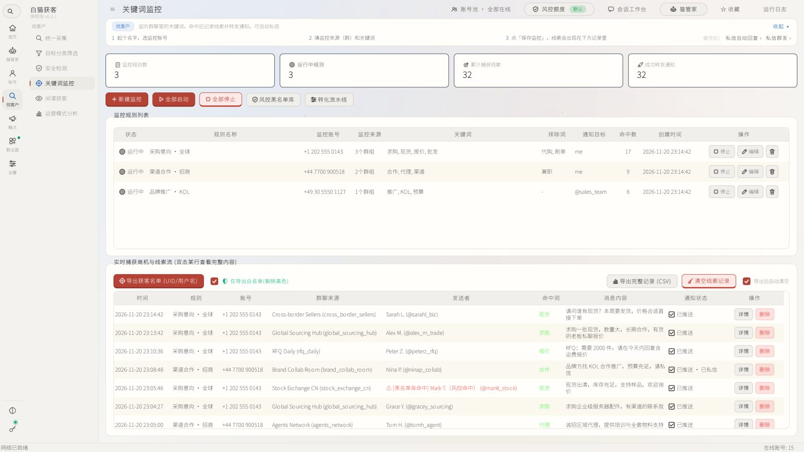

# 06. 关键词监控

> **一句话结论**：监听群里的关键词，有人提到就立刻记成线索，并可以转发通知给你。它盯着几百个群、不用你 24 小时刷屏，客户刚发出需求你就能第一时间联系。



页面顶部四个统计：**监控规则数、运行中规则、累计捕获线索、成功转发通知**。下面左边是「监控规则列表」，右边是「实时捕获商机与线索流」（双击某行查看完整内容）。

---

## 一、三步开始

### 1. 新建监控
点「新建监控」，填写：

| 项 | 说明 |
| :--- | :--- |
| 名称（必填） | 如「币圈群-兼职线索」 |
| 监控账号（必填） | 用哪个在线账号来监听；账号要已加入目标群 |
| 监控来源 | 每行一个：`@group`、`-1001234` 或 `me`；**留空 = 监听该账号所有已加入的群聊**。也可以点按钮从账号已加入的群里勾选 |
| 关键词（必填） | 每行一个，**命中任意一个就触发** |
| 排除词 | 每行一个，消息里含此词就忽略（如：机器人、广告、招聘） |
| 关键词按正则匹配 | 需要时勾选；默认是普通文字匹配 |
| 区分英文字符大小写 | 默认不区分 |
| 通知转发到 | `me`（收藏夹）、`@用户` 或数字 ID，留空不转发 |
| 命中风控黑名单的发信人后，仍然继续通知 | 默认命中黑名单的人不再通知，勾选后仍通知（但会红色高危标记） |
| Webhook | 命中时 POST 一份 JSON 到你的地址，留空不推送 |
| 信誉核验公群 | 选填：核验发信人是否在这个担保公群里 |

### 2. 启动
点「全部启动」（或在规则行里单独启动）。规则状态显示运行中，就开始后台监听。

### 3. 看线索
群里有人触发关键词，右侧线索流里会出现一行：时间、规则、账号、群聊来源、发送者、命中词、消息内容、通知状态。**双击一行**看完整内容、发送者信誉和风控状态。

---

## 二、导出与风控黑名单

| 按钮 | 作用 |
| :--- | :--- |
| 导出获客名单（UID / 用户名） | 只导出去重后的 `@用户名` 或 UID，方便一键导入「私信群发」或「强拉加群」 |
| 仅导出白名单（剔除高危） | 导出时自动比对风控黑名单库，剔除高危 / 恶意用户 |
| 导出完整记录（CSV） | 整张线索表 |
| 导出后自动清空 | 导出后自动清空线索记录，不再二次确认 |
| 清空线索记录 | 手动清空 |
| 风控黑名单库 | 管理恶意用户黑名单；命中时红色高危预警，可对恶意用户一键拉黑 |
| 转化流水线 | 监听即转化：命中后自动去重、过滤机器人 / 黑名单、分配已养号账号并模拟真人私信（推荐替代旧版自动私信） |

> 风控信誉核验：自动比对本地黑名单库（跑分、老赖、同行等标签），**只用真实读到的数据**，读不到的显示未核验。

---

## 三、让猫管家帮你做

```text
帮我监听这几个群里出现下面这些关键词的消息：求购、现货、报价、批发。命中后记录成线索并通知我。先告诉我要用哪个账号、监听哪些群，我确认再开始。
```

```text
看一下最近关键词监控命中了多少条线索，哪些词命中最多，有没有命中风控黑名单的发信人？
```

---

## 四、常见问题

**为什么没有命中？**
账号没加入这个群；关键词写错；排除词太宽；规则没启动。「监控来源」留空会监听账号所有已加入的群。

**误报很多？**
加「排除词」；对反复出现的无关发言人用风控黑名单拉黑。

**能自动私信命中的人吗？**
用「转化流水线」。它会去重、过滤机器人和黑名单，用养号账号模拟真人私信，并受账号风控额度限制。

---

<p align="center">
  <a href="05_collect.md">上一篇：统一采集</a> | <a href="07_unified_send.md">下一篇：统一群发</a>
</p>
