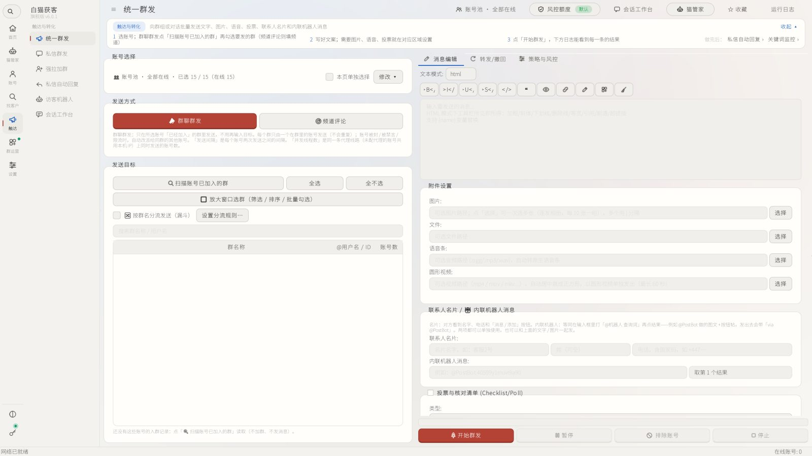

# 07. 统一群发

> **一句话结论**：向群或频道评论区批量发送文字、图片、语音条、圆形视频、投票、联系人名片和内联机器人消息。多账号轮流发，开始前先预检账号和额度，发送后回读核实消息真的在对话里。



页面分三块：**账号选择**（同统一采集的账号池）、**发送方式与目标**、**三个页签（消息编辑 / 转发撤回 / 策略与风控）**。

---

## 一、两种发送方式

### 群聊群发
只在所选账号**已经加入**的群里发，**不用输入目标**。

1. 点「扫描账号已加入的群」：读取所选账号的对话列表（不加群、不发消息），更新下面的群清单；
2. 勾选要发的群（「全选 / 全不选」；账号和群很多时点「放大窗口选群」按名称、类型、账号数、人数筛选，再一键勾选）；
3. **每个群只由一个在群里的账号发送，不会重复**；账号被封、被禁言、限流时，自动改派给同群的其他账号。

「按群名分流发送（漏斗）」：按群名里的关键词把不同内容分给不同的群，互不串（例如群名带「北京」的群发北京版文案），点「设置分流规则…」配置。

### 频道评论
向开启了讨论组的频道的帖子发评论。目标用「获取已加入的频道」或「导入文件」填入；可勾选「评论前先让账号加入频道」。评论模式：最新或历史帖子 / 未来的帖子（实时挂机监听）/ 指定帖子 ID 或链接。

---

## 二、消息编辑页签

| 内容 | 说明 |
| :--- | :--- |
| 文本 | 支持 html / md 两种模式，工具条有加粗、斜体、下划线、删除线、等宽、引用块 |
| 图片 | 点「选择」可一次选多张，会作为一组相册连发（每 10 张一组，文案作为说明） |
| 文件 | 任意文件 |
| 语音条 | 音频（.ogg / .mp3 / .wav）自动转成原生语音条；安装版已内置转码组件 |
| 圆形视频 | 任意视频自动居中裁成正方形、最长 60 秒，以原生圆形视频**单独**发出（不能带文字，文案会另发一条） |
| 联系人名片 | 对方看到名字、电话和「消息 / 添加」按钮 |
| 内联机器人消息 | 填「@机器人 查询词」，每个发送账号用自己的身份向机器人查询；内容必须是该账号有权使用的 |
| 投票与核对清单 | 类型选「核对清单（Checklist）」或「普通投票（Poll）」，可设置允许他人新增任务、标记完成、多选 |
| 发信后发起短暂 VoIP 电话 | 2.5 秒振铃唤醒，提升点击率 |
| 触达顺序 | 勾选后按步骤依次触达同一个人（如：先打电话、打不通发语音条、再发文字） |
| 对方的动态（Stories） | 浏览、点赞、或把内容以「回复了你的动态」发出；对方没有动态时可改发普通私信 |

> 核对清单（Checklist）是 Telegram 高级会员功能：发送账号没有开通会员时，这种方式会发送失败。

---

## 三、转发 / 撤回页签

- **转发模式**：填「源群组」和「消息 ID」（多个用逗号），启用后忽略文本与附件，把已有消息转发出去；
- **自动撤回**：发送后自动撤回，可设置撤回延迟；「假消息」不为空时先替换成这段内容再撤回，为空则直接删除。

---

## 四、策略与风控页签

| 项 | 说明 |
| :--- | :--- |
| 发送并发 | 群聊群发里每群一个账号；这个数字是「同一条代理线路」上同时发送的账号数，不同代理线路互不影响；越大越快，越容易触发风控 |
| 操作间隔 / 休息间隔 | 每次操作之间等多久（秒） |
| 循环控制 | 启用循环发送、循环间隔、最大轮次（0 = 无限） |
| 发不出去的群怎么办（自动修复） | **默认关闭，有风险**：开启后每轮发完，对「没人能发」的群由轻到重处理：账号被禁言则退群重进再过验证（额度不够就不退）、仍不行则让其他健康账号加入并过验证；会占用入群额度。不开启时发不出去的群只在结束时汇总，可放进「待补群清单」自己处理 |
| 防封与重试 | 「提示双向后尝试次数」默认 0（直接换下一个账号，推荐）；「忽略 Telegram 限流冷却」**高风险，默认关闭**：限流后账号自动进入冷却，目标换下一个账号 |

---

## 五、开始发送

1. 点「开始群发」，先弹出**预检面板**：账号状态、今日风控额度、预计耗时、可发的群数、风险提示；异常账号自动排除，确认后才开始；
2. 发送中可以「暂停 / 继续」；「排除账号」让刚被风控的账号从下一条起不再参与，不必暂停；
3. 发送后软件**回读核实消息确实存在**，日志写出消息 ID 与耗时；限流不再在后台悄悄等待，而是按设置冷却或改派；
4. 结束后汇总每个群的结果；没有可用账号的群可放进「待补群清单」，到「批量加群」载入补进去。

---

## 六、让猫管家帮你做

```text
把这条消息发到我加入的这几个群里：「【内容】」。每个群之间随机间隔，先给我预览发送计划，确认后再开始。
```

---

## 七、常见问题

**为什么有的群没发出去？**
群里所有账号都发不了：被管理员单独禁言、账号失效、被踢，或额度不够。结束时会列出原因。

**新号能直接群发吗？**
不建议。风控额度会限制新号；先养号 3 天以上。

---

<p align="center">
  <a href="06_keyword_monitor.md">上一篇：关键词监控</a> | <a href="08_private_send.md">下一篇：私信群发</a>
</p>
