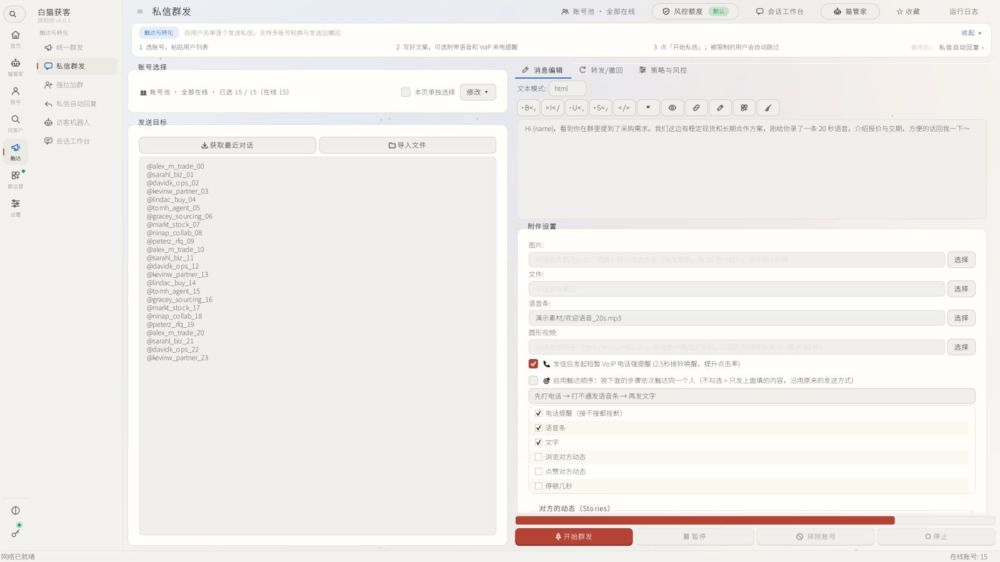

# 08. 私信群发

> **一句话结论**：向一份用户名单逐个发私信。支持文字、图片、语音条、圆形视频、联系人名片、内联机器人消息，还能先浏览 / 点赞对方的动态再发消息，多账号轮换，被限制的用户自动跳过。



> **视频教程**：[私信群发（约 2 分钟，带配音和字幕）](../getting_started/tutorials.md)

页面顶部的三步提示：**1 选账号，粘贴用户列表；2 写好文案，可选附带语音和 VoIP 来电提醒；3 点「开始群发」，被限制的用户会自动跳过**。

---

## 一、三步开始

### 1. 选账号并填目标
- 在左边「账号选择」里选账号（可按分组选）；
- 在「发送目标」框里**一行一个用户名**（`@用户名` 或 `+国家码手机号`）；也可以点「获取最近对话」从在线账号读取最近的对话，或「导入文件」导入采集的名单；
- 从 [05. 统一采集](05_collect.md) 来的名单，点「带去私信」就会追加到这里（不会自动开始）。

> **手机号也能当目标**：先查通讯录，没有就临时导入联系人解析，解析完立刻删除；对方没注册或隐私不允许时会说明原因。

### 2. 写消息
「消息编辑」页签里：
- 文本模式 html / md，工具条有加粗、斜体、下划线、删除线、等宽、引用块等；
- 变量：`{name}` 会换成对方的昵称，例如 `Hi {name}，在某某群看到您在找……`；
- 「附件设置」：图片（可选多张，连发相册）、文件、语音条、圆形视频；
- 「发信后发起短暂 VoIP 电话强提醒」：2.5 秒振铃唤醒；
- 联系人名片、内联机器人消息的用法和 [07. 统一群发](07_unified_send.md) 一样。

### 3. 开始
点「开始群发」，先看**预检面板**：账号状态与私信额度、预计耗时；新号 / 养号阶段额度很低时会提示，并可一键跳到「设置 → 账号风控额度」调整。确认后开始。

---

## 二、触达顺序：像真人一样先混脸熟

勾选「启用触达顺序」后，按步骤依次触达同一个人；**不勾选 = 只发上面填的内容**。

预设顺序有：先混脸熟（浏览动态 → 点赞 → 停顿 → 文字）、图片 → 文字、文字 → 图片、圆形视频 → 文字、语音条 → 文字、文字 → 联系人名片，以及带电话的顺序。也可以选「自定义步骤」：从浏览动态、点赞、电话提醒、转发并置顶、文字、图片、文件、语音条、圆形视频、名片、内联机器人消息、停顿里勾选并排序。

规则：
- 每一步失败只记日志、继续下一步；缺内容的步骤跳过；所有步骤都没做成才算这个人失败；
- 启用顺序后，「发信后打电话」与「浏览 / 点赞」改由步骤决定。

### 对方的动态（Stories）
- **浏览**对方的动态（全部标记已读）；
- **点赞**（可选表情，也可随机）；
- **内容回复到对方的动态**：对方聊天列表里显示「回复了你的动态」+ 你的内容，文字、图片、文件、语音条、圆形视频都可以；
- 选「最新 / 最早 / 随机一条」；「对方没有动态时改发普通私信」可以兜底；对方挂在个人主页的置顶动态也会被使用。

注意：回复动态**绕不过对方开启的「付费消息」**；Telegram Premium 账号可以绕过「仅联系人可发」的限制。批量对陌生人浏览 / 点赞同样有被风控的可能，请控制节奏。

---

## 三、策略与风控

「策略与风控」页签的各项（并发、操作间隔、休息间隔、循环、自动修复、重试策略）和 [07. 统一群发](07_unified_send.md) 相同。私信相关的建议：

- 每个账号每天控制在 20～40 条精准私信以内；
- 「提示双向后尝试次数」保持默认 0，遇到双向限制直接换下一个账号；
- 「忽略 Telegram 限流冷却」保持关闭（高风险）；
- 额度和风控按私信计，受「账号风控额度」限制。

发送后软件**回读核实消息确实存在**；限流时按设置冷却，不再静默等待；对方开启付费消息时，失败原因会明确写出。发送中可以「暂停 / 继续」，也可以「排除账号」。

---

## 四、让猫管家帮你做

```text
我想给下面这批用户发私信，内容是：「【话术】」。请先预览：用哪些账号、每个号发多少条、预计要多久、会不会超过风控额度。我确认之后再真正发送。
【粘贴用户名单】
```

---

## 五、常见问题

**对方收不到 / 显示失败？**
对方关闭了陌生人私信、开启了付费消息，或账号被限制。失败原因会写在结果里。

**回复率低怎么办？**
先发小批量测试话术；话术结尾用轻量提问；用「先混脸熟」顺序；先用 [11. 资料修改](11_profile.md) 把账号包装成和行业匹配的人设。

---

<p align="center">
  <a href="07_unified_send.md">上一篇：统一群发</a> | <a href="09_force_invite.md">下一篇：强拉加群</a>
</p>
