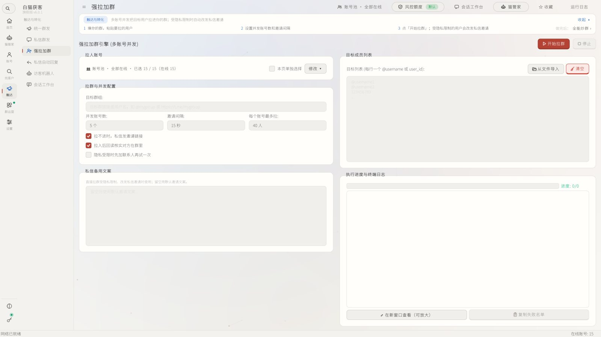

# 09. 强拉加群

> **一句话结论**：用多个账号并发把一批用户拉进**你自己的群**。拉入才算拉入：软件会回读核实对方真的在群里，隐私受限的人不会被算成功。**默认先预览，不会一上来就真实执行。**



---

## 一、开始前先确认

- 负责拉人的账号**已加入目标群**，并且在群里有拉人的权限；
- 目标群允许普通成员拉人（或这些账号是管理员）；
- 你有一份目标成员名单：每行一个 `@username` 或 `user_id`。

点「开始拉群」时，软件会**先做预检**：逐个核实选中的账号确实在目标群里、有拉人权限；不合格的自动排除并写明原因（例如「不在目标群里」「目标群不允许普通成员拉人」）；同时显示今日「拉人」风控额度和预计耗时。

---

## 二、设置与步骤

1. 在「拉人账号」里选账号；
2. 「目标群组」填链接或用户名，如 `@mygroup` 或 `https://t.me/mygroup`；
3. 「目标成员列表」一行一个，或点「从文件导入」；
4. 「拉群与并发配置」：

| 项 | 说明 |
| :--- | :--- |
| 并发账号数 | 同时执行拉群的账号数（不超过可用账号数）；没配独享代理的账号并发超过 3 会有提醒 |
| 邀请间隔 | 同一个账号两次邀请之间的间隔（2～300 秒，上下浮动 20%） |
| 每个账号最多拉 | 每个账号本次最多发起多少次邀请（0 = 不限）；Telegram 对拉人管得很严，新号每天只有几十个甚至更少，超过会被限制 |
| 拉不进时，私信发邀请链接 | 对方隐私设置不允许被拉时，改发私信邀请链接；**只算「已发邀请」，对方点了才入群，不计入「拉入」** |
| 拉入后回读核实对方在群里 | 多一次读取，结果更可信；接口说成功但对方其实不在群里的，不算成功 |
| 隐私受限时先加联系人再试一次 | 成功率低，会在账号里留下联系人记录，不会向对方暴露手机号；默认关闭 |

5. 「私信备用文案」：改发私信邀请时使用，留空用默认邀请文案；
6. 点「开始拉群」；进度和终端日志在下方，「在新窗口查看（可放大）」；
7. 结束后点「复制失败名单」，把没拉成功的用户粘回目标列表重试。

---

## 三、结果怎么看

- **已拉入**：回读确认对方真的在群里；
- **已发邀请**：隐私受限，已改发私信邀请，不等于对方进群；
- **失败**：原因用人话写出，结束时汇总；
- 遇到限流或被限制主动联系陌生人的账号，会单独冷却，不会反复撞墙。

---

## 四、让猫管家帮你做

```text
把这批用户拉进我的群【群链接】。先预览：每个账号拉几个人、哪些人因为隐私设置拉不进、会不会超额度。不要真的执行。
【粘贴用户名单】
```

---

## 五、建议

- 自建群在强拉前先铺垫一些真实讨论记录（可以用 [15. 全能炒群](15_ai_hype.md)），避免新用户进群看到空群就退；
- 新群前几天循序渐进，拉人规模逐步放大；
- 每号单次不要拉太多，间隔不要太短。

---

<p align="center">
  <a href="08_private_send.md">上一篇：私信群发</a> | <a href="10_warmup.md">下一篇：批量加群</a>
</p>
