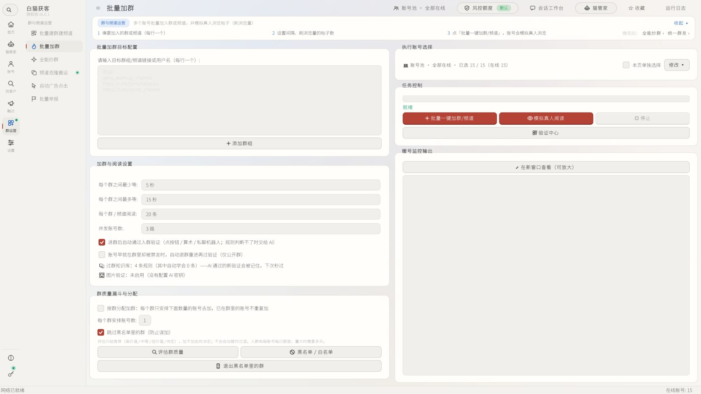

# 10. 批量加群（含养号与入群验证）

> **一句话结论**：让多个账号批量加入一批群或频道，加群后可以模拟真人阅读；遇到入群验证（点按钮、算术题、私聊机器人）软件会自动处理，处理不了的交给 AI。加群有每账号每日额度，量大需要多天，这也是养号的节奏。



---

## 一、基本步骤

1. 「批量加群目标配置」里一行一个填群或频道的链接 / 用户名；或点「添加群组」弹窗里粘贴多个；群发时发现没有可用账号的群，点「载入待补群清单」一键载入；
2. 在「执行账号选择」里选账号；
3. 「加群与阅读设置」：

| 项 | 说明 |
| :--- | :--- |
| 每个群之间最少等 / 最多等 | 随机间隔（秒），越慢越安全 |
| 每个群 / 频道阅读 | 「模拟真人阅读」时每个群或频道从最新往前看几条（1～1000）；**会真实计入频道浏览量** |
| 并发账号数 | 多账号并行、单账号内部串行 |
| 进群后自动通过入群验证 | 点按钮 / 算术 / 私聊机器人；规则判断不了时交给 AI（用「设置 → AI 与凭证」里配置的接口） |
| 账号早就在群里却被禁言时，自动退群重进再过验证 | 仅公开群；账号入群额度不够时不会退群，避免回不去 |

4. 点「**批量一键加群 / 频道**」，先弹出**预检**：账号有没有被冻结、每个账号已加入多少群还能再加多少、今日入群额度、AI 是否就绪、预计耗时与「按每日额度约需几天」；确认后开始；
5. 想只养号不加新群，点「**模拟真人阅读**」；
6. 「停止」随时终止。

---

## 二、群质量漏斗与分配

- **按群分配加群**：开启后每个群只安排下面数量的账号去加（1～5 个），已在群里的账号不重复加；关闭（默认）时每个选中的账号都加入每个群，适合养号；
- **跳过黑名单里的群**：防止误加；
- **评估群质量**：只读取群的公开信息和最近消息打分，**不加群、不发消息**；结果只给推荐（高价值 / 中等 / 低价值 / 待定），加不加由你决定，软件不会自动替你过滤；
- **黑名单 / 白名单**：管理不想加的群和一定要保留的群；
- **退出黑名单里的群**：扫描所选账号已加入的群，找出在黑名单里的，由你勾选并设置并发后批量退出；白名单的群永不推荐退出；私有群会标出，退出后需要邀请链接才能回来。

---

## 三、入群验证

- 支持的类型：点按钮、算术题、私聊机器人、「先加入某频道，再点『完成验证』」等；
- **过群知识库**：AI 通过的新验证会被记住，下次秒过（页面显示已有多少条规则）；
- 图片验证需要配置能看图的 AI（没配置时显示「未启用」）；
- 「**验证中心**」：最近一次批量加群里**没通过验证**的群，在这里看到验证消息（文字 / 按钮 / 图片 / 语音）并处理；
- 找不到群时先用全局搜索兜底，再换账号重试，最后给出人话提示。

---

## 四、让猫管家帮你做

```text
让这几个账号加入下面这些群，并模拟真人浏览一下帖子。先告诉我加群的节奏，避免一次加太多。
【群链接，每行一个】
```

---

## 五、建议

- 新号第一周只加群和自然阅读，第二周再开启轻量私聊；
- 并发超过 3 而账号还在用本机网络时会提醒，可一键跳到 [代理管理](02_proxy.md)；
- 入群额度受「账号风控额度」限制，量大分多天做。

---

<p align="center">
  <a href="09_force_invite.md">上一篇：强拉加群</a> | <a href="11_profile.md">下一篇：资料修改</a>
</p>
