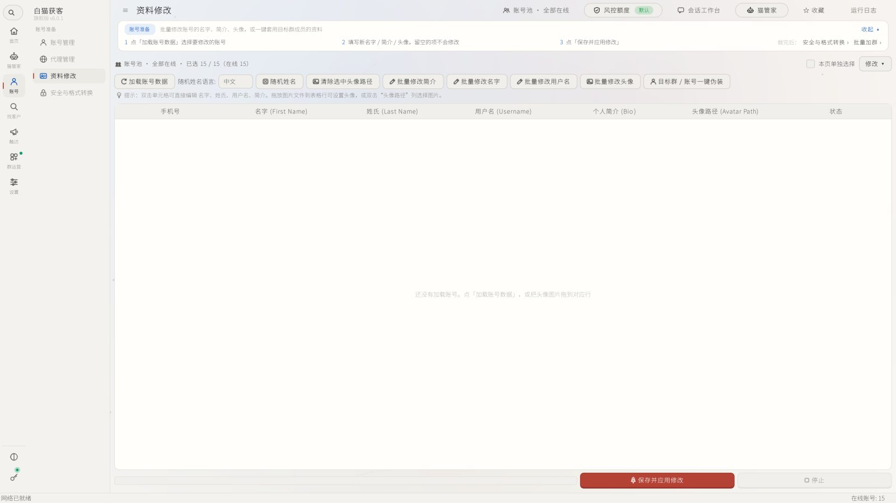

# 11. 资料修改

> **一句话结论**：批量修改账号的名字、用户名、简介和头像，让一批账号看起来像真实、统一的客服或专家人设；也可以一键套用某个目标账号或目标群里真实用户的资料。



---

## 一、操作步骤

1. 点「**加载账号数据**」，把账号的当前资料读进表格（列：手机号、名字、姓氏、用户名、个人简介、头像路径、状态）；
2. 直接**双击单元格**编辑名字、姓氏、用户名、简介；**把图片拖到表格行**可设置头像，或双击「头像路径」列选择图片；
3. 点「**保存并应用修改**」，软件逐个账号提交，结果写在「状态」列；「停止」可中断。

---

## 二、批量工具

| 按钮 | 作用 |
| :--- | :--- |
| 随机姓名 | 按「随机姓名语言」（中文 / 英文）给选中的行生成名字 |
| 批量修改名字 | 批量填写名字 |
| 批量修改简介 | 批量填写简介 |
| 批量修改用户名 | 按「前缀 + 随机后缀」生成，或粘贴一份名单按顺序对应选中的账号；被占用时自动换随机后缀重试 |
| 批量修改头像 | 从文件夹给账号分配头像 |
| 清除选中头像路径 | 去掉已选的头像 |
| 目标群 / 账号一键伪装 | 取指定目标账号或目标群里**真实用户**的名字、用户名、简介和头像，填入表格里选中的行（没选中则填全部）；改的是表格里的内容，确认后再「保存并应用」 |

> 用户名需要全网唯一；被占用时软件会换后缀重试。头像要用你有权使用的图片。

---

## 三、让猫管家帮你做

```text
我想把【这几个账号】的头像、名字和简介改成统一的品牌形象：名字「【名字】」，简介「【简介】」。先预览，不要直接改。
```

---

## 四、建议

- 新买的号先改资料、再绑代理、再静置，最后才发信；
- 人设要和你的业务相符（客服、顾问、采购），简介里不要放违规词；
- 一次不要把大批账号改成一模一样的名字，容易被识别成批量号。

---

<p align="center">
  <a href="10_warmup.md">上一篇：批量加群</a> | <a href="12_security_check.md">下一篇：安全检测</a>
</p>
