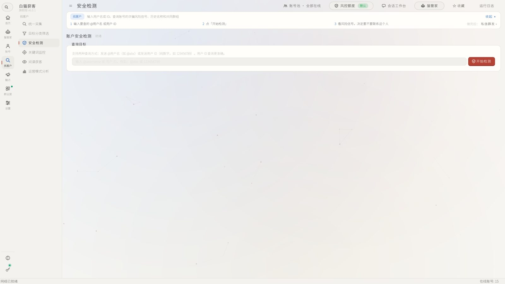

# 12. 安全检测

> **一句话结论**：输入一个 `@用户名` 或用户 ID，查询这个账号的**诈骗风险信号、历史名称和共同群组**，在联系陌生人、接受合作前先判断对方靠不放心。



---

## 一、怎么用

1. 在「查询目标」输入 `@用户名`（如 `@abc`）或纯数字的**用户 ID**；**用户 ID 查询更准确**；
2. 点「开始检测」，状态栏显示进度；
3. 结果分成几块：

| 区块 | 内容 |
| :--- | :--- |
| 风险信号 | 对方账号的风险信号（具体项目以软件显示为准） |
| 账户基本信息 | 名字、用户名、ID 等 |
| 历史名称 / 历史用户名 | 对方改过的名字和用户名 |
| 所在群组（共同群组） | 你的账号和对方共同所在的群：名称、类型、链接 |
| 近期发言 | 在哪些群、什么时间、说了什么 |

---

## 二、怎么看结果

- **风险信号有标记**：谨慎对待，不要预付款、不要点陌生链接；
- **历史名称频繁变化**：可能是改名躲避记录的号；
- **共同群组**：能看出对方活跃在哪些圈子；可以去那些群里了解对方口碑；
- 查不到或读不到的信息会如实显示，不会编造。

---

## 三、让猫管家帮你做

```text
帮我查一下这个用户有没有诈骗风险信号、历史用户名和共同群组：【@用户名 或 ID】。
```

---

## 四、常见问题

**提示没有在线账号？**
先到 [账号管理](01_account.md) 连接账号。

**用户名查不到？**
用户名可能已改，改用用户 ID 查询。

---

<p align="center">
  <a href="11_profile.md">上一篇：资料修改</a> | <a href="13_target_classifier.md">下一篇：目标分类筛选</a>
</p>
