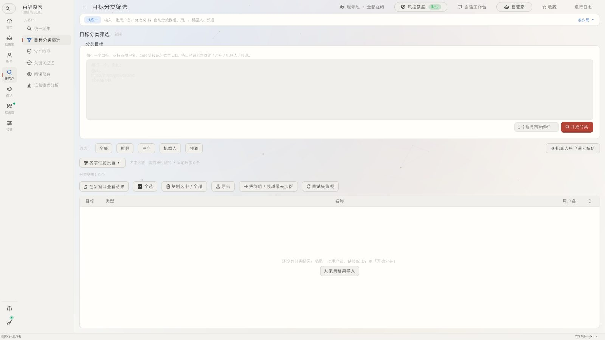

# 13. 目标分类筛选

> **一句话结论**：手里有一批用户名、链接或 ID，不知道哪些是真人、哪些是群、机器人或频道？粘进来，软件自动分成**群组、用户、机器人、频道**，还能按名字规则把疑似广告号和批量注册号过滤掉，再把干净的名单一键带去私信或加群。



---

## 一、操作步骤

1. 「分类目标」里每行一个：`@用户名`、`t.me` 链接或纯数字 UID；也可以点「从采集结果导入」；
2. 「个账号同时解析」：1～100，每个在线账号同一时刻只解析一条（避免被限流）；实际并发 = min(这里的数字, 在线账号数)；
3. 点「开始分类」；
4. 看结果：顶部「筛选」按钮切换 全部 / 群组 / 用户 / 机器人 / 频道；表格列：目标、类型、名称、用户名、ID；
5. 解析失败或未处理的（例如账号被限流），点「重试失败项」，已成功的保留。

---

## 二、名字过滤

点「名字过滤设置」展开（设置会保存）：

- **过滤名字 / 用户名里含这些关键词的**：每行或用逗号分隔一个（如：主页、招商、注册、送、号商），「恢复默认关键词」回到默认；
- **过滤重复名字**：同一个名字出现 N 次及以上（2～1000）就过滤——批量注册的号通常名字雷同；默认整组都过滤，勾选「每组保留第一个」则每个名字留一个；
- 「显示」下拉：通过过滤的 / 被过滤的（看原因）/ 全部。

---

## 三、用结果

| 按钮 | 作用 |
| :--- | :--- |
| 把真人用户带去私信 | 只带「用户」类型（机器人、频道、群不带），追加到 [私信群发](08_private_send.md) 的目标框，不会自动开始 |
| 把群组 / 频道带去加群 | 只带通过名字过滤的群组和频道，追加到 [批量加群](10_warmup.md) 的目标框，不会自动开始 |
| 复制选中 / 全部 | 没选行时复制当前显示的全部；复制的是 `@用户名`（没有用户名用原目标） |
| 导出 | 保存结果 |
| 在新窗口查看结果 | 结果多时用独立窗口：搜索、按类型筛选、全选、复制、导出、带去私信 / 加群 |

---

## 四、让猫管家帮你做

```text
我有一批用户名和链接，在下面。请分成「真人用户、群组、机器人、频道」四类，告诉我各有多少。
【粘贴名单】
```

---

## 五、常见问题

**为什么有些目标分不出类型？**
目标已失效、改名或账号被限流。用「重试失败项」再试。

**名字过滤会不会误伤真人？**
可能。先选「被过滤的（看原因）」检查一遍，再决定是否调整关键词。

---

<p align="center">
  <a href="12_security_check.md">上一篇：安全检测</a> | <a href="14_report.md">下一篇：批量举报</a>
</p>
