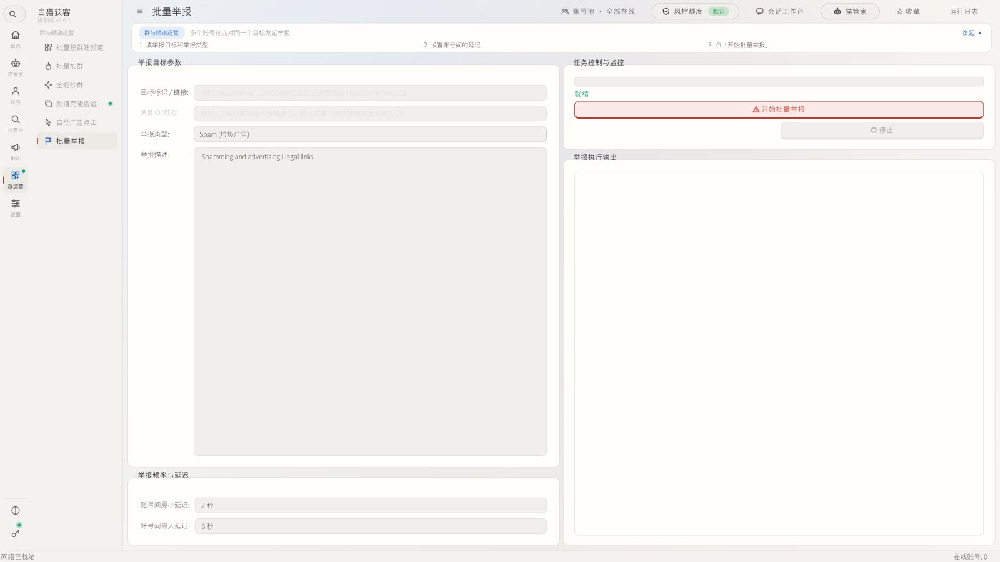

# 14. 批量举报

> **一句话结论**：让多个账号轮流对**同一个目标**（用户、群、频道或某条消息）发起举报。只用于举报真实存在的违规内容，不要滥用。



---

## 一、操作步骤

1. 选「执行账号」（在线账号）；
2. 「举报目标参数」：
   - 「目标标识 / 链接」：`@username`、`-1001234567`，或消息链接 `https://t.me/xxx/123`；
   - 「消息 ID（可选）」：多个用逗号分隔；上面填了消息链接时可以不填；
3. 「举报类型」：Spam（垃圾广告）/ Violence（暴力内容）/ Pornography（成人色情）/ Child Abuse（虐待儿童）/ Other（其它原因 / 自定义）；选 Other 时填「举报描述」；
4. 「举报频率与延迟」：设置「账号间最小延迟」和「账号间最大延迟」（秒），越慢越自然；
5. 点「开始批量举报」，下方「举报执行输出」显示每个账号的结果；「停止」随时终止。

---

## 二、让猫管家帮你做

```text
用这几个账号轮流举报这个垃圾广告群：【@群用户名】，类型选垃圾广告。先告诉我会用哪些账号、间隔多久，我确认再做。
```

举报属于对外动作，猫管家会先让你确认。

---

## 三、注意

- 只举报真实违规的内容；虚假、恶意举报可能让你的账号被限制；
- 举报是否被受理由 Telegram 决定，软件只负责提交，不保证结果；
- 间隔不要设太短，账号之间错开。

---

<p align="center">
  <a href="13_target_classifier.md">上一篇：目标分类筛选</a> | <a href="15_ai_hype.md">下一篇：全能炒群</a>
</p>
