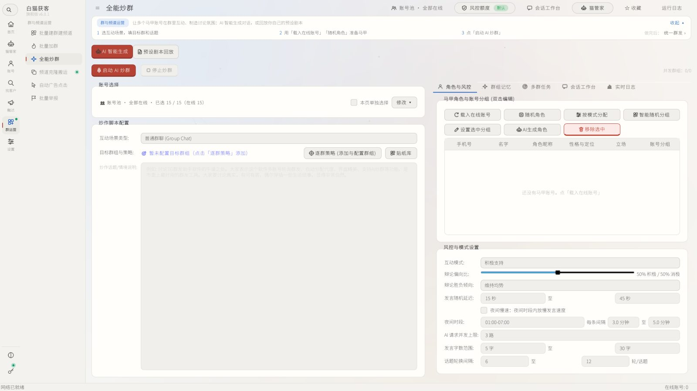

# 15. 全能炒群

> **一句话结论**：让多个账号在群里自然地聊起来，带热气氛。两种玩法：**AI 智能生成**（让大模型扮演多个角色自动聊）和**预设剧本回放**（回放你自己编辑的话术文件，可以多角色、引用、带图片、按北京时间定时）。



页面顶部切换「AI 智能生成」和「预设剧本回放」。AI 智能生成使用「设置 → AI 与凭证」里配置的 AI 接口。

---

## 一、预设剧本回放

### 剧本文件怎么写
一个文本文件（UTF-8 或 GBK），**每行一条**：

```text
账号编号:[rN]正文||图片<HH:MM:SS>
```

- 账号编号：第几个参与账号发这句；
- `[rN]` 引用：引用某条消息；引用方式在设置里选「按账号编号」（引用该账号最近发出的消息，推荐）或「按物理行号」（引用话术文件的第 N 行）；
- `||图片`：这一行附带一张图片，图片到「图片文件夹」里按文件名找；
- `<HH:MM:SS>`：带这个的行按**北京时间**定时发出（交给 Telegram 的定时队列）；不带的是实时消息。

没有现成话术时，点「**从参考群聊天生成剧本…**」：读取参考群最近的聊天，自动整理成剧本文件（只读，不发送）。写好后点「**校验剧本**」检查格式。

### 任务设置
| 项 | 说明 |
| :--- | :--- |
| 任务名称 / 目标群组 | 目标群需要账号已在群里 |
| 参与账号 | 剧本里的账号编号按这里的顺序对应；「对齐模式」下编号 k 对应第 k 个账号（超出时循环） |
| 初次发言延迟 / 再次发言延迟 | 随机区间（秒） |
| 每日运行时段 | 如 `10:00-23:30`（北京时间，只约束实时消息）；留空 = 全天 |
| 夜间慢速 | 夜间时段内放慢发言（例如 01:00-07:00 每 3～5 分钟才发一条），像真人夜里偶尔冒泡 |
| 随机点赞 | 剧本账号发言后，其他账号按概率给它点一个正能量表情（只对实时行生效） |
| 演几轮 | 1～365 轮；定时消息第 k 轮落在第 k 天 |
| 发言前先阅读群消息 | 默认勾选：每个账号开口前先把群里的消息标记已读 |
| 转发非任务账号的发言 | 默认关闭：群里有真人说话时转给你指定的人或群，方便人工接管；**未在真实 Telegram 环境验证** |
| 不转发机器人发的消息 | 默认勾选，转发群不会那么吵 |

点「保存为任务」，然后在「剧本任务」列表里「开始 / 暂停 / 继续 / 停止 / 载入设置 / 删除」。进度与报告里，**定时消息只算「已提交定时队列」，不是已发送**。

### 清理定时消息
- 「清除群内定时任务」：清掉这个任务的账号在目标群里「还没发出」的定时消息（已发出的不受影响）；
- 「查所有群的定时消息」：任务停了或删了，已交给 Telegram 的定时消息仍会发出；这个按钮扫描账号加入的所有群，看哪些群里还有待发的定时消息，并可清理。

---

## 二、AI 智能生成

让大模型扮演多个角色自动聊天：设置话题、人设、参与账号和节奏，点「启动 AI 炒群」；「停止炒群」随时停止。先确认 AI 接口已经配置好并通过「测试连接」。

---

## 三、让猫管家帮你做

```text
在【群链接】里用 3 个账号做一场自然的讨论，话题是「【话题】」，人设分别是：老用户、新用户、咨询者。先把对话脚本发给我看，确认后再发。
```

---

## 四、建议

- 群里有真人时，节奏放慢，别刷屏；
- 先用小号在自己的测试群里试一遍剧本；
- 新群先铺垫真实讨论，再做强拉，见 [09. 强拉加群](09_force_invite.md)。

---

<p align="center">
  <a href="14_report.md">上一篇：批量举报</a> | <a href="16_spy_engine.md">下一篇：间谍获客</a>
</p>
