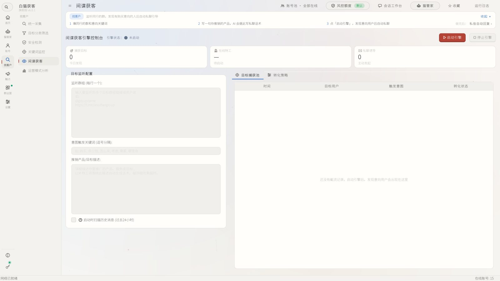

# 16. 间谍获客

> **一句话结论**：监听**同行的群**，发现有购买意向的人后，由闲置账号私聊引导。默认的「隐形潜伏模式」只监听和私聊，**绝不在群里发言**，封号风险最低。



页面顶部是「间谍获客引擎控制台」：引擎状态、「启动引擎 / 停止引擎」，以及四个统计：**捕获目标、今日发现、在线特工、私聊诱导**。下面分两个页签：**目标捕获池**（看截流记录）和**转化策略**（设置怎么做）。

---

## 一、设置步骤

### 目标监听配置
- 「监听群组」一行一个；
- 「意图触发关键词」用逗号分隔，如：购买、多少钱、怎么卖、考虑、需要、哪里有；
- 「推销产品 / 目标描述」：告诉 AI 你卖什么，用来生成私聊话术和判断意图；
- 「启动时扫描历史消息（过去 24 小时）」：引擎启动时先检索过去 24 小时的聊天记录，匹配的也会被捕获。

### 转化策略
| 项 | 说明 |
| :--- | :--- |
| 作业模式：隐形潜伏（推荐） | 零封号风险：只监听意图并私聊，绝不在群内发言 |
| 作业模式：双簧戏法 | 特工在群内回复暗示、帮腔，再私聊；适合管理宽松的群，风险更高 |
| 启用 AI 商业意图二次核验 | 群友触发关键词后，大模型结合你的产品判断是真需求还是随口吐槽、反讽、闲聊，只打真需求 |
| 激活主动私聊触达 | 捕获意向后由闲置账号发起私聊 |
| 触达方式 | 直接发送 AI 定制私聊文案；或：先打电话振铃 → 失败转语音条 → 再发 AI 文字 |
| 备用语音条 | VoIP 电话不通时备用发送的语音条文件（.ogg / .mp3） |

设置好后点「启动引擎」。截流记录在「目标捕获池」里：时间、目标用户、触发意图、转化状态。

---

## 二、闭环：会话工作台

间谍触达的潜在客户一旦回复私信，会自动实时推送到侧边栏的「会话工作台」，由你的人工一键跟进。

---

## 三、让猫管家帮你做

```text
监听这几个同行的群，发现有购买意向的人就私聊引导，我卖的是「【产品描述】」。用隐形潜伏模式，不要在群里发言。先告诉我会用哪些账号、监听哪些群，我确认再开始。
```

---

## 四、注意

- AI 意图判定和私聊文案用的是「设置 → AI 与凭证」里的接口，需要先配好；
- 监听的群需要账号已经加入；
- 私聊同样受账号风控额度限制，不要一次触达太多人。

---

<p align="center">
  <a href="15_ai_hype.md">上一篇：全能炒群</a> | <a href="17_visitor_bot.md">下一篇：访客机器人</a>
</p>
