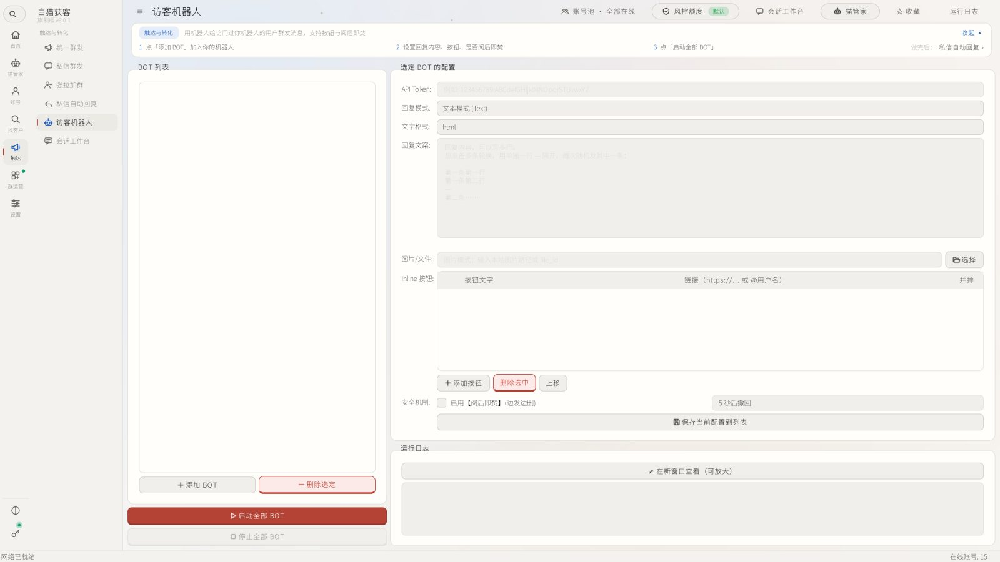

# 17. 访客机器人

> **一句话结论**：用你自己的 Telegram 机器人，给**访问过你机器人的用户**自动回复一条带按钮的消息，支持文字或图片、内联按钮和阅后即焚。需要你先在 @BotFather 创建机器人并拿到 **API Token**。



页面分两部分：左边「选定 BOT 的配置」，右边「BOT 列表」和「运行日志」。

---

## 一、先拿到机器人 Token

在 [@BotFather](https://t.me/BotFather) 发送 `/newbot` 创建机器人，拿到形如 `123456789:ABCdefGHIjklMNOpqrSTUvwxYZ` 的 token。详细步骤见 [25. 配置 Telegram 机器人](25_phone_remote.md) 的第一步（创建机器人的步骤相同；这里的机器人和手机遥控用的机器人建议**分开**）。**token 不要发给任何人。**

---

## 二、配置一个机器人

1. 点「添加 BOT」，在「API Token」里粘贴 token；
2. 「回复模式」选「文本模式（Text）」或「图片模式（Image）」；图片模式在「图片 / 文件」里选本地图片，或填 `file_id`；
3. 「文字格式」html / md，在「回复文案」里写内容；
4. 「Inline 按钮」：点「添加按钮」，填「按钮文字」和「链接」（`https://…` 或 `@用户名`），可设置「并排」，「上移」调整顺序；
5. 「安全机制」：勾选「启用阅后即焚（边发边删）」，设置「N 秒后撤回」（1～600 秒）；
6. 点「保存当前配置到列表」。

---

## 三、运行

- 在「BOT 列表」里可以管理多个机器人：「添加 BOT」「删除选定」「启动全部 BOT」「停止全部 BOT」；
- 运行日志在下方，「在新窗口查看（可放大）」。

---

## 四、让猫管家帮你做

```text
用我的访客机器人给访问过它的用户发一条通知：「【内容】」。先告诉我会发给多少人，我确认再发。
```

---

## 五、注意

- 机器人只能给**主动和它说过话**（点过 Start）的用户发消息，这是 Telegram 的限制；
- 机器人 token 泄露后，在 BotFather 里 `/revoke` 作废并换新 token。

---

<p align="center">
  <a href="16_spy_engine.md">上一篇：间谍获客</a> | <a href="18_auto_reply.md">下一篇：私信自动回复</a>
</p>
