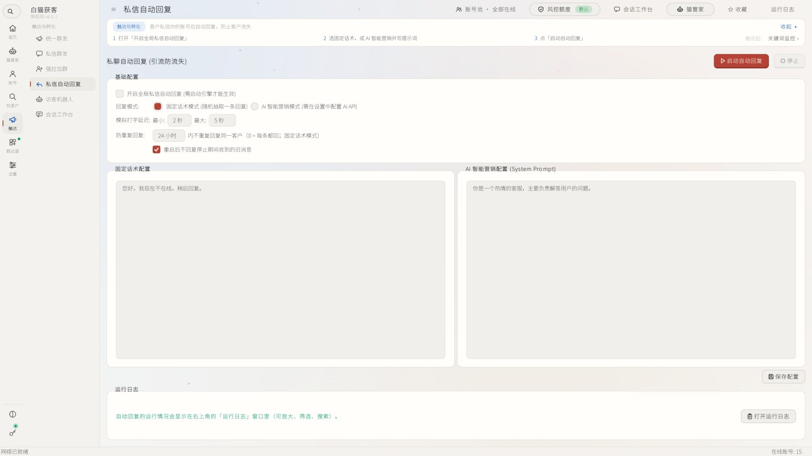

# 18. 私信自动回复

> **一句话结论**：客户私信你的账号后自动回复，防止客户流失。两种模式：**固定话术**（随机抽取一条）和 **AI 智能营销**（用你写的人设提示词让 AI 接待）。



---

## 一、设置步骤

1. 勾选「**开启全局私信自动回复**」（需要点「启动自动回复」引擎才生效）；
2. 选「回复模式」：
   - **固定话术模式**：在「固定话术配置」里写多条话术，每次随机抽一条；
   - **AI 智能营销模式**：在「AI 智能营销配置（System Prompt）」里写人设和规则，需要先在「设置 → AI 与凭证」里配置 AI 接口；
3. 「模拟打字延迟」：最小 / 最大（秒），让回复像真人在打字；
4. 「防重复回复」：N 小时内不重复回复同一客户（固定话术模式；0 = 每条都回）；记录保存在本机；
5. 「重启后不回复停止期间收到的旧消息」：避免重新启动后把老客户又回复一遍；
6. 点「保存配置」，再点「启动自动回复」；运行情况在右上角的「运行日志」里（可放大、筛选、搜索）。

---

## 二、让猫管家帮你做

```text
帮我给【某个账号】开启私信自动回复：客户第一次私信时回复「【欢迎语】」，包含「价格」两个字时回复「【报价说明】」。先预览规则，再启用。
```

---

## 三、建议

- 话术里留一个轻量提问，引导对方继续对话；
- 有真人客服时，用会话工作台接手后续对话；
- AI 模式记得写清楚「哪些话题不能答」，避免乱承诺价格；
- 想让自动回复覆盖多个账号，先在 [账号管理](01_account.md) 里确认这些账号都在线。

---

<p align="center">
  <a href="17_visitor_bot.md">上一篇：访客机器人</a> | <a href="19_channel_clone.md">下一篇：频道克隆搬运</a>
</p>
