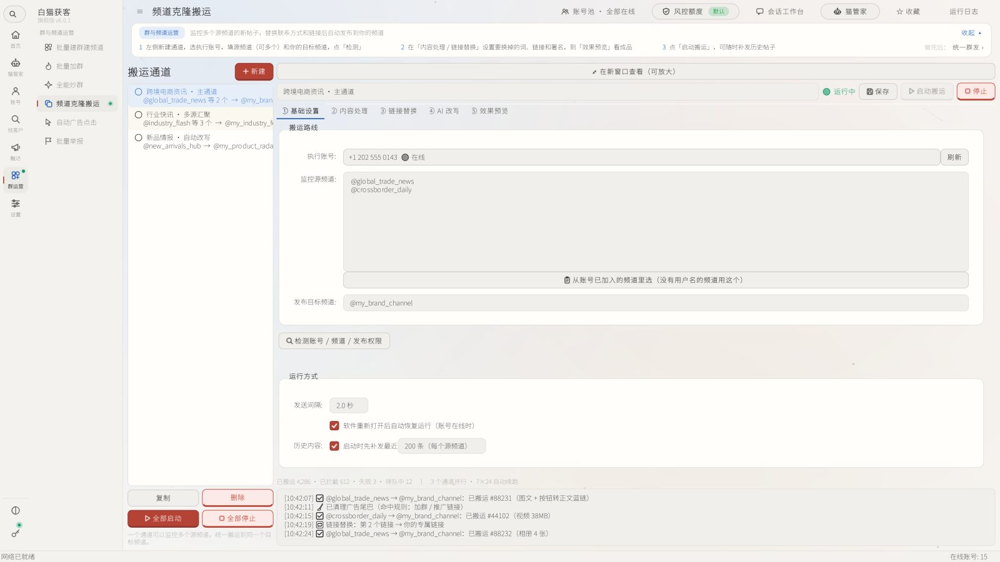

# 19. 频道克隆搬运

> **一句话结论**：监控一个或多个**源频道**的新帖子，替换掉联系方式和链接后，自动发布到**你自己的频道**。一个「搬运通道」可以监控多个源频道，统一搬运到同一个目标频道。



页面上方是搬运通道的操作：「新建 / 复制 / 删除 / 全部启动 / 全部停止」，运行状态和统计（已搬运、已拦截、失败、排队中）。下面是五个页签。

---

## 一、五个页签

### ① 基础设置（搬运路线 + 运行方式）
| 项 | 说明 |
| :--- | :--- |
| 通道名称 | 如「科技资讯 → 我的频道」 |
| 执行账号 | 用哪个账号搬运；**需要是目标频道的管理员** |
| 监控源频道 | 一行一个：`@news_channel`、`https://t.me/xxx`、私密邀请链接 `https://t.me/+AbCdEf`、或 `-100…` 的 ID；没有用户名的频道点「从账号已加入的频道里选」 |
| 发布目标频道 | 你自己的频道，如 `@my_channel` |
| 检测账号 / 频道 / 发布权限 | 开始前检查一遍 |
| 发送间隔 | 每发一条后至少等多久（0～600 秒），越大越像真人、越不容易限流 |
| 软件重新打开后自动恢复运行 | 账号在线时自动恢复 |
| 启动时先补发最近 N 条 | 每个源频道 1～10000 条；通道运行中也可以「补发最近 N 条」，或粘贴某条消息的链接「从这条起补发」 |

### ② 内容处理
- **搬运哪些内容**：图片 / 视频 / 文件 / 语音（带说明文字一起搬）、贴纸 / 动图表情、自动删除文末的引流 / 联系方式（如订阅、投稿、`@xxx`）；
- **原帖下方的按钮**：把链接按钮转成文字链接（推荐，入口不丢）/ 直接丢弃按钮；
- **文字替换**：每行 `原词 => 新词`，例如 `@old_service => @my_service`；只写原词不写箭头 = 把这个词删掉；以 `re:` 开头可用正则；
- **拦截不想搬的帖子**：每行一个词，帖子里出现就整条不搬（含蓝色链接和按钮里的文字）；
- **加上我的署名**：给每条帖子加开头和结尾，如「联系我 @my_service」。

### ③ 链接替换
样式不变，只改点开后的跳转地址；正文里的蓝色链接、直接写出的网址、按钮里的网址都会处理。方式：不替换 / 全部统一替换成我的链接 / 按出现顺序依次换成不同链接 / 只替换指定位置的链接（填第几个链接、第几行按钮）。

### ④ AI 改写
可选。开启后每条文字都交给 AI 重写一遍再发布；「我的专属信息」让 AI 把原文里的联系方式和竞品名替换成你的；可编辑「改写指令」，「恢复默认指令」回到默认。注意：AI 重写会重排文字，**原帖的加粗、链接等样式不会保留**；需要先在「设置 → AI 与凭证」配好 AI 接口。

### ⑤ 效果预览
左边贴一段原帖文字，右边实时显示按当前规则搬运后的样子（**不会真的发送，也不含 AI 改写**），点「刷新预览」。

---

## 二、启动与运行

1. 先点「检测账号 / 频道 / 发布权限」；
2. 在「⑤ 效果预览」里试几段文字，确认替换结果；
3. 点「保存」，再点「启动搬运」；
4. 搬运过程中看统计：已搬运、已拦截、失败、排队中。遇到 Telegram 限流时会给出友好的休眠提示，不会硬撞。

---

## 三、让猫管家帮你做

```text
监控这几个源频道，把新帖子里的联系方式和链接替换成我的，再发到我的频道【@我的频道】。先告诉我会替换哪些内容。
【源频道，每行一个】
```

---

## 四、注意

- 只搬运你有权转载的内容，注意源频道的版权；
- 目标频道的账号必须是管理员，否则发布失败；
- 补发历史条数多时，发送间隔要放宽。

---

<p align="center">
  <a href="18_auto_reply.md">上一篇：私信自动回复</a> | <a href="20_ad_clicker.md">下一篇：自动广告点击</a>
</p>
