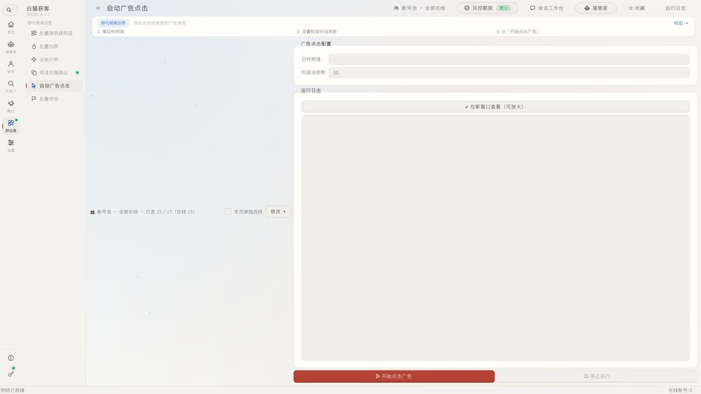

# 20. 自动广告点击

> **一句话结论**：让账号自动点击某个频道里最近的广告消息。设置只有两项：目标频道和检查多少条消息。



---

## 一、操作步骤

1. 选执行账号（在线账号）；
2. 「广告点击配置」：
   - 「目标频道」：如 `https://t.me/target_channel_name`；
   - 「检查消息数」：检查最近多少条消息（1～1000）；
3. 点「开始点击广告」，运行日志里显示结果（「在新窗口查看（可放大）」）；「停止执行」随时终止。

---

## 二、让猫管家帮你做

```text
用这几个账号检查这个频道最近 50 条消息里的广告并点击：【频道链接】。先告诉我会用哪些账号，我确认再做。
```

---

## 三、注意

- 账号需要已能访问该频道；
- 频繁点击同一批广告可能被判定为异常行为，控制频率；
- 点击购买、支付类按钮在猫管家里默认关闭，需要你明确放开。

---

<p align="center">
  <a href="19_channel_clone.md">上一篇：频道克隆搬运</a> | <a href="21_batch_create.md">下一篇：批量建群建频道</a>
</p>
