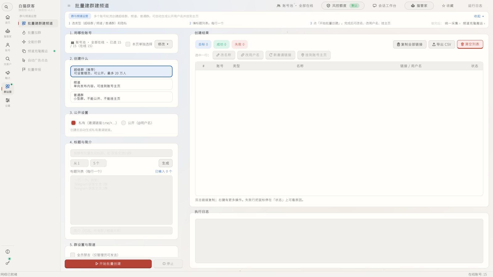

# 21. 批量建群建频道

> **一句话结论**：多个账号轮流批量创建超级群、频道或普通群，可以自动生成公开用户名，并把频道挂到账号主页。页面按 5 步从上到下填，最后点「开始批量创建」。



---

## 一、五步设置

### 1. 用哪些账号
选在线账号；没有选账号时页面会提示「还没有选择账号」。

### 2. 创建什么
| 类型 | 特点 |
| :--- | :--- |
| 超级群（推荐） | 可设管理员、可公开，最多 20 万人 |
| 频道 | 单向发布内容，可挂到账号主页 |
| 普通群 | 小型群，不能公开、不能挂主页 |

### 3. 公开设置
- **私有**：创建后自动生成私有邀请链接（`t.me/+…`）；
- **公开**：设置 `@用户名`；「用户名规则」可选「前缀 + 随机」或「前缀 + 序号」，前缀可选（如 `vipgroup`，字母开头）；示例：`@cut76`、`@wpel1`、`@e2xla`。

### 4. 标题与简介
- 「按模板批量生成标题」：如 `获客交流{n}群`，`{n}` 会替换成序号；设置起始序号和个数（1～500），点「生成」，追加到下面的标题列表；也可以直接一行一个手填；
- 「简介」（可选）：所有群 / 频道共用。

### 5. 群设置与限速
- 「全员禁言（仅管理员可发言）」；
- 「新成员可见入群前的历史消息」；
- 「每个间隔 N 到 M 秒」（2～600）、「每号最多 N 个」（1～100）——创建太快、太多会触发限制，建议放慢。

点「**开始批量创建**」；「停止」随时终止。

---

## 二、创建结果

页面上方「创建结果」显示：目标、成功、失败。表格列：序号、账号、类型、名称、链接、用户名、状态。

- 「复制全部链接」「导出 CSV」「清空列表」；
- 选中一行后：「改名称」「改用户名」「新邀请链接」「挂到账号主页」（**只有频道可以挂到账号主页**）；
- 双击链接复制，右键有更多操作；失败行把鼠标停在「状态」上看原因。

> 创建群属于对外动作，在猫管家里默认关闭或只预览，需要你明确确认。

---

## 三、让猫管家帮你做

```text
我想批量创建 5 个超级群，名字前缀「【前缀】」，由这几个账号各建一个。先预览会怎么建、有没有风险，我确认再做。
```

---

## 四、建议

- 新号不要短时间内建很多个；
- 公开用户名要符合 Telegram 规则，被占用会失败；
- 建好后接着用 [09. 强拉加群](09_force_invite.md) 或 [15. 全能炒群](15_ai_hype.md) 运营。

---

<p align="center">
  <a href="20_ad_clicker.md">上一篇：自动广告点击</a> | <a href="22_operation_analysis.md">下一篇：运营模式分析</a>
</p>
