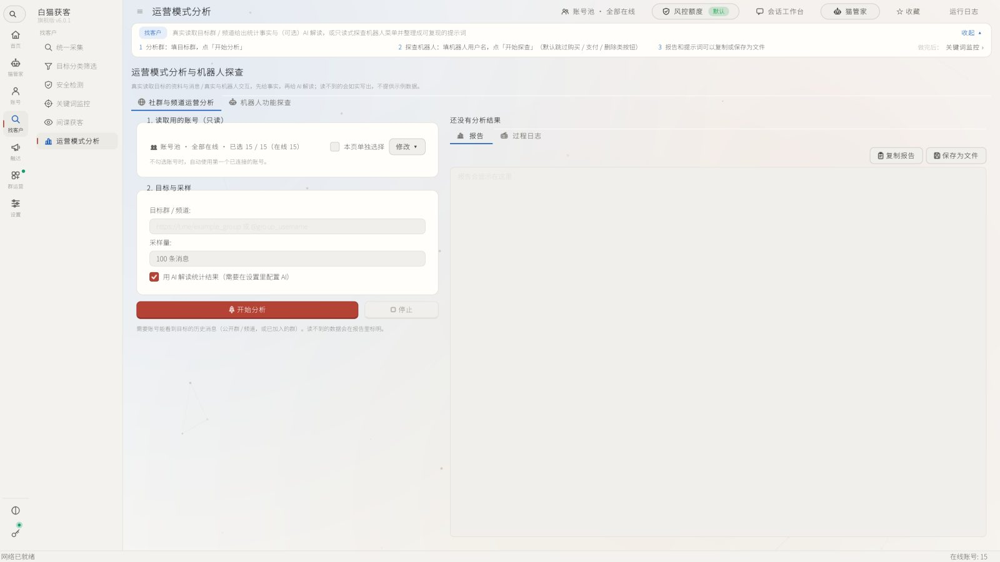

# 22. 运营模式分析与机器人探查

> **一句话结论**：用真实读到的数据研究别人是怎么运营的。**先给事实，再给 AI 解读；读不到的会如实写出，绝不提供示例数据。** 两个页签：**社群与频道运营分析**（研究一个群或频道）和**机器人功能探查**（研究一个机器人有哪些功能）。



---

## 一、社群与频道运营分析

1. 「读取用的账号（只读）」选账号；
2. 「目标群 / 频道」填 `https://t.me/example_group` 或 `@group_username`；账号需要能看到目标的历史消息（公开群 / 频道，或已加入的群）；
3. 「采样量」：读取最近的 20～1000 条消息作为样本。**样本只代表这一小段时间，不代表整个社群**；
4. 勾选「用 AI 解读统计结果」（需要在设置里配置 AI）：先给纯统计事实，再让 AI 按 5 个维度解读；没配置 AI 或调用失败时，只给纯事实并写明「未调用 AI」及原因；
5. 点「开始分析」，在「报告」页签查看，可「复制报告」。

---

## 二、机器人功能探查

1. 「探查用的账号」：不勾选时自动使用第一个已连接的账号；
2. 「目标机器人」：`@WalletBot` 或 `WalletBot`；
3. 「探查深度」：1～4 层菜单；「点击上限」：5～80 次，每次点击之间随机停顿 1～2 秒，避免限流；
4. 选项：
   - **跳过可能产生费用 / 不可逆的按钮（推荐，默认开启）**：不点购买、支付、充值、提现、确认、删除、退出等按钮；
   - 「试一下它声明的指令」：最多试 3 个安全的指令；
   - 「整理成复现提示词」：有 AI 时由 AI 润色；
5. 点「开始探查」。

**无论怎么设置，探查都不会点外链、小程序、支付发票，也不会分享手机号或位置**，这些属于泄露隐私或没有意义的动作。

结果在几个页签里：**菜单树**（机器人的菜单结构）、**复现提示词**（可「复制提示词」「保存为文件」）、**过程日志**。也可以点「复制给 AI Agent 的指令（MCP 完整探查）」，让外部 AI Agent 做更完整的探查。

> 探查只用真实与机器人交互得到的内容；没有账号或读不到数据时，会返回明确的错误，不会给你一棵虚构的菜单树。

---

## 三、让猫管家帮你做

```text
分析这个群的运营方式：【群链接】。给我发言活跃度、常见话题、有没有营销话术，只用真实读到的数据，读不到就直接告诉我。
```

```text
帮我探查这个机器人有哪些功能：【@机器人用户名】。只读式探查，不要点外链、支付或分享手机号的按钮，最后整理成一份菜单结构。
```

---

## 四、常见问题

**报告里很多项是「读不到」？**
账号看不到该群的历史消息。加入这个群，或换公开群 / 频道。

**探查到一半停了？**
达到点击上限，或对方机器人限流。调高上限、放慢后重试。

---

<p align="center">
  <a href="21_batch_create.md">上一篇：批量建群建频道</a> | <a href="23_cat_butler.md">下一篇：猫管家</a>
</p>
